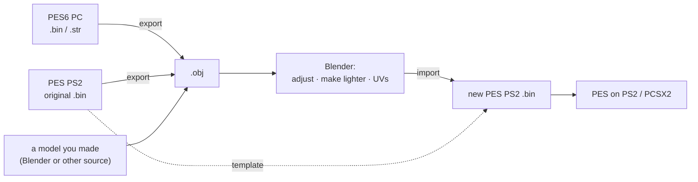
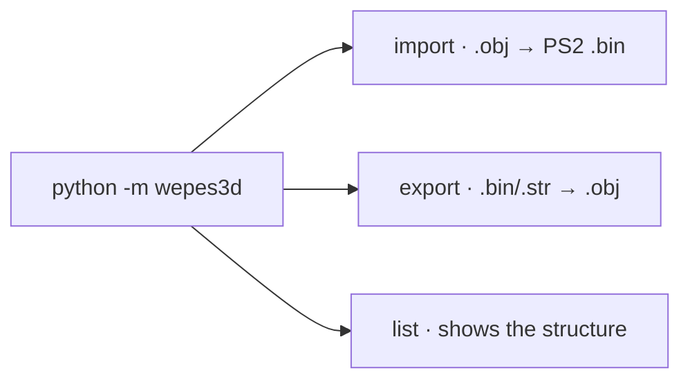
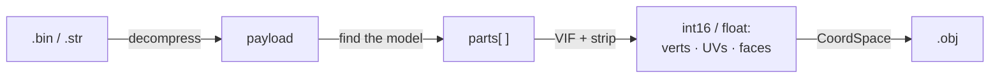
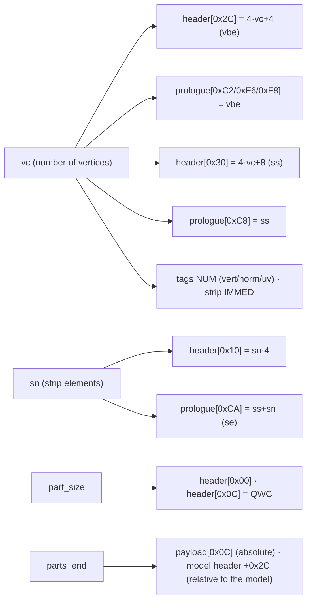

# wepes3d

**Put new 3D models into Pro Evolution Soccer (PES / Winning Eleven) for
PlayStation 2** — new trophies, player faces and hair, and more — to make the
game look more real.

You make or edit the model in Blender, save it as `.obj`, and wepes3d writes a
game `.bin` that the PS2 (or the PCSX2 emulator) can load. Pure Python,
**no external dependencies**.

> **In short:** the target is always **PES on PS2**. The other features —
> exporting PS2 models and exporting PES6 PC models — exist to help you get a
> good model into the PS2 game.

---

## Why this project?

PES and Winning Eleven on PS2 are still alive thanks to the modding community,
which keeps updating teams, players and kits. But the **3D models** were
always the hard part: a new trophy or the real face of a player needs a new
mesh inside the game files, and the PS2 format makes this very hard to do by
hand (see [the hard part: derived bytes](#the-hard-part-derived-bytes)).

**The main goal of wepes3d is to import new 3D models into PES PS2**, so that
modders can bring more realism to the game:

- **New trophies** — the real trophy of a competition, made in Blender or
  taken from PES6 PC.
- **Faces and hair** — the real look of a player.
- **Stadiums and kits** — next on the list (export already works; import is
  planned).

---

## Where the models come from, and where they go



| Step | What it is for |
|---|---|
| **Export from PES PS2** | Open the original model in Blender: see its size and position, use it as a starting point and check your result. |
| **Export from PES6 PC** | **Bring PC models to the PS2.** The PES6 PC modding scene made many trophies and faces. Export them to `.obj`, make them lighter in Blender and import them into a PS2 `.bin`. |
| **Import into PES PS2** | **The main goal.** Writes your `.obj` into a PS2 `.bin`. The original game file is the template: its textures, bones and other sub-models are kept. |

> **PC is only a source.** wepes3d does not write PES6 PC files, and this is
> not a goal of the project: PC models are exported only to be brought to the
> PS2.

---

## What it supports

**PES / WE on PlayStation 2 — the target:**

| Asset | Import (`.obj → .bin`) | Export (`.bin → .obj`) |
|---|:---:|:---:|
| Face / hair | ✅ | ✅ |
| Trophy (and its sub-models) | ✅ | ✅ |
| Stadium / crowd / boards | ⏳ planned | ✅ |
| Kit (uniform / hands) | ⏳ planned | ✅ |

**PES6 / WE on PC — a source of models for the PS2:**

| Asset | Export (`.bin/.str → .obj`) |
|---|:---:|
| Face / hair | ✅ |
| Trophy | ✅ |

> 📚 **Full technical documentation in [docs/](docs/README.md)** — the
> knowledge base of the reverse engineering of the format, with diagrams and
> examples.

---

## Quick start

You only need **Python 3.8+** — no external dependencies. Clone the repository
and run the commands from its root:

```bash
git clone https://github.com/FVitor7/wepes3d
cd wepes3d
```

The CLI has **three subcommands**:



### Example 1 — a new face in PES PS2

```bash
# see the original face in Blender (writes .obj + .mtl)
python -m wepes3d export face.bin face.obj --type face

# import your new face (face.bin is the template)
python -m wepes3d import face.bin my_face.obj out.bin \
    --type face --allow-recount --recalculate-normals --auto-fit
```

### Example 2 — a PES6 PC trophy in PES PS2

```bash
# 1. export the cup (part 0) of the PES6 PC trophy
python -m wepes3d list   pl.str --type pc
python -m wepes3d export pl.str pc_cup.obj --type pc --model 0

# 2. look at the PS2 trophy you will replace (section 0 = the main cup)
python -m wepes3d list   trophy.bin --type trophy
python -m wepes3d export trophy.bin ps2_cup.obj --type trophy --section 0

# 3. in Blender: make pc_cup.obj lighter and save it as my_cup.obj
#    (the PES6 cup has ~2,100 vertices; a lighter model, around 1,000, is
#    safer for the PS2)

# 4. import it into the PS2 trophy
python -m wepes3d import trophy.bin my_cup.obj new_trophy.bin \
    --type trophy --section 0 --allow-recount --recalculate-normals --auto-fit
```

`--auto-fit` scales the cup with one uniform scale (it keeps the proportions)
to the size and position of the PS2 cup. Only section 0 changes; the other
sub-models and the textures stay the same.

If the model is too heavy for the parts of the PS2 cup, the import stops and
tells you. Decimate more, or add `--max-verts-per-part 255`: no part gets
more than 255 vertices, and the import adds the parts it needs (trophies do
not have the 8-part limit of faces).

Each subcommand has its own help: `... import --help`, `... export --help`.
The **step-by-step cookbook** is in [docs/00-user-guide.md](docs/00-user-guide.md).

### `import` options

| Option | When to use it |
|---|---|
| `--allow-recount` | Almost always. Allows an `.obj` whose vertex count is different from the template. |
| `--recalculate-normals` | Almost always. Computes the normals of the new geometry. |
| `--auto-fit` | When the `.obj` has any scale/position (Blender, PES6 PC). Scales and centers it into the template bbox. |
| `--section N` | Trophies: which sub-model to replace (0 = the main one). |
| `--match-template` | With `--auto-fit`, when the `.obj` is anatomical (a face) and you want to match the template regions. |
| `--use-groups` | You split the mesh into N objects in Blender (1 per part). |
| `--max-verts-per-part N` | No part gets more than N vertices (≤ 255); the import adds parts when needed (a face stops at 8). Useful for heavy models, like the ones from PES6 PC. |
| `--part-sizes a,b,…` | Manual control: how many vertices go in each part. |
| `--strip-mode connected\|list` | Strip encoding of new parts. `connected` (**default**): connected tristrips (~35% smaller), checked in the game. `list`: triangle list (legacy). |
| `--no-preserve-strips` | Rare. Encodes every strip again (turns off the zero-diff passthrough). |

### "Model folder" export options (`--type stadium|kit|pc`)

`--all` (everything in one `.obj`, default) · `--model M` (one model) ·
`--block B` (only one block) · `--parts` (1 `.obj` per model) · `--groups`
(1 object per part) · `--dedup` (removes duplicates).

---

## How to prepare the `.obj`

1. **Triangulate** (convex n-gons are fan-triangulated automatically; concave
   ones must be triangulated in Blender).
2. **UVs:** *seams* and different `v`/`vt` indices (Blender export) are
   handled while reading — the vertex is duplicated at each seam.
   `UV → Merge UVs by Distance` still helps to save vertices.
3. **Decimate** to the budget: for a face, **≤ ~1,300 vertices** in total and
   **≤ ~170 per region** (the strip overflows before the 255 v/part limit).
   Models from PES6 PC are usually heavier than PS2 models.
4. Export **with UVs**. Any scale/position is fine (use `--auto-fit`).
5. **Textures are not converted.** The new `.bin` keeps the texture of the
   template, so the UVs of your model must match that texture (or change the
   texture with another tool).

**Format limits:** ≤ 255 vertices and ~340 triangles per part; ≤ 8 parts per
face model (trophies have no 8-part limit). The reasons are in the
[user guide](docs/00-user-guide.md#format-limits).

---

## Python API

```python
from wepes3d import (
    import_face, export_face, import_trophy, export_trophy, import_auto, export_auto,
    export_stadium_complete, list_stadium,
    export_kit_complete, list_kit,
    export_pc, export_pc_complete, list_pc,
)

# Import a face / hair (PS2):
import_face("face.bin", "my_face.obj", "out.bin",
            allow_recount=True, recalculate_normals=True, auto_fit=True)

# Import a trophy (section=0 = main; 1+ = base/stage/etc.):
import_trophy("trophy.bin", "my_cup.obj", "out.bin", section=0,
              allow_recount=True, recalculate_normals=True, auto_fit=True)

# Detects face vs trophy from the magic:
import_auto("any.bin", "new.obj", "out.bin", allow_recount=True)

# Export (.bin → .obj + .mtl):
export_face("face.bin", "face.obj")
export_trophy("trophy.bin", "ps2_cup.obj", section=0)
export_stadium_complete("stadium.bin", "stadium.obj")
export_pc("pl.str", "pc_cup.obj", model=0)           # PES6 PC: a source for PS2

# Rewrite an .obj with 1 UV per vertex (`f i/i`). The import already does
# this while reading; useful to check in Blender what it will see:
from wepes3d import convert_obj_to_vertex_uv
convert_obj_to_vertex_uv("blender.obj", "ready.obj")

# Low-level building blocks:
from wepes3d import parse_model, decompress_bin, detect_asset_type
payload, header, trailing = decompress_bin("trophy.bin")
print(detect_asset_type(payload))                    # 'face' or 'trophy'
```

---

## How it works (in 1 minute)

A `.bin`/`.str` has **3 layers**: file (zlib) → payload (the wrapper) → parts
(the geometry). The **internal 3D model is the same** for every PS2 asset; only
the wrapper and the scale/axes change. (PES6 PC uses a different format — see
[docs/12](docs/12-pes6-pc.md).)



Details: [docs/01](docs/01-bin-format.md) (format) ·
[02](docs/02-payload-anatomy.md) (byte by byte) · [04](docs/04-vif-and-vu1.md)
(VIF/VU1) · [05](docs/05-strip-encoding.md) (strip).

### The hard part: derived bytes

> This is the part that cost the most in the reverse engineering, and the
> reason this package exists. **Replacing the geometry of a `.bin` is not just
> writing the new vertices.**

A PES PS2 model goes **straight to the graphics hardware** (VIF → VU1 → GS):
the `.bin` is a ready-made *stream of commands*, not a neutral mesh. So when a
part is rebuilt with a different number of vertices, **~15 derived fields**
in the part **and** in the global header must be computed and written again.
Many of them are **redundant**: the same value is copied in 2–4 places, and
each copy is read by a different stage of the pipeline. **Forget a single byte
→ an invisible face or a crash in the game.** Worse, the model often **still
works** in external editors (they ignore the microcode), so the mistake stays
hidden.



**Which** bytes these are, **where** they are and **why** they exist
(interleaved layout in the VU, redundant copies, DMA pointers) is explained in
detail:

- **[02 — Payload anatomy §5](docs/02-payload-anatomy.md#5-the-map-of-the-bytes-you-need-to-write)** — the **full map** of the bytes to write, with formulas.
- **[04 — VIF and VU1](docs/04-vif-and-vu1.md)** — *why* `vbe`/`ss`/`se` exist and what the microcode does.
- **[06 — Bug history](docs/06-bug-history.md)** — how **each** field was found (what was invisible, the investigation, the fix).

In the code, `shared/model/rebuilder.py` writes the part fields and
`shared/pipeline/importer.py` writes the global header and fixes the pointers.
You do not need to handle these bytes by hand — but if you want to **extend**
the format, start with these three documents.

### Zero-diff roundtrip (automatic passthrough)

Every part whose geometry **exactly matches** the template keeps its
**original strip** (it is not encoded again). So, if you import an `.obj`
exported from the same template **without edits**, you get a
**byte-identical payload**:

```bash
python -m wepes3d export face.bin face.obj --type face
python -m wepes3d import face.bin face.obj rt.bin --type face
python -c "from wepes3d import decompress_bin as d; print(d('face.bin')[0] == d('rt.bin')[0])"
# True
```

The compressed `.bin` also comes out identical (`cmp` passes) when Python's
zlib reproduces the compression of the original file — this happens with the
test trophy, not with `examples/face.bin`. When you edit, **only the changed
parts** are encoded again (with the `connected` strip by default). The
**geometry** is always kept. See
[03 §Validation](docs/03-import-pipeline.md#validation-roundtrip).

---

## Project layout

An asset-agnostic core (`shared/`) + adapters kept apart **by platform**
(`adapters/`). PC and PS2 are different binary formats, so PC does not reuse
the PS2 engine — only the common I/O. Details in
[docs/10](docs/10-architecture.md).

```
wepes3d/                   repository root
├── wepes3d/               the PACKAGE (the code)
│   ├── __init__.py / __main__.py / cli.py      public API · `python -m` · subcommands
│   ├── shared/            asset-agnostic CORE
│   │   ├── constants.py       magics, factors, limits
│   │   ├── io/                bin_io · pes_archive · obj_io · obj_write
│   │   ├── geometry/          coords (CoordSpace) · transform (bbox/fit/normals)
│   │   ├── model/             parser · reader (universal) · strip · strip_connected · rebuilder
│   │   └── pipeline/          assets · importer · exporter · folder · partition
│   └── adapters/          by PLATFORM
│       ├── pesweps2/          PS2 (the target): faces · trophies · stadiums · kits
│       └── pes6pc/            PC (a source): coords · reader (export only)
├── tests/                 pytest suite + real seed files (seed/)
├── docs/                  technical documentation
├── examples/              sample face.bin
└── README.md · LICENSE · pyproject.toml · requirements-dev.txt
```

Tests: `pip install -r requirements-dev.txt`, then `python -m pytest` (see
[tests/README.md](tests/README.md)).

---

## Documentation

Everything is in **[docs/](docs/README.md)** (start-here table, full index and
glossary). Good places to start:

- [00 — User guide](docs/00-user-guide.md) — step-by-step recipes for every asset.
- [13 — A face, byte by byte](docs/13-face-byte-by-byte.md) — a guided tour with `examples/face.bin`.
- [06 — Bug history](docs/06-bug-history.md) — the 16 bugs of the reverse engineering and what each one taught us.

---

## Principles

1. **Self-contained** — no dependency on external tools or files.
2. **Do not touch what we do not understand** — bones, textures and unknown
   fields of the template are kept untouched.
3. **Cross-validation** — every constant of the format was confirmed by
   comparing several real game files (see [06](docs/06-bug-history.md)).

> Contributions and fixes are welcome.

---

## License

Code and documentation under the [MIT](LICENSE) license.

The game files in `examples/` and `tests/seed/` (and the `.obj` files extracted
from them) belong to their owners (Konami) and are **not** covered by this
license — they are here only for testing and interoperability.
