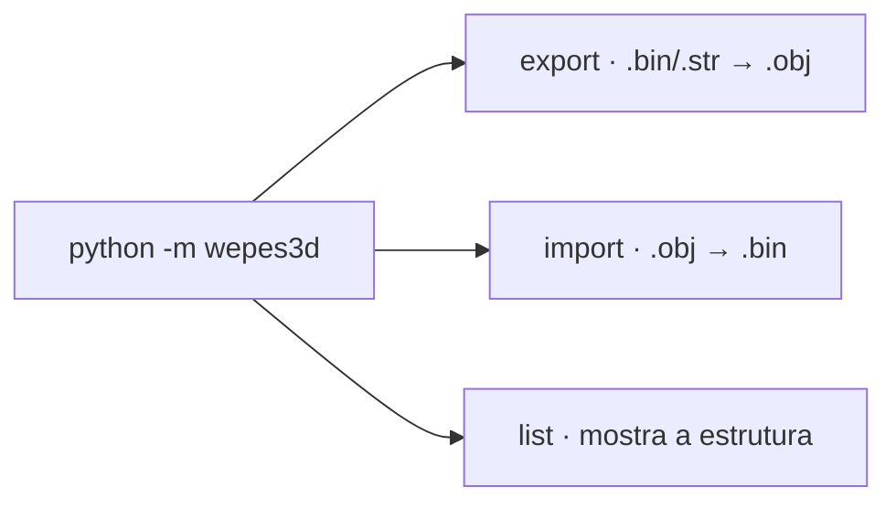
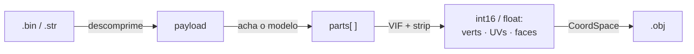
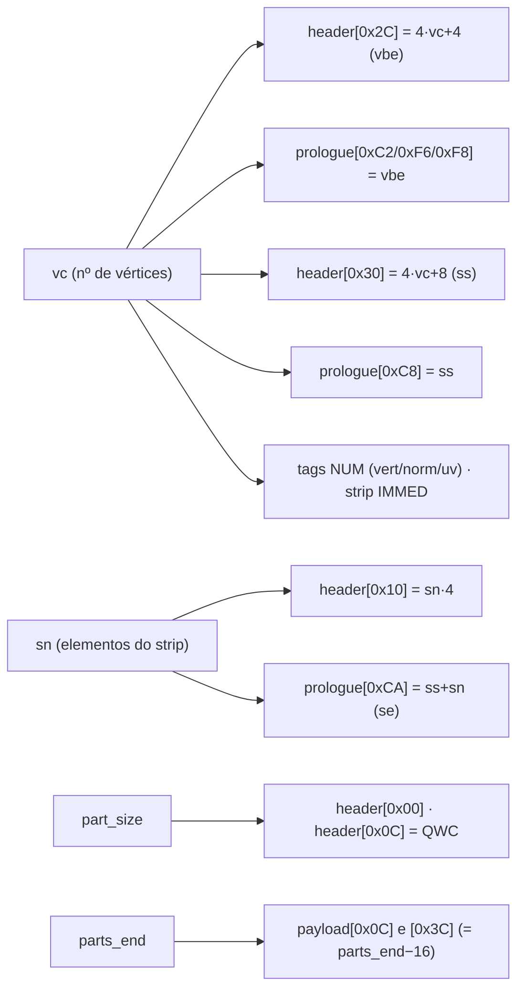

# wepes3d

**Exportador e importador de modelos 3D do Pro Evolution Soccer** entre o formato
`.bin`/`.str` do jogo e `.obj` (Wavefront, editável no Blender). Python puro, **sem
dependências externas**.

Cobre duas plataformas e quatro tipos de asset:

| Plataforma | Asset | Exportar (`→ .obj`) | Importar (`.obj →`) |
|---|---|:---:|:---:|
| **PES/WE PlayStation 2** | Face / cabelo | ✅ | ✅ |
| | Troféu (e sub-modelos) | ✅ | ✅ |
| | Estádio / torcida / placas | ✅ | ⏳ planejado |
| | Kit (uniforme / mãos) | ✅ | ⏳ planejado |
| **PES6 / WE PC** | Face / cabelo | ✅ | ⏳ planejado |
| | Troféu | ✅ | ⏳ planejado |

> 📚 **Documentação técnica completa em [docs/](docs/README.md)** — base de
> conhecimento da engenharia reversa do formato, com diagramas e exemplos.

---

## Instalação e uso rápido

Só precisa de **Python 3.8+** — sem dependências externas. Clone o repositório e
rode os comandos da raiz dele:

```bash
git clone https://github.com/FVitor7/wepes3d
cd wepes3d
```

A CLI tem **três subcomandos**:



```bash
# EXPORTAR (abrir no Blender) — gera .obj + .mtl
python -m wepes3d export face.bin face.obj --type face

# IMPORTAR uma face nova (caso principal)
python -m wepes3d import face.bin meu_rosto.obj saida.bin \
    --type auto --allow-recount --recalculate-normals --auto-fit

# LISTAR a estrutura (seções de troféu, modelos de estádio/kit, partes PC…)
python -m wepes3d list trofeu.bin --type trophy
```

Cada subcomando tem ajuda própria: `... export --help`, `... import --help`.
O **cookbook passo a passo** está em [docs/00-guia-de-uso.md](docs/00-guia-de-uso.md).

### Flags do `import`

| Flag | Quando usar |
|---|---|
| `--allow-recount` | Quase sempre. Permite `.obj` com contagem de vértices ≠ do template. |
| `--recalculate-normals` | Quase sempre. Calcula normais da geometria nova. |
| `--auto-fit` | Quando o `.obj` vem em escala/posição arbitrária (Blender). Escala/centra no bbox do template. |
| `--match-template` | Com `--auto-fit`, quando o `.obj` é anatômico (rosto) e você quer casar as regiões do template. |
| `--use-groups` | Você separou a malha em N objetos no Blender (1 por part). |
| `--part-sizes a,b,…` / `--max-verts-per-part N` | Controle manual da partição. |
| `--strip-mode connected\|list` | Codificação do strip de parts novas. `connected` (**default**): tristrips conectados (~35% menor), validado in-game. `list`: triangle list (legado). |
| `--no-preserve-strips` | Raro. Recodifica todos os strips (desliga o passthrough zero-diff). |

### Flags de export "pasta de modelos" (`--type stadium|kit|pc`)

`--all` (tudo num `.obj`, default) · `--model M` (um modelo) · `--block B` (restringe
a um bloco) · `--parts` (1 `.obj` por modelo) · `--groups` (1 objeto por part) ·
`--dedup` (remove duplicados).

---

## Como funciona (em 1 minuto)

Um `.bin`/`.str` tem **3 camadas**: arquivo (zlib) → payload (o invólucro) → parts
(a geometria). O **modelo 3D interno é idêntico** entre os assets; só mudam o
invólucro e a escala/eixos.



Detalhes: [docs/01](docs/01-formato-bin.md) (formato) ·
[02](docs/02-anatomia-payload.md) (byte-a-byte) · [04](docs/04-vu-microcode.md)
(VIF/VU) · [05](docs/05-strip-encoding.md) (strip).

---

## Importar do zero: o desafio dos bytes derivados

> Esta é a parte que mais custou na engenharia reversa, e a razão de existir este
> pacote. **Trocar a geometria de um `.bin` não é só escrever os vértices novos.**

Um modelo do PES PS2 vai **direto para o hardware gráfico** (VIF → VU1 → GS): o
`.bin` é um *stream de comandos* pré-formatado, não uma malha neutra. Por isso, ao
reconstruir uma part com um número diferente de vértices, é preciso **recalcular e
gravar ~15 campos derivados** espalhados pela part **e** pelo header global — muitos
deles **redundantes** (o mesmo valor copiado em 2–4 lugares, cada um lido por uma
etapa diferente do pipeline). **Esquecer um único byte → face invisível ou crash no
jogo** — e, pior, frequentemente **funcionando** em editores externos (que ignoram o
microcode), o que mascara o erro.



A descoberta de **quais** bytes são esses, **onde** estão e **por que** existem
(layout *interleaved* na VU, cópias redundantes, ponteiros DMA) está documentada em
detalhe:

- **[02 — Anatomia do payload §5](docs/02-anatomia-payload.md#5-o-mapa-dos-bytes-que-você-precisa-gravar)** — o **mapa completo** dos bytes a gravar, com fórmulas.
- **[04 — VIF e VU1](docs/04-vu-microcode.md)** — *por que* `vbe`/`ss`/`se` existem e o que o microcode faz.
- **[06 — Bugs históricos](docs/06-bugs-historicos.md)** — a história de como **cada** campo foi descoberto (o que estava invisível, a investigação, o fix).

No código, quem grava tudo isso é `shared/model/rebuilder.py` (campos da part) e
`shared/pipeline/importer.py` (header global + patch dos ponteiros). Você não precisa
lidar com esses bytes na mão — mas se for **estender** o formato, comece por esses
três documentos.

---

## Roundtrip zero-diff (passthrough automático)

Toda part cuja geometria **reproduz exatamente** a do template tem o **strip original
preservado** (em vez de recodificado). Logo, reimportar um `.obj` exportado do
próprio template **sem editar** resulta num `.bin` **byte-idêntico**:

```bash
python -m wepes3d export face.bin face.obj --type face
python -m wepes3d import face.bin face.obj rt.bin --type face
cmp face.bin rt.bin && echo "zero-diff ✓"
```

Ao editar, **só as parts alteradas** são recodificadas (strip `connected` por
padrão). A **geometria** é sempre preservada. Ver [03 §Validação](docs/03-pipeline.md#validação-roundtrip).

---

## Estrutura do pacote

Núcleo asset-agnóstico (`shared/`) + adapters isolados **por plataforma**
(`adapters/`). PC e PS2 são formatos binários diferentes, então o PC não reaproveita
o motor PS2 — só a I/O comum. Detalhes em [docs/11](docs/11-arquitetura.md).

```
wepes3d/                   raiz do repositório
├── wepes3d/               o PACOTE (o código)
│   ├── __init__.py / __main__.py / cli.py      API pública · `python -m` · subcomandos
│   ├── shared/            NÚCLEO asset-agnóstico
│   │   ├── constants.py       magics, fatores, limites
│   │   ├── io/                bin_io · pes_archive · obj_io · obj_write
│   │   ├── geometry/          coords (CoordSpace) · transform (bbox/fit/normais)
│   │   ├── model/             parser · reader (universal) · strip · strip_connected · rebuilder
│   │   └── pipeline/          assets · importer · exporter · folder · partition
│   └── adapters/          por PLATAFORMA
│       ├── pesweps2/          PS2: faces · trophies · stadiums · kits
│       └── pes6pc/            PC:  coords · reader (só export)
├── tests/                 suíte pytest + arquivos-semente reais (seed/)
├── docs/                  documentação técnica
├── examples/              face.bin de exemplo
└── README.md · LICENSE · pyproject.toml · requirements-dev.txt
```

---

## API Python

```python
from wepes3d import (
    import_face, export_face, import_trophy, export_trophy, import_auto, export_auto,
    export_stadium_complete, list_stadium,
    export_kit_complete, list_kit,
    export_pc, export_pc_complete, list_pc,
)

# Face / cabelo (PS2):
import_face("face.bin", "rosto.obj", "saida.bin",
            allow_recount=True, recalculate_normals=True, auto_fit=True)

# Troféu (section=0 = principal; 1+ = base/palco/etc.):
import_trophy("trofeu.bin", "taca.obj", "saida.bin", section=0, allow_recount=True)

# Auto-detecta face vs troféu pelo magic:
import_auto("qualquer.bin", "novo.obj", "saida.bin", allow_recount=True)

# Export (.bin → .obj + .mtl):
export_face("face.bin", "face.obj")
export_trophy("trofeu.bin", "taca.obj", section=0)
export_stadium_complete("estadio.bin", "estadio.obj")
export_pc_complete("pl.str", "trofeu_pc.obj")        # PES6 PC

# Reescrever um .obj com 1 UV por vértice (`f i/i`) — p.ex. um export do Blender,
# onde os índices de v e vt das faces não batem:
from wepes3d import convert_obj_to_vertex_uv
convert_obj_to_vertex_uv("blender.obj", "pronto.obj")

# Componentes de baixo nível:
from wepes3d import parse_model, decompress_bin, detect_asset_type
payload, header, trailing = decompress_bin("trofeu.bin")
print(detect_asset_type(payload))                    # 'face' ou 'trophy'
```

---

## Como preparar o `.obj`

1. **Triangule** (n-gonos convexos são triangulados por leque; côncavos, no Blender).
2. **1 UV por vértice** (sem *seams*): `UV → Merge UVs by Distance`.
3. **Decime** ao orçamento: **≤ ~1.300 vértices** no total e **≤ ~170 por região**
   (o strip estoura antes do limite de 255 v/part).
4. Exporte **com UVs**. Escala/posição livres (use `--auto-fit`).

### Limites do formato

| Limite | Valor | Origem |
|---|---|---|
| Parts por modelo (face) | **8** | capacidade fixa do buffer (`payload[0x04]=8`). > 8 = invisível. |
| Vértices por part | **255** | `NUM` do VIF UNPACK é uint8. |
| Triângulos por part | **~340** | limite do strip (alinhado a múltiplos de 4). |

> Troféus não têm o limite de 8 parts; o limite por part (255 v / ~340 tri) vale para todos.

---

## Documentação

Tudo em **[docs/](docs/README.md)**: [00 guia de uso](docs/00-guia-de-uso.md)
· [01 formato](docs/01-formato-bin.md) · [02 anatomia](docs/02-anatomia-payload.md)
· [03 pipeline](docs/03-pipeline.md) · [04 VIF/VU](docs/04-vu-microcode.md)
· [05 strip](docs/05-strip-encoding.md) · [06 bugs](docs/06-bugs-historicos.md)
· [07 debugging](docs/07-debugging-guide.md) · [08 troféus](docs/08-trofeus.md)
· [09 estádios](docs/09-estadios.md) · [10 kits](docs/10-kits.md)
· [11 arquitetura](docs/11-arquitetura.md) · [12 coordenadas](docs/12-coordenadas.md)
· [13 PES6 PC](docs/13-pes6-pc.md)
· [14 exemplo: face byte a byte](docs/14-exemplo-face-byte-a-byte.md).

---

## Princípios

1. **Autossuficiente** — sem dependências de ferramentas/arquivos externos.
2. **Não tocar no que não entendemos** — bones, texturas e campos desconhecidos do
   template são preservados intactos.
3. **Validação cruzada** — toda constante do formato foi confirmada comparando
   vários arquivos reais do jogo (ver [06](docs/06-bugs-historicos.md)).

> Em PT-BR, acompanhando a comunidade brasileira de edição de PES. Tradução para
> inglês planejada. Contribuições e correções são bem-vindas.

---

## Licença

Código e documentação sob a licença [MIT](LICENSE).

Os arquivos do jogo em `examples/` e `tests/seed/` (e os `.obj` extraídos deles)
pertencem aos seus detentores (Konami) e **não** são cobertos por essa licença —
estão aqui só para teste e interoperabilidade.
