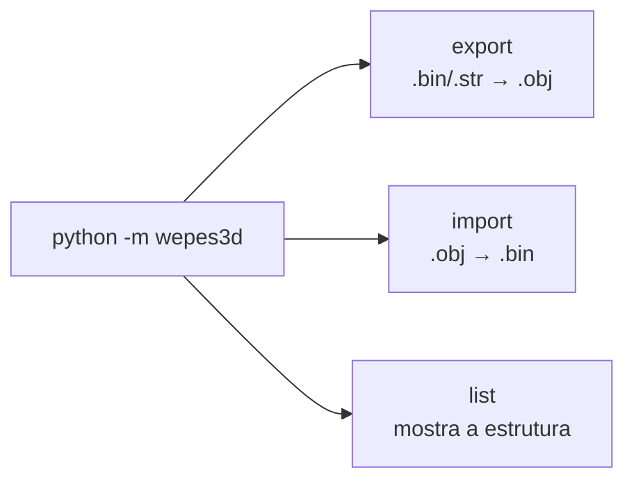
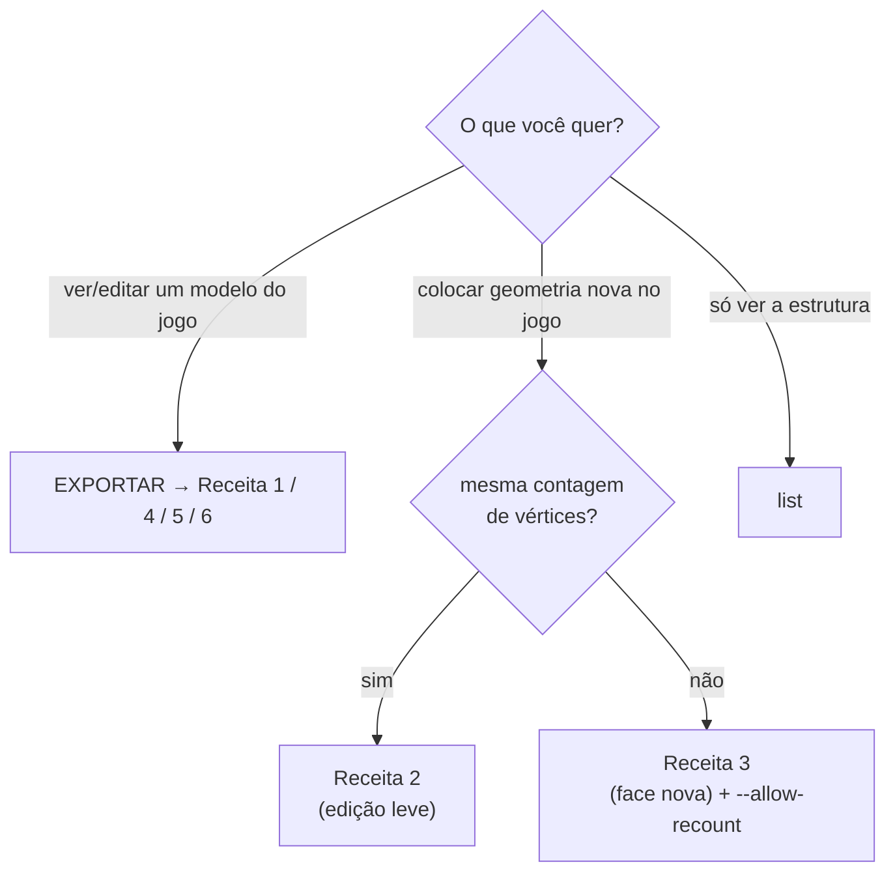
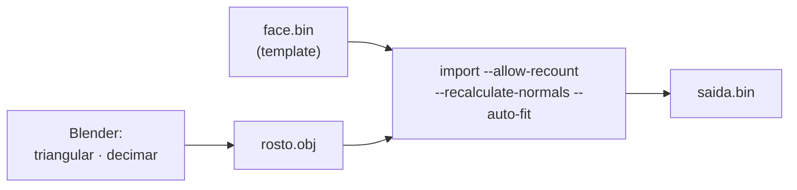

# 00 — Guia de uso (cookbook)

Receitas práticas, passo a passo, para os fluxos mais comuns. Se você só quer
**usar** a ferramenta (sem entender o formato por dentro), comece por aqui.

> Para *como o formato funciona*, veja [01](01-formato-bin.md)…[05](05-strip-encoding.md).
> Para *resolver problemas*, veja [07 — Guia de debugging](07-debugging-guide.md).

---

## A interface em 30 segundos

A CLI tem **três subcomandos**:



```bash
python -m wepes3d export  ENTRADA.bin  SAIDA.obj   [opções]
python -m wepes3d import  TEMPLATE.bin GEO.obj  OUT.bin  [opções]
python -m wepes3d list    ENTRADA.bin  [--type ...]
```

- **export** = abrir o modelo do jogo no Blender (gera `.obj` + `.mtl`).
- **import** = colocar a SUA geometria de volta num `.bin`, usando um `.bin`
  original como **template** (a "casca": header, bones, texturas).
- **list** = inspecionar (quantos modelos / seções / parts o arquivo tem).

Cada subcomando tem ajuda própria: `... export --help`, `... import --help`.

> Não tem nada para instalar além de **Python 3.8+** (sem dependências externas).
> Rode os comandos da raiz do repositório (a pasta criada pelo `git clone`).

---

## Qual receita é a sua?



---

## Receita 1 — Exportar uma face (ver/editar no Blender)

```bash
python -m wepes3d export face.bin face.obj --type face
#   gera: face.obj + face.mtl   (o .mtl aponta para face.png, a textura)
```

```python
from wepes3d import export_face
export_face("face.bin", "face.obj")        # face.obj + face.mtl
```

Abra `face.obj` no Blender (`File → Import → Wavefront (.obj)`). Se você extraiu a
textura como `face.png` na mesma pasta, ela já vem referenciada pelo `.mtl`.

> Não sabe se o `.bin` é face ou troféu? Use `--type auto` (detecta pelo magic), ou
> rode `list` primeiro.

---

## Receita 2 — Reimportar a mesma face (edição leve)

Exportou, ajustou alguns vértices, e quer colocar de volta **com a mesma contagem
de vértices** do original:

```bash
python -m wepes3d import face.bin face_editada.obj saida.bin \
    --type face --recalculate-normals
```

Se a contagem de vértices/UVs bate com o template, a ferramenta usa a distribuição
de parts original — você **não** precisa de `--allow-recount`.

> **Roundtrip byte-idêntico (zero-diff):** se o `.obj` reproduzir *exatamente* a
> geometria do template (mesmos vértices/UVs/normais e os mesmos triângulos), o
> **strip original é preservado** e o **payload** do `.bin` de saída fica
> **idêntico** ao de entrada (o arquivo comprimido só difere se o zlib do Python
> não reproduzir a compressão original). Assim que você edita uma part, **só ela** é
> recodificada. Detalhes em [03 §Validação](03-pipeline.md#validação-roundtrip) e
> [05](05-strip-encoding.md).

---

## Receita 3 — Importar uma face NOVA (o caso principal)

Você tem um rosto 3D de outra fonte (scan, escultura, outro jogo) e quer colocá-lo
num jogador. A contagem de vértices é diferente do template.



**1) Prepare a malha no Blender:**
- **Triangule**: `Mesh → Triangulate Faces` (n-gonos convexos são triangulados por
  leque automaticamente, mas côncavos exigem isso).
- **UVs**: *seams* e índices de `v`/`vt` diferentes (o normal no export do Blender)
  são resolvidos na leitura — o vértice é duplicado em cada seam. Para economizar
  vértices, `UV Editor → UV → Merge UVs by Distance` ainda ajuda.
- **Reduza polígonos** (`Decimate`): mire **≤ ~1.300 vértices no total** e
  **≤ ~170 por região** (o *strip* estoura antes do limite de 255 — ver [limites](#limites-do-formato)).
- Escala/posição **não importam** — `--auto-fit` encaixa no bbox do template.
- **Exporte** `File → Export → Wavefront (.obj)` com *UVs* e *Triangulated Mesh*.

**2) Importe:**
```bash
python -m wepes3d import face.bin rosto_novo.obj saida.bin \
    --type auto --allow-recount --recalculate-normals --auto-fit
```
```python
from wepes3d import import_face
import_face("face.bin", "rosto_novo.obj", "saida.bin",
            allow_recount=True, recalculate_normals=True, auto_fit=True)
```

**3)** Coloque `saida.bin` no jogo (no lugar da face do jogador, com a ferramenta
de empacotamento da comunidade).

**Estratégia de partição** (como os vértices viram *parts*) — escolha 1:

| Você tem… | Use | O que faz |
|---|---|---|
| uma malha qualquer | *(default, BFS)* | agrupa por adjacência de faces |
| o rosto separado em N objetos no Blender | `--use-groups` | cada objeto/grupo vira uma part |
| topologia anatômica + quer casar com o template | `--match-template --auto-fit` | nearest-neighbor no espaço do template |
| controle total | `--part-sizes 90,90,...` ou `--max-verts-per-part 150` | você manda |

> Deu errado? Face invisível, buracos, picos → [07 — Guia de debugging](07-debugging-guide.md).

---

## Receita 4 — Troféu (exportar uma seção e importar)

Um troféu é uma **coleção de sub-modelos** (`.mdl`): `sec0` = a taça; `sec1+` =
base, pedestal, palco, etc. (ver [08 — Troféus](08-trofeus.md)).

**Ver quantas seções tem:**
```bash
python -m wepes3d list trofeu.bin --type trophy
```
```python
from wepes3d import decompress_bin, trophy_section_offsets, parse_model
payload, _, _ = decompress_bin("trofeu.bin")
for i, off in enumerate(trophy_section_offsets(payload)):
    m = parse_model(payload, off)
    print(f"sec{i}: {len(m.parts)} parts, {sum(p.vertex_count for p in m.parts)} v")
```

**Exportar a taça (sec0) — ou outro sub-modelo:**
```bash
python -m wepes3d export trofeu.bin taca.obj --type trophy --section 0
python -m wepes3d export trofeu.bin base.obj --type trophy --section 4
```

**Importar uma taça nova em sec0:**
```bash
python -m wepes3d import trofeu.bin taca_nova.obj saida.bin \
    --type trophy --section 0 --allow-recount --recalculate-normals --auto-fit
```
A ferramenta reescreve **só a seção escolhida** e corrige os ponteiros do container
(diretório de seções + texturas) automaticamente — as outras seções ficam intactas.

---

## Receita 5 — Exportar estádios

Arquivos de estádio são **"pastas de modelos"** (ver [09 — Estádios](09-estadios.md)):
`.str` = torcida; `.bin` = container (estrutura do estádio / placas).

```bash
# 1) Ver a estrutura (blocos, modelos, nº de parts):
python -m wepes3d list stad1_main.bin --type stadium

# 2) Estádio INTEIRO num único .obj:
python -m wepes3d export stad1_main.bin estadio.obj --type stadium --all

# 3) Um .obj por modelo (OUT vira prefixo):
python -m wepes3d export stad1_main.bin out/estadio --type stadium --parts

# 4) Só um modelo específico (índice global; blocos de textura são pulados):
python -m wepes3d export stad1_main.bin arquibancada.obj --type stadium --model 4
```
```python
from wepes3d import (
    list_stadium, export_stadium_complete, export_stadium_parts, export_stadium_scene,
)
list_stadium("stad1_main.bin")                              # imprime a estrutura
export_stadium_complete("stad1_main.bin", "estadio.obj")    # tudo num .obj
export_stadium_parts("crowd_h.str", "out/torcida")          # 1 .obj por modelo
export_stadium_scene(["stad1_main.bin", "crowd_h.str"], "cena.obj")  # vários juntos
```

> **Import de estádio ainda não existe.** Os arquivos de **textura/dados** dentro do
> container são detectados e **pulados** (0 modelos 3D).

---

## Receita 6 — Exportar kits (uniforme/mãos)

Igual a estádio (mesma engine de "pasta de modelos"), com a coordenada da face. Os
modelos costumam ser **LODs** (mesma peça em níveis de detalhe).

```bash
python -m wepes3d list   kit_1135 --type kit          # ver a estrutura
python -m wepes3d export kit_1135 camisa.obj --type kit --all
python -m wepes3d export kit_1135 out/kit   --type kit --parts   # 1 .obj por LOD
```
Duas opções úteis para inspecionar no Blender:
- `--groups` — grava **1 objeto (`o part_NN`) por part** (liga/desliga cada pedaço).
- `--dedup` — remove painéis **double-sided** duplicados (`.obj` mais limpo).

---

## Receita 7 — PES6 PC (faces e troféus)

O PES6 **PC** tem um formato **diferente** do PS2 (ver [13 — PES6 PC](13-pes6-pc.md)).
O suporte é **só export** por enquanto, e funciona como "pasta de modelos":

```bash
python -m wepes3d list   pl.str  --type pc             # estrutura (partes)
python -m wepes3d export pl.str  trofeu.obj --type pc --all      # troféu inteiro
python -m wepes3d export pl.str  taca.obj   --type pc --model 0  # só a parte 0
python -m wepes3d export Kroos.bin rosto.obj --type pc           # face (1 modelo)
```
```python
from wepes3d import list_pc, export_pc, export_pc_complete
list_pc("pl.str")
export_pc_complete("pl.str", "trofeu.obj")
export_pc("Kroos.bin", "rosto.obj")        # face PC = 1 modelo
```

---

## Checklist do `.obj` (antes de importar)

- [ ] **Triangulado** (n-gonos convexos são triangulados por leque automaticamente).
- [ ] **Decimado** ao orçamento de vértices (ver abaixo) — lembrando que cada
      *seam* de UV duplica vértices (`UV → Merge UVs by Distance` reduz isso).
- [ ] Exportado **com UVs**. Escala/posição livres (use `--auto-fit`).

### Limites do formato

| Limite | Valor | Por quê |
|---|---|---|
| Parts por modelo (face) | **8** | capacidade fixa do buffer no engine (`payload[0x04]=8`). > 8 = **invisível**. |
| Vértices por part | **255** | `NUM` do VIF UNPACK é `uint8`. |
| Triângulos por part | **~340** | limite do *strip* (alinhado a múltiplos de 4). |
| **Na prática** | **≤ ~170 v/part**, **≤ ~1.300 no total** | numa malha fechada `triângulos ≈ 2 × vértices`, então o strip estoura antes dos 255 v. |

> Troféus **não** têm o limite de 8 parts por sub-modelo (têm 14–31). O limite por
> part (255 v / ~340 tri) vale para todos.

Estourou? **Decime** mais no Blender, ou aumente o nº de parts
(`--max-verts-per-part`, respeitando o teto de 8 parts em faces).

---

## Resolveu não?

- Sintomas (invisível / buraco / pico / textura errada) → [07 — Guia de debugging](07-debugging-guide.md).
- Bugs históricos e suas causas → [06 — Histórico de bugs](06-bugs-historicos.md).
- Lista completa de flags e da API → [README do pacote](../README.md).
