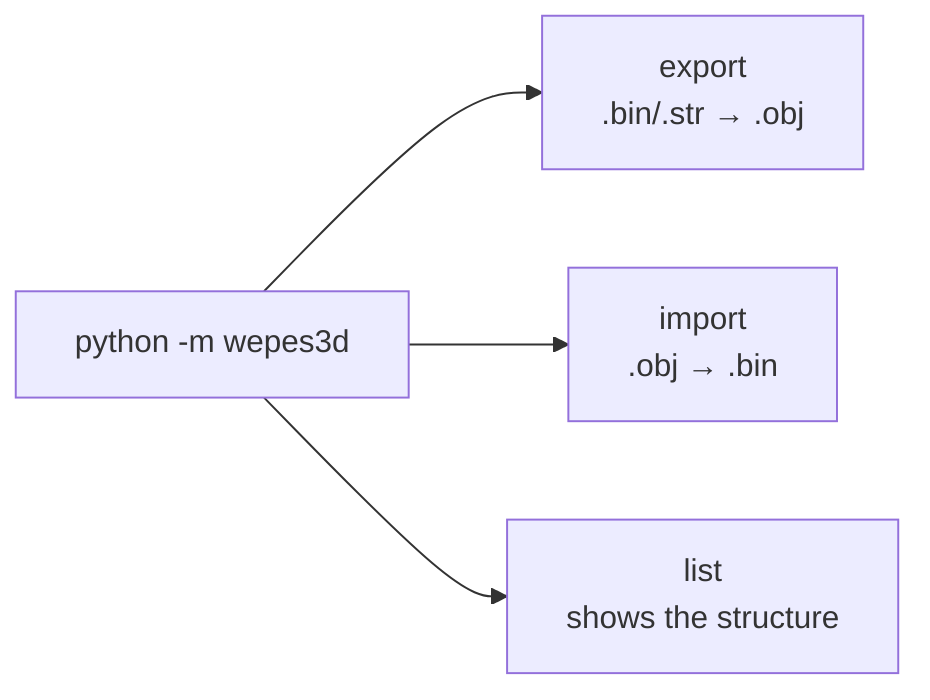
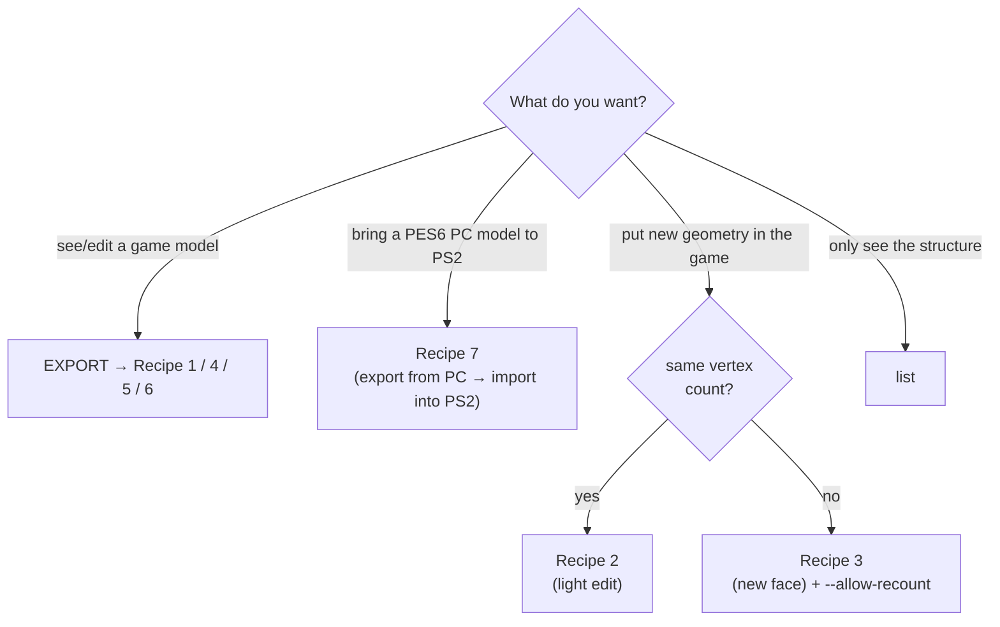
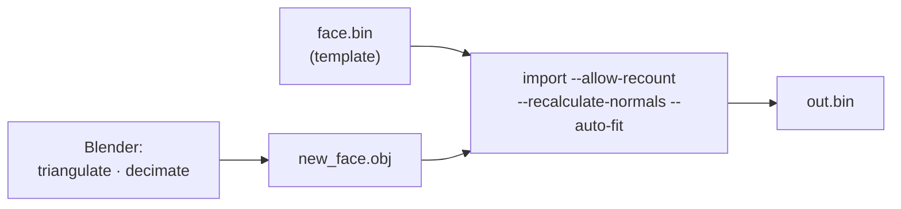

# 00 — User guide (cookbook)

Practical, step-by-step recipes for the most common tasks. If you only want to
**use** the tool (without learning how the format works inside), start here.
The main goal is to **import new models into PES PS2** (Recipes 3, 4 and 7);
the exports help you get there.

> To learn *how the format works*, read [01](01-bin-format.md)…[05](05-strip-encoding.md).
> To *fix a problem*, read [07 — Debugging guide](07-debugging-guide.md).

---

## The interface in 30 seconds

The CLI has **three subcommands**:



```bash
python -m wepes3d export  INPUT.bin    OUTPUT.obj          [options]
python -m wepes3d import  TEMPLATE.bin GEOMETRY.obj OUT.bin [options]
python -m wepes3d list    INPUT.bin    [--type ...]
```

- **export** = open a game model in Blender (writes `.obj` + `.mtl`).
- **import** = put YOUR geometry back into a `.bin`, using an original `.bin`
  as the **template** (the "shell": header, bones, textures).
- **list** = inspect a file (how many models / sections / parts it has).

Each subcommand has its own help: `... export --help`, `... import --help`.

> There is nothing to install apart from **Python 3.8+** (no external
> dependencies). Run the commands from the repository root (the folder created
> by `git clone`).

---

## Which recipe do you need?



---

## Recipe 1 — Export a face (to see/edit it in Blender)

```bash
python -m wepes3d export face.bin face.obj --type face
#   writes: face.obj + face.mtl   (the .mtl points to face.png, the texture)
```

```python
from wepes3d import export_face
export_face("face.bin", "face.obj")        # face.obj + face.mtl
```

Open `face.obj` in Blender (`File → Import → Wavefront (.obj)`). If you
extracted the texture as `face.png` into the same folder, the `.mtl` already
points to it.

> Not sure if the `.bin` is a face or a trophy? Use `--type auto` (it checks the
> magic), or run `list` first.

---

## Recipe 2 — Import the same face again (light edit)

You exported a face, moved some vertices, and want to put it back **with the
same vertex count** as the original:

```bash
python -m wepes3d import face.bin edited_face.obj out.bin \
    --type face --recalculate-normals
```

If the vertex/UV count matches the template, the tool uses the original part
layout — you do **not** need `--allow-recount`.

> **Byte-identical roundtrip (zero-diff):** if the `.obj` gives back *exactly*
> the template geometry (same vertices/UVs/normals and the same triangles),
> the **original strip is kept** and the **payload** of the output `.bin` is
> **identical** to the input one (the compressed file only differs when Python's
> zlib does not reproduce the original compression). As soon as you edit a
> part, **only that part** is encoded again. Details in
> [03 §Validation](03-import-pipeline.md#validation-roundtrip) and
> [05](05-strip-encoding.md).

---

## Recipe 3 — Import a NEW face (the main use case)

You have a 3D face from another source (a scan, a sculpt, another game) and
want to put it on a player. Its vertex count is different from the template.



**1) Prepare the mesh in Blender:**
- **Triangulate**: `Mesh → Triangulate Faces` (convex n-gons are fan-triangulated
  automatically, but concave ones need this step).
- **UVs**: *seams* and different `v`/`vt` indices (normal in a Blender export)
  are handled while reading — the vertex is duplicated at each seam. To save
  vertices, `UV Editor → UV → Merge UVs by Distance` still helps.
- **Reduce polygons** (`Decimate`): aim for **≤ ~1,300 vertices in total** and
  **≤ ~170 per region** (the *strip* overflows before the 255 limit — see
  [limits](#format-limits)).
- Scale/position **do not matter** — `--auto-fit` fits the mesh into the
  template bbox.
- **Export** with `File → Export → Wavefront (.obj)`, with *UVs* and
  *Triangulated Mesh* on.

**2) Import:**
```bash
python -m wepes3d import face.bin new_face.obj out.bin \
    --type auto --allow-recount --recalculate-normals --auto-fit
```
```python
from wepes3d import import_face
import_face("face.bin", "new_face.obj", "out.bin",
            allow_recount=True, recalculate_normals=True, auto_fit=True)
```

**3)** Put `out.bin` in the game (in place of the player's face, with the
community packing tool).

**Partition strategy** (how the vertices become *parts*) — pick 1:

| You have… | Use | What it does |
|---|---|---|
| any mesh | *(default, BFS)* | groups faces by adjacency |
| the face split into N objects in Blender | `--use-groups` | each object/group becomes a part |
| an anatomical topology that should match the template | `--match-template --auto-fit` | nearest neighbour in template space |
| full control | `--part-sizes 90,90,...` or `--max-verts-per-part 150` | you decide |

> Something went wrong? Invisible face, holes, spikes →
> [07 — Debugging guide](07-debugging-guide.md).

---

## Recipe 4 — Trophy (export a section and import)

A trophy is a **collection of sub-models** (`.mdl`): `sec0` = the cup;
`sec1+` = base, pedestal, stage, etc. (see [08 — Trophies](08-trophies.md)).

**See how many sections it has:**
```bash
python -m wepes3d list trophy.bin --type trophy
```
```python
from wepes3d import decompress_bin, trophy_section_offsets, parse_model
payload, _, _ = decompress_bin("trophy.bin")
for i, off in enumerate(trophy_section_offsets(payload)):
    m = parse_model(payload, off)
    print(f"sec{i}: {len(m.parts)} parts, {sum(p.vertex_count for p in m.parts)} v")
```

**Export the cup (sec0) — or another sub-model:**
```bash
python -m wepes3d export trophy.bin cup.obj  --type trophy --section 0
python -m wepes3d export trophy.bin base.obj --type trophy --section 4
```

**Import a new cup into sec0:**
```bash
python -m wepes3d import trophy.bin new_cup.obj out.bin \
    --type trophy --section 0 --allow-recount --recalculate-normals --auto-fit
```
The tool rewrites **only the chosen section** and fixes the container pointers
(section directory + textures) automatically — the other sections stay
untouched.

---

## Recipe 5 — Export stadiums

Stadium files are **"model folders"** (see
[09 — Stadiums and kits](09-stadiums-and-kits.md)): `.str` = crowd; `.bin` =
container (stadium structure / boards).

```bash
# 1) See the structure (blocks, models, number of parts):
python -m wepes3d list stad1_main.bin --type stadium

# 2) The WHOLE stadium in one .obj:
python -m wepes3d export stad1_main.bin stadium.obj --type stadium --all

# 3) One .obj per model (OUT becomes a prefix):
python -m wepes3d export stad1_main.bin out/stadium --type stadium --parts

# 4) Only one model (global index; texture blocks are skipped):
python -m wepes3d export stad1_main.bin stand.obj --type stadium --model 4
```
```python
from wepes3d import (
    list_stadium, export_stadium_complete, export_stadium_parts, export_stadium_scene,
)
list_stadium("stad1_main.bin")                               # prints the structure
export_stadium_complete("stad1_main.bin", "stadium.obj")     # everything in one .obj
export_stadium_parts("crowd_h.str", "out/crowd")             # 1 .obj per model
export_stadium_scene(["stad1_main.bin", "crowd_h.str"], "scene.obj")  # several together
```

> **Stadium import does not exist yet.** The **texture/data** files inside the
> container are detected and **skipped** (0 3D models).

---

## Recipe 6 — Export kits (uniform/hands)

Same as stadiums (same "model folder" engine), with the face coordinates. The
models are usually **LODs** (the same piece at different levels of detail).

```bash
python -m wepes3d list   kit_1135 --type kit                    # see the structure
python -m wepes3d export kit_1135 shirt.obj --type kit --all
python -m wepes3d export kit_1135 out/kit   --type kit --parts  # 1 .obj per LOD
```
Two useful options to inspect the model in Blender:
- `--groups` — writes **1 object (`o part_NN`) per part** (turn each piece on/off).
- `--dedup` — removes duplicated **double-sided** panels (a cleaner `.obj`).

---

## Recipe 7 — Bring a PES6 PC model to PS2

PES6 **PC** has a **different** format from PS2 (see
[12 — PES6 PC](12-pes6-pc.md)). wepes3d only **exports** PC models: they are a
**source** of models for PES PS2, not a target. The path is: export from PC →
make the model lighter in Blender → import it into a PS2 `.bin`.

**1. Export from PC** (it works like a "model folder"):

```bash
python -m wepes3d list   pl.str    --type pc                        # structure (parts)
python -m wepes3d export pl.str    trophy.obj --type pc --all       # whole trophy
python -m wepes3d export pl.str    cup.obj    --type pc --model 0   # only part 0 (the cup)
python -m wepes3d export Kroos.bin face.obj   --type pc             # face (1 model)
```
```python
from wepes3d import list_pc, export_pc, export_pc_complete
list_pc("pl.str")
export_pc_complete("pl.str", "trophy.obj")
export_pc("pl.str", "cup.obj", model=0)   # only part 0
export_pc("Kroos.bin", "face.obj")        # a PC face = 1 model
```

**2. In Blender:** make the model lighter (PC models are heavier: the PES6
cup has ~2,100 vertices; aim for ~1,000), and check the UVs against the
texture of the PS2 template — textures are not converted. Save it as `.obj`.

**3. Import it into PS2** like any new model — a trophy with
[Recipe 4](#recipe-4--trophy-export-a-section-and-import), a face with
[Recipe 3](#recipe-3--import-a-new-face-the-main-use-case):

```bash
python -m wepes3d import trophy.bin my_cup.obj new_trophy.bin \
    --type trophy --section 0 --allow-recount --recalculate-normals --auto-fit
```

If the import stops with `the mesh does not fit in the N parts of the
template…`, the model is still too heavy for the parts of the PS2 template:
decimate it more, or add `--max-verts-per-part 255` so that the import adds
the parts it needs (trophies have no part limit; a face has at most 8).

---

## `.obj` checklist (before importing)

- [ ] **Triangulated** (convex n-gons are fan-triangulated automatically).
- [ ] **Decimated** to the vertex budget (see below) — remember that each UV
      *seam* duplicates vertices (`UV → Merge UVs by Distance` reduces this).
- [ ] Exported **with UVs**. Any scale/position (use `--auto-fit`).

### Format limits

| Limit | Value | Why |
|---|---|---|
| Parts per model (face) | **8** | fixed buffer size in the engine (`payload[0x04]=8`). > 8 = **invisible**. |
| Vertices per part | **255** | the `NUM` of the VIF UNPACK is a `uint8`. |
| Triangles per part | **~340** | strip limit (aligned to multiples of 4). |
| **In practice** | **≤ ~170 v/part**, **≤ ~1,300 in total** | in a closed mesh `triangles ≈ 2 × vertices`, so the strip overflows before 255 v. |

> Trophies do **not** have the 8-part limit per sub-model (they have 14–31).
> The per-part limit (255 v / ~340 tri) applies to everything.

Over the limit? **Decimate** more in Blender, or raise the number of parts
(`--max-verts-per-part`, up to the 8-part limit for faces).

---

## Still stuck?

- Symptoms (invisible / holes / spikes / wrong texture) → [07 — Debugging guide](07-debugging-guide.md).
- Historical bugs and their causes → [06 — Bug history](06-bug-history.md).
- Full list of options and of the API → [project README](../README.md).
