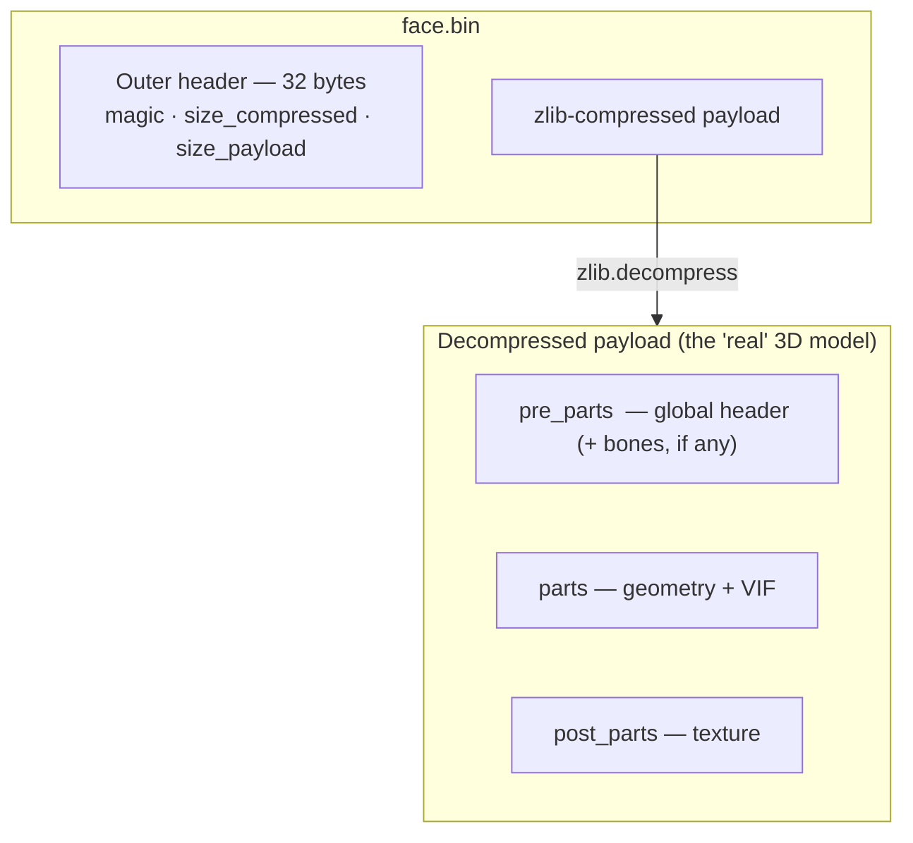

# 01 — The PES PS2 `.bin` format

> "To change something with confidence, you first need to understand it."

This document explains, at a high level, what a face/hair `.bin` file of Pro
Evolution Soccer (PS2) is, how it is built in layers, and where each piece fits
in the bigger picture of the game.

---

## 1. Context: PES PS2 and its 3D assets

Pro Evolution Soccer for PlayStation 2 (mainly versions 5 and 6) stores the
player data in big files (the "option file" and the game files). Inside them,
each **face** and each **hair** is an independent 3D sub-asset — a model with
geometry, a texture and (in some cases) animation bones.

These sub-assets are extracted into single `.bin` files with the community
extraction tools. **That single `.bin`** is what this package works with — not
the parent file.


---

## 2. The layers of the file

A face `.bin` is like an onion with layers. From the outside to the inside:



### 2.1 Outer header (32 bytes)

The first 32 bytes are packing information: two 16-byte sub-headers, with:

- the PES **magic** (`00 06 01 00`) — it says this is a compressed PES asset;
- **`size_compressed`** (uint32 LE at `0x04`): size of the zlib blob;
- **`size_payload`** (uint32 LE at `0x08`): size of the decompressed payload;
- other fields of the packer, which we **keep untouched** in a roundtrip (we
  do not interpret them).

> In this package, `shared/io/bin_io.decompress_bin` reads these 32 bytes,
> returns them as `outer_full_header`, and passes them untouched to
> `compress_bin` when writing. **We do not touch what we do not understand.**

### 2.2 zlib payload

From byte 32 on comes the blob compressed with **zlib** (standard, level 9).
Decompressing it is simple:

```python
import zlib
with open("face.bin", "rb") as f:
    f.read(32)                  # skips the outer header
    payload = zlib.decompress(f.read())
```

### 2.3 Decompressed payload

**This is where the 3D model lives.** It has three blocks (numbers from the
simple `face.bin`, our reference template):

| Block | Size | Content |
|---|---|---|
| **`pre_parts`** | 272 bytes (0x110) | Global header + pointers |
| **`parts`** | 16,560 bytes (0x40B0) | 8 parts × ~2 KB — where the geometry is |
| **`post_parts`** | 21,632 bytes | Header + **texture** (RGBA or palette) |

Each block is described byte by byte in
[02 — Payload anatomy](02-payload-anatomy.md).

---

## 3. Why does this format look "strange"?

The first time you look at a PES PS2 payload, it looks odd: magics that make no
obvious sense, repeated offsets (`vbe` shows up 3× in the same file!), VIF tags
mixed with the data. **This is not random.**

The PS2 has a unique architecture, with a dedicated path for geometry:


The `.bin` payload is **not a 3D mesh in the usual sense**: it is a **stream of
VIF commands** mixed with data. The CPU (EE = Emotion Engine) sends the payload
by DMA straight to the VIF1, which feeds the VU1, which runs a microcode that:

1. Decodes vertices, normals and UVs (interleaved in VU memory);
2. Applies transformations (bone skinning, projection);
3. Decodes the triangle strip and sends triangles to the GS.

That is why the format has all these **VIFcodes** (`STCYCL`, `STMOD`,
`STMASK`, `UNPACK V3-16`, …) — they set up the VU1 before the data itself
arrives. Changing the wrong field can crash the VU ("unknown vifcmd") or
corrupt the geometry.

More about this in [04 — VIF and VU1](04-vif-and-vu1.md).

---

## 4. "Simple" vs "rich" templates

Not every `.bin` has the same structure. What tells the two kinds apart is the
**size of `pre_parts`** (with or without the bones area), **not** the value of
`offset_file_1`.

| | Simple (no bones) | Rich (with bones) |
|---|---|---|
| `pre_parts` | ~272–288 bytes | **12,288 bytes** (272 + ~12 KB of bones) |
| Face animation | static | bone skinning |
| Examples | `face.bin` (`offset_file_1=0x10`), `h2/h3/h4.bin` (`0x20`) | `face_1..5.bin`, `h1.bin` (`0x20`) |

> ⚠ `offset_file_1 = 0x20` does **not** mean "rich": `h2/h3/h4.bin` have `0x20`
> and still have no bones. The reliable sign is **`pre_parts > ~300 bytes`**.

**We use `face.bin` (simple) as the template** because it is the easiest path:
no bones, no animation to keep in sync, nothing to misalign. Rich templates
also load (their bone bytes are kept untouched), but since a recount moves the
vertices without updating the bones, the animation would be wrong — so the
pipeline **never writes** to the bones area.

---

## 5. What this package does

In short: it reads the `.obj`, fits it into the template bbox (optional),
splits it into parts, computes normals, rebuilds each part (int16 + strip +
~15 header fields), fixes the pointers in `pre_parts`, and compresses the
result. Each step is described in [03 — Import pipeline](03-import-pipeline.md).

---

## 6. What we do **not** do (and why)

- **Bone weights** (animation): this area exists in "rich" templates, with
  sub-tables in mixed formats that are only partly mapped. A static face is
  the safe path. See [06 — Bug history](06-bug-history.md) (Bug 11).
- **Texture**: kept untouched from the template. To change the texture, edit
  `post_parts` with another tool. Our scope is **geometry**.
- **LOD / mip levels**: there is no evidence that the face `.bin` uses several
  levels.

---

## Next: byte-by-byte anatomy

If you want to change specific bytes, read
[02 — Payload anatomy](02-payload-anatomy.md): the full map of **all** fields,
with formulas and cross-references.
