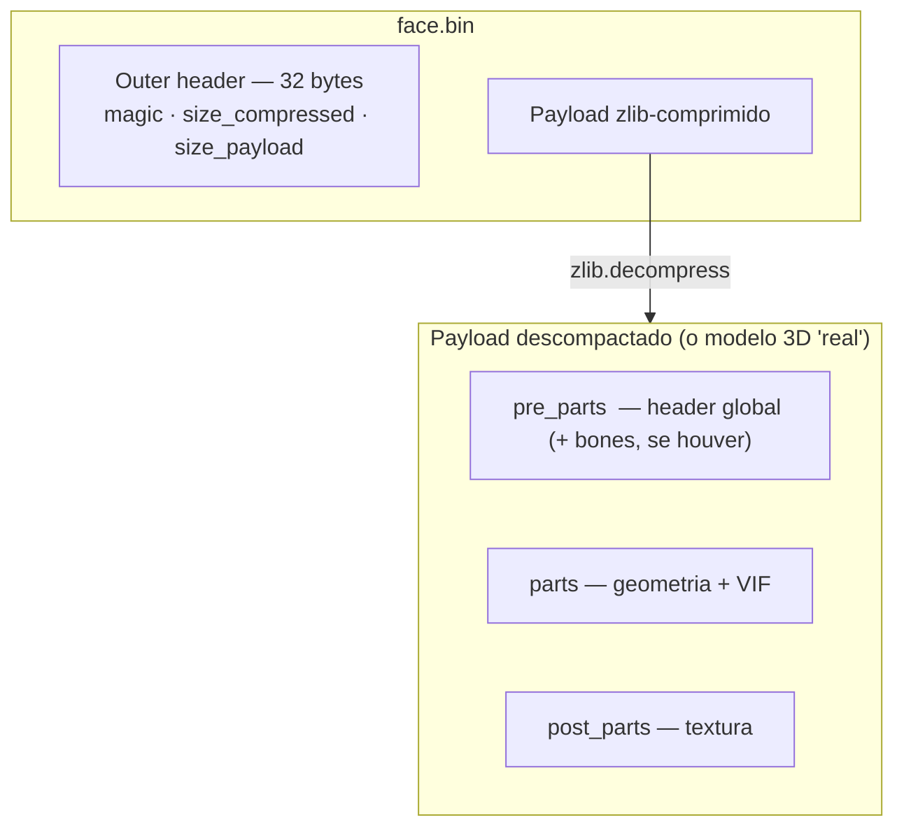
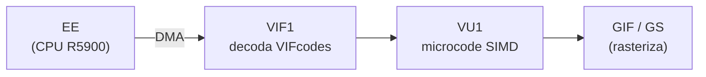
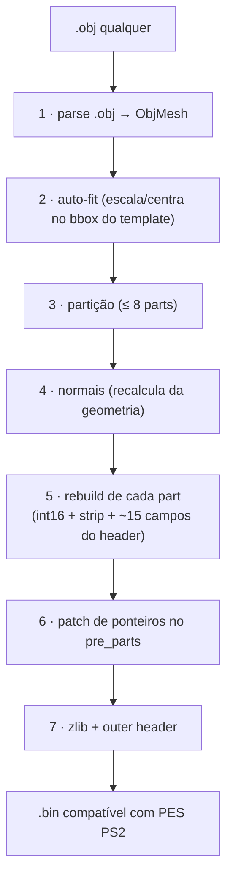

# 01 — O formato `.bin` do PES PS2

> "Para modificar com confiança, primeiro é preciso entender."

Este documento explica em alto nível o que é um arquivo `.bin` de face/cabelo no
Pro Evolution Soccer (PS2), como ele é estruturado em camadas, e onde cada pedaço
cabe no quebra-cabeça maior do jogo.

---

## 1. Contexto: PES PS2 e seus assets 3D

O Pro Evolution Soccer para PlayStation 2 (versões 5 e 6, principalmente) armazena
os dados dos jogadores em arquivos grandes (o "option file" e os arquivos de jogo).
Dentro deles, cada **face** e cada **cabelo** é um sub-asset 3D independente — um
modelo com geometria, textura e (em alguns casos) bones de animação.

Esses sub-assets são extraídos para arquivos `.bin` individuais usando as
ferramentas de extração da comunidade. **É esse `.bin` individual** que nosso
pacote manipula — não o arquivo-mãe.


---

## 2. Camadas do arquivo

Um `.bin` de face é uma "cebola" de camadas. Da mais externa para a mais interna:



### 2.1 Outer header (32 bytes)

Os primeiros 32 bytes são informações de pacote: dois sub-headers de 16 bytes,
contendo:

- **Magic** do PES (`00 06 01 00`) — identifica que é um asset comprimido do PES;
- **`size_compressed`** (uint32 LE em `0x04`): tamanho do blob zlib;
- **`size_payload`** (uint32 LE em `0x08`): tamanho do payload descompactado;
- Outros campos do empacotador, que **preservamos intactos** no roundtrip (não
  interpretamos).

> No nosso pacote, `shared/io/bin_io.decompress_bin` lê esses 32 bytes inteiros,
> devolve-os como `outer_full_header`, e os passa intactos para `compress_bin` na
> hora de escrever. **Não tocamos no que não entendemos.**

### 2.2 Payload zlib

A partir do byte 32 vai o blob comprimido com **zlib** (padrão, nível 9).
Descompactar é direto:

```python
import zlib
with open("face.bin", "rb") as f:
    f.read(32)                  # pula o outer header
    payload = zlib.decompress(f.read())
```

### 2.3 Payload descompactado

É **aqui que mora o modelo 3D**. Layout em três blocos (números do `face.bin`
simples, o template de referência):

| Bloco | Tamanho | Conteúdo |
|---|---|---|
| **`pre_parts`** | 272 bytes (0x110) | Header global + ponteiros |
| **`parts`** | 16.560 bytes (0x40B0) | 8 parts × ~2 KB — onde fica a geometria |
| **`post_parts`** | 21.632 bytes | Cabeçalho + **textura** (RGBA ou paletizada) |

Cada bloco é dissecado em [02 — Anatomia do payload](02-anatomia-payload.md).

---

## 3. Por que esse formato é "estranho"?

A primeira vez que se olha um payload do PES PS2, ele parece bizarro: magics
não-óbvios, offsets duplicados (`vbe` aparece 3× no mesmo arquivo!), tags VIF
intercalando dados. **Isso não é arbitrário.**

O PS2 tem uma arquitetura única, com um caminho dedicado para a geometria:



O payload do `.bin` **não é uma malha 3D no sentido comum**: é um **stream de
comandos VIF** entremeado com dados. A CPU (EE = Emotion Engine) faz DMA do payload
direto para o VIF1, que alimenta a VU1, que executa um microcode que:

1. Decodifica vértices, normais e UVs (intercalados na memória da VU);
2. Processa transformações (bone skinning, projeção);
3. Decodifica o triangle strip e dispara triângulos para o GS.

Por isso o formato tem todos esses **VIFcodes** (`STCYCL`, `STMOD`, `STMASK`,
`UNPACK V3-16`, …) — eles configuram a VU1 antes do dado em si chegar. Mexer num
campo errado pode crashar a VU ("unknown vifcmd") ou corromper a geometria.

Mais sobre isso em [04 — VIF e VU1](04-vu-microcode.md).

---

## 4. Templates "simples" vs "ricos"

Nem todo `.bin` tem a mesma estrutura. O que distingue os dois padrões é o
**tamanho do `pre_parts`** (tem ou não a área de bones), **não** o valor de
`offset_file_1`.

| | Simples (sem bones) | Rico (com bones) |
|---|---|---|
| `pre_parts` | ~272–288 bytes | **12.288 bytes** (272 + ~12 KB de bones) |
| Animação facial | estática | bone skinning |
| Exemplos | `face.bin` (`offset_file_1=0x10`), `h2/h3/h4.bin` (`0x20`) | `face_1..5.bin`, `h1.bin` (`0x20`) |

> ⚠ `offset_file_1 = 0x20` **não** implica "rico": `h2/h3/h4.bin` têm `0x20` e mesmo
> assim não têm bones. O sinal confiável é **`pre_parts > ~300 bytes`**.

**Usamos `face.bin` (simples) como template** porque é o caminho de menor
resistência: sem bones, sem animação para sincronizar, sem desalinhamento.
Templates ricos também carregam (os bytes de bones são preservados intactos), mas
como o recount reposiciona os vértices sem atualizar os bones, a animação ficaria
incorreta — por isso o pipeline **não escreve** na área de bones.

---

## 5. O que o nosso pacote faz (resumo)



Detalhamento em [03 — Pipeline](03-pipeline.md).

---

## 6. O que **não** fazemos (e por quê)

- **Bone weights** (animação): a área existe em templates "ricos", com sub-tabelas
  em formatos mistos só parcialmente mapeados. Face estática é o caminho seguro.
  Ver [06 — Bugs históricos](06-bugs-historicos.md).
- **Textura**: preservada intacta do template. Para trocar a textura, edita-se o
  `post_parts` com outra ferramenta. Nosso escopo é **geometria**.
- **LOD / mip levels**: não há evidência de que o `.bin` de face use múltiplos
  níveis.

---

## Próximo: anatomia byte-a-byte

Se você quer modificar bytes específicos, leia [02 — Anatomia do payload](02-anatomia-payload.md):
o mapa completo de **todos** os campos com fórmulas e referências cruzadas.
