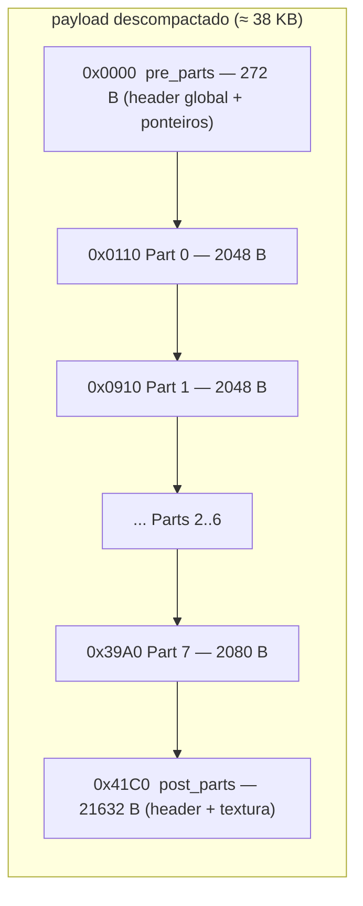
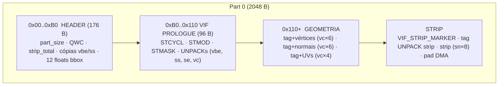
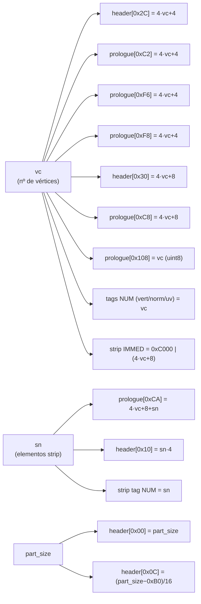

# 02 — Anatomia do payload

Mapa byte-a-byte do payload descompactado de um `.bin` de face/cabelo do PES PS2.

> **Por que este documento é o coração do projeto.** Importar um `.obj` "do zero"
> não é só escrever os vértices novos. O formato espalha **~15 campos derivados**
> (tamanhos, contagens, endereços de VU, ponteiros DMA) por dentro de cada part
> **e** no header global — muitos deles **redundantes** (o mesmo valor copiado em
> 2–4 lugares). Esquecer **um** byte → face invisível ou crash no jogo. Identificar
> todos foi o trabalho mais difícil da engenharia reversa (ver [06](06-bugs-historicos.md)).
> Este documento é o **mapa completo** desses bytes. A [seção 5](#5-o-mapa-dos-bytes-que-você-precisa-gravar)
> é o resumo operacional.

> **Convenção de notação:**
> - `byte[X]` = offset absoluto no payload.
> - `header[X]` = offset relativo ao início de uma part.
> - `prologue[X]` = offset relativo ao início do VIF prologue da part.
> - Todos os valores são **little-endian**.

---

## 1. Layout em alto nível

Referência: o `face.bin` simples (template do nosso pipeline).



Cada uma das 8 parts do template tem **`vc = 87` vértices** e **`strip_NUM` de 43
a 48** elementos V4-16.

---

## 2. `pre_parts_bytes` (0x000..0x110)

272 bytes: o outer header de 32 bytes (já visto em [01](01-formato-bin.md)) + o
**model header** (0x20..0x110).

| Offset | Tipo | Valor | Significado |
|---|---|---|---|
| `0x000` | uint32 | 2 | flag/versão |
| **`0x004`** | uint32 | 8 | ⚠ **`MAX_PARTS_HARD`** — capacidade fixa do buffer de parts. Vale 8 em **todos** os exemplos. `total_parts > 8` → face invisível. **Constante: NÃO mexer.** |
| `0x008` | uint32 | `0x10` | **`offset_file_1`** — onde começa o model header |
| **`0x00C`** | uint32 | `0x41C0` | ⚠ **`parts_end`** — ponteiro absoluto p/ o início de `post_parts`. **Atualizar** quando parts mudam de tamanho. |
| `0x010` | bytes | `03 00 FF FF` | **`MAGIC_MODEL`** — começo do model header |
| `0x014` | uint32 | 8 | constante |
| **`0x030`** | uint32 | 8 | **`total_parts` real** (em `offset_file_1 + 0x20`). **Atualizar** se o nº de parts mudar. |
| `0x034` | uint32 | `0x100` | `parts_start_rel` (relativo a `offset_file_1`) |
| **`0x03C`** | uint32 | `0x41B0` | ⚠ **fim das parts relativo ao modelo** (`offset_file_1 + 0x2C` = `parts_end − offset_file_1`). Com o modelo em `0x10`, coincide com `parts_end − 16`. **Atualizar** junto com `0x00C`. |
| `0x040..0x0DC` | — | — | metadata (vec4 floats etc.) |
| `0x0E0..0x10F` | — | — | constantes + padding |

### Por que `parts_end` aparece duas vezes?

São dois campos de **níveis diferentes**: `0x0C` é do header do arquivo e guarda o
fim das parts **absoluto** (onde começa o `post_parts`); `offset_file_1 + 0x2C` é do
model header e guarda o mesmo fim **relativo ao modelo** — como o `parts_start_rel`
em `+0x24`. Atualizar só um → editores da comunidade crasham ao abrir o `.bin`
(foi o [Bug 4](06-bugs-historicos.md#bug-4--segundo-ponteiro-parts_end---16-não-atualizado),
revisto no [Bug 14](06-bugs-historicos.md#bug-14--fim-das-parts-relativo-ao-modelo)).

> ⚠ Em `face.bin` o modelo começa em `0x10`, então o campo relativo cai em `0x3C`
> e vale `parts_end − 16` — e foi descrito assim por muito tempo. Com o modelo em
> `0x20` (`h2`, `face_1`…) ele fica em `0x4C` e vale `parts_end − 0x20`; num troféu,
> em `seção + 0x2C`. Validado em faces, troféus, kits e estádios reais.

---

## 3. Estrutura de uma part

Referência: **Part 0** (offset `0x110`, size `0x800` = 2048 bytes).



### 3.1 Header da part (0x00..0xB0) — campos que importam

| Offset | Valor (P0) | Significado |
|---|---|---|
| `0x00` | `0x800` | **`part_size`** — varia (recomputado no rebuild) |
| `0x08` | `0xB0` | `part_info_start` — offset do VIF prologue |
| **`0x0C`** | `0x75` | ⚠ **`QWC = (part_size − 0xB0) / 16`** — DMA quadword count |
| **`0x10`** | `0xAC` | ⚠ **`strip_indices_total = strip_NUM × 4`** |
| **`0x2C`** | `0x160` (352) | ⚠ **`vbe = 4×vc + 4`** — cópia do prologue `0xC2` ([Bug 10](06-bugs-historicos.md#bug-10--cópias-de-vbe-e-ss-no-header-da-part-não-atualizadas)) |
| **`0x30`** | `0x164` (356) | ⚠ **`ss = 4×vc + 8`** — cópia do prologue `0xC8` (Bug 10) |
| `0x34` | 0 | `tex_id` |
| `0x60..0x8C` | 12× `128.0` | provável matriz 3×4 de bbox/clipping (preservada) |

### 3.2 VIF Prologue (0xB0..0x110) — os parâmetros do microcode

96 bytes que configuram a VU1. Cada VIFcode tem 4 bytes
(`IMMED:2 · NUM:1 · I-flag+CMD:1`). Os campos que dependem de `vc`/`sn`:

| Offset rel | Tipo | Fórmula | Significado |
|---|---|---|---|
| `0xC2` | uint16 | `4×vc + 4` | `vbe` (vertex_block_end), cópia 1 |
| `0xC8` | uint16 | `4×vc + 8` | `ss` (strip_start) |
| `0xCA` | uint16 | `4×vc + 8 + sn` | `se` (strip_end) |
| `0xF6` | uint16 | `4×vc + 4` | `vbe`, cópia 2 |
| `0xF8` | uint16 | `4×vc + 4` | `vbe`, cópia 3 |
| `0x108` | uint8 | `vc` | vertex_count duplicado |
| `0x10C` | — | `04 01 00 01` | **STCYCL CL=4 WL=1** → layout INTERLEAVED (ver [04 §3](04-vu-microcode.md)) |

### 3.3 Layout interleaved (a pegadinha que custou o [Bug 5](06-bugs-historicos.md#bug-5--immed-de-normaisuvs-alterado-erradamente))

O `STCYCL CL=4 WL=1` faz cada elemento ocupar 1 qword "ativo" + 3 de skip.
Vértices, normais e UVs ficam **INTERLEAVED** na VU memory:

```
qw[4 + 4n + 0] = vértice n   ← UNPACK IMMED ADDR = 4
qw[4 + 4n + 1] = normal  n   ← IMMED ADDR = 5
qw[4 + 4n + 2] = (skip)
qw[4 + 4n + 3] = uv      n   ← IMMED ADDR = 7
```

**Implicação crítica:** os IMMEDs das tags de normais (`0x8005`) e UVs (`0x8007`)
são **CONSTANTES** — não escalam com `vc`. Só o `NUM` muda. (Assumir layout
sequencial foi o Bug 5.)

### 3.4 Tags VIF UNPACK de geometria

Logo após o prologue, três tags marcam cada bloco. Formato `IMMED:2 NUM:1 CMD:1`:

| Bloco | Bytes (P0) | IMMED | NUM | CMD | Dados |
|---|---|---|---|---|---|
| Vértices | `04 80 57 69` | `0x8004` | `vc` | `0x69` = V3-16 | `vc × 6` B na ordem **(Y, Z, X)** |
| Normais | `05 80 57 69` | `0x8005` | `vc` | `0x69` = V3-16 | `vc × 6` B na ordem **(X, Y, Z)** ⚠ diferente |
| UVs | `07 80 57 65` | `0x8007` | `vc` | `0x65` = V2-16 | `vc × 4` B na ordem **(U, V)** |

> Se `vc` for **ímpar** (template, vc=87): **2 bytes de padding** após vértices e
> após normais (UVs já ficam alinhados).

### 3.5 Strip block

```
[VIF_STRIP_MARKER: 8 B]  01 00 00 05 01 01 00 01   (STMOD ADD + STCYCL CL=1 WL=1)
[tag UNPACK strip: 4 B]  LL HH NN 6D
[strip data: sn × 8 B]   sn elementos V4-16 = sn×4 índices int16
[post_strip + pad DMA]   alinha part_size a múltiplo de 16
```

A **tag do strip** é a única cujo IMMED **varia** com `vc` (o strip vem depois do
bloco interleaved):

| Campo | Fórmula |
|---|---|
| IMMED (uint16) | `0xC000 \| (4×vc + 8)` |
| NUM | `sn` (elementos V4-16) |
| CMD | `0x6D` = V4-16 |

A codificação dos índices está em [05 — Strip encoding](05-strip-encoding.md).

---

## 4. `post_parts_bytes` (após a última part)

21.632 bytes em `face.bin`. **Preservado intacto** pelo pacote.

| Range | Conteúdo |
|---|---|
| `0x0000..0x007F` | Cabeçalho do post_parts |
| `0x0080..fim` | **Textura** (RGBA ou paletizada) |

> ⚠ **[Bug 11](06-bugs-historicos.md#bug-11--rebuild_bone_weights-corrompia-textura):** uma versão antiga escrevia "bone weights" em `post_parts[0x80..]`.
> Errado — essa área é **textura** (os bytes `0x80` eram o canal **alpha** de pixels
> RGBA, coincidência). Bone weights de verdade ficam no **pre_parts** (`0xE0..`),
> com entries de 8 bytes — e nós **não** mexemos neles.

---

## 5. O mapa dos bytes que você precisa gravar

Esta é a lista operacional: **tudo** que muda quando você reconstrói uma part.
Note a **redundância** — o mesmo valor aparece em vários lugares, cada um lido por
uma etapa diferente do pipeline gráfico:



### Em CADA part

| Onde | Fórmula |
|---|---|
| `header[0x00]` | `part_size` (header + verts + pads + tags + strip + post, alinhado a 16) |
| `header[0x0C]` | `QWC = (part_size − 0xB0) / 16` |
| `header[0x10]` | `strip_indices_total = sn × 4` |
| `header[0x2C]` | `4×vc + 4` *(vbe — Bug 10)* |
| `header[0x30]` | `4×vc + 8` *(ss — Bug 10)* |
| `prologue[0xC2]` | `4×vc + 4` |
| `prologue[0xC8]` | `4×vc + 8` |
| `prologue[0xCA]` | `4×vc + 8 + sn` |
| `prologue[0xF6]` | `4×vc + 4` |
| `prologue[0xF8]` | `4×vc + 4` |
| `prologue[0x108]` (byte) | `vc` |
| tag vértices/normais/UVs NUM | `vc` |
| tag strip IMMED | `0xC000 \| (4×vc + 8)` |
| tag strip NUM | `sn` |

### No `pre_parts`

| Onde | Fórmula |
|---|---|
| `payload[offset_file_1 + 0x20]` | `total_parts` |
| `payload[0x0C]` | `parts_end` = `pre_parts_size + Σ part.size` |
| `payload[offset_file_1 + 0x2C]` | `parts_end − offset_file_1` (relativo ao modelo; em `face.bin` é o `0x3C` = `parts_end − 16`) |

**Não tocar:** `payload[0x04] = 8` (constante; subir invisibiliza a face — [Bug 12](06-bugs-historicos.md#bug-12--mais-de-8-parts--face-invisível)).

> No código, quem grava tudo isso é `shared/model/rebuilder.rebuild_part` (campos da
> part) e `shared/pipeline/importer` (campos do pre_parts + patch dos ponteiros).
> Ver [03 — Pipeline §6/§7](03-pipeline.md).

---

## Próximo: pipeline

Para ver **quando** cada campo é gravado durante o import: [03 — Pipeline](03-pipeline.md).
Para entender **por que** `vbe`/`ss`/`se` existem: [04 — VIF/VU](04-vu-microcode.md).
