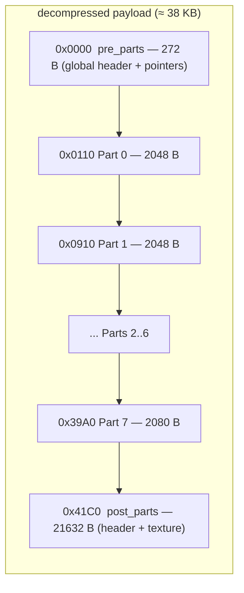
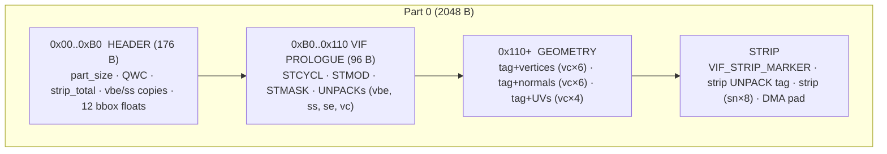
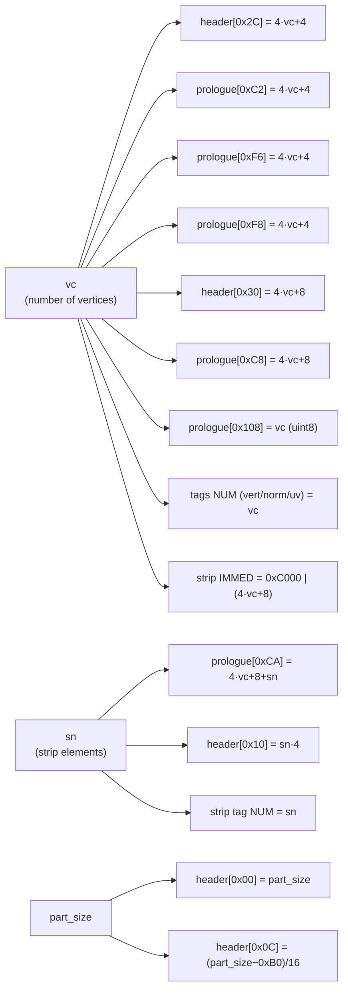

# 02 — Payload anatomy

Byte-by-byte map of the decompressed payload of a PES PS2 face/hair `.bin`.

> **Why this document is the heart of the project.** Importing an `.obj` "from
> scratch" is not just writing the new vertices. The format spreads **~15
> derived fields** (sizes, counts, VU addresses, DMA pointers) inside each part
> **and** in the global header — many of them **redundant** (the same value
> copied in 2–4 places). Forget **one** byte → invisible face or a crash in the
> game. Finding all of them was the hardest part of the reverse engineering
> (see [06](06-bug-history.md)). This document is the **full map** of those
> bytes. [Section 5](#5-the-map-of-the-bytes-you-need-to-write) is the practical
> summary.

> **Notation:**
> - `byte[X]` = absolute offset in the payload.
> - `header[X]` = offset relative to the start of a part.
> - `prologue[X]` = offset relative to the start of the part (the VIF prologue
>   lives at 0xB0..0x110 of the part).
> - All values are **little-endian**.

---

## 1. High-level layout

Reference: the simple `face.bin` (the template of our pipeline).



Each of the 8 parts of the template has **`vc = 87` vertices** and a
**`strip_NUM` of 43 to 48** V4-16 elements.

---

## 2. `pre_parts_bytes` (0x000..0x110)

272 bytes: the 32-byte file header + the **model header** (0x10..0x110).

| Offset | Type | Value | Meaning |
|---|---|---|---|
| `0x000` | uint32 | 2 | flag/version |
| **`0x004`** | uint32 | 8 | ⚠ **`MAX_PARTS_HARD`** — fixed size of the parts buffer. It is 8 in **all** examples. `total_parts > 8` → invisible face. **Constant: do NOT change.** |
| `0x008` | uint32 | `0x10` | **`offset_file_1`** — where the model header starts |
| **`0x00C`** | uint32 | `0x41C0` | ⚠ **`parts_end`** — absolute pointer to the start of `post_parts`. **Update it** when the parts change size. |
| `0x010` | bytes | `03 00 FF FF` | **`MAGIC_MODEL`** — start of the model header |
| `0x014` | uint32 | 8 | constant |
| **`0x030`** | uint32 | 8 | real **`total_parts`** (at `offset_file_1 + 0x20`). **Update it** if the number of parts changes. |
| `0x034` | uint32 | `0x100` | `parts_start_rel` (relative to `offset_file_1`) |
| **`0x03C`** | uint32 | `0x41B0` | ⚠ **end of the parts, relative to the model** (`offset_file_1 + 0x2C` = `parts_end − offset_file_1`). With the model at `0x10`, it equals `parts_end − 16`. **Update it** together with `0x00C`. |
| `0x040..0x0DC` | — | — | metadata (vec4 floats etc.) |
| `0x0E0..0x10F` | — | — | constants + padding |

### Why does `parts_end` show up twice?

They are two fields at **different levels**: `0x0C` belongs to the file header
and stores the **absolute** end of the parts (where `post_parts` starts);
`offset_file_1 + 0x2C` belongs to the model header and stores the same end
**relative to the model** — like `parts_start_rel` at `+0x24`. Updating only
one → community editors crash when they open the `.bin`
([Bug 4](06-bug-history.md#bug-4--second-parts_end-pointer-not-updated),
revised in [Bug 14](06-bug-history.md#bug-14--end-of-the-parts-relative-to-the-model)).

> ⚠ In `face.bin` the model starts at `0x10`, so the relative field is at
> `0x3C` and equals `parts_end − 16` — and it was described like that for a long
> time. With the model at `0x20` (`h2`, `face_1`…) it is at `0x4C` and equals
> `parts_end − 0x20`; in a trophy, at `section + 0x2C`. Checked on real faces,
> trophies, kits and stadiums.

---

## 3. Structure of a part

Reference: **Part 0** (offset `0x110`, size `0x800` = 2048 bytes).



### 3.1 Part header (0x00..0xB0) — the fields that matter

| Offset | Value (P0) | Meaning |
|---|---|---|
| `0x00` | `0x800` | **`part_size`** — changes (computed again on rebuild) |
| `0x08` | `0xB0` | `part_info_start` — offset of the VIF prologue |
| **`0x0C`** | `0x75` | ⚠ **`QWC = (part_size − 0xB0) / 16`** — DMA quadword count |
| **`0x10`** | `0xAC` | ⚠ **`strip_indices_total = strip_NUM × 4`** |
| **`0x2C`** | `0x160` (352) | ⚠ **`vbe = 4×vc + 4`** — copy of prologue `0xC2` ([Bug 10](06-bug-history.md#bug-10--copies-of-vbe-and-ss-in-the-part-header-not-updated)) |
| **`0x30`** | `0x164` (356) | ⚠ **`ss = 4×vc + 8`** — copy of prologue `0xC8` (Bug 10) |
| `0x34` | 0 | `tex_id` |
| `0x60..0x8C` | 12× `128.0` | probably a 3×4 bbox/clipping matrix (kept as it is) |

### 3.2 VIF prologue (0xB0..0x110) — the microcode parameters

96 bytes that set up the VU1. Each VIFcode has 4 bytes
(`IMMED:2 · NUM:1 · I-flag+CMD:1`). The fields that depend on `vc`/`sn`:

| Rel offset | Type | Formula | Meaning |
|---|---|---|---|
| `0xC2` | uint16 | `4×vc + 4` | `vbe` (vertex_block_end), copy 1 |
| `0xC8` | uint16 | `4×vc + 8` | `ss` (strip_start) |
| `0xCA` | uint16 | `4×vc + 8 + sn` | `se` (strip_end) |
| `0xF6` | uint16 | `4×vc + 4` | `vbe`, copy 2 |
| `0xF8` | uint16 | `4×vc + 4` | `vbe`, copy 3 |
| `0x108` | uint8 | `vc` | vertex_count, again |
| `0x10C` | — | `04 01 00 01` | **STCYCL CL=4 WL=1** → INTERLEAVED layout (see [04 §3](04-vif-and-vu1.md#3-stcycl-the-secret-of-the-interleaved-layout)) |

### 3.3 The interleaved layout (the trap behind [Bug 5](06-bug-history.md#bug-5--wrong-immed-for-normalsuvs))

`STCYCL CL=4 WL=1` makes each element use 1 "active" qword + 3 skipped ones.
Vertices, normals and UVs are **INTERLEAVED** in VU memory:

```
qw[4 + 4n + 0] = vertex n   ← UNPACK IMMED ADDR = 4
qw[4 + 4n + 1] = normal n   ← IMMED ADDR = 5
qw[4 + 4n + 2] = (skip)
qw[4 + 4n + 3] = uv     n   ← IMMED ADDR = 7
```

**Key consequence:** the IMMEDs of the normals tag (`0x8005`) and the UVs tag
(`0x8007`) are **CONSTANT** — they do not grow with `vc`. Only `NUM` changes.
(Assuming a sequential layout was Bug 5.)

### 3.4 Geometry VIF UNPACK tags

Right after the prologue, three tags mark each block. Format
`IMMED:2 NUM:1 CMD:1`:

| Block | Bytes (P0) | IMMED | NUM | CMD | Data |
|---|---|---|---|---|---|
| Vertices | `04 80 57 69` | `0x8004` | `vc` | `0x69` = V3-16 | `vc × 6` B in the order **(Y, Z, X)** |
| Normals | `05 80 57 69` | `0x8005` | `vc` | `0x69` = V3-16 | `vc × 6` B in the order **(X, Y, Z)** ⚠ different |
| UVs | `07 80 57 65` | `0x8007` | `vc` | `0x65` = V2-16 | `vc × 4` B in the order **(U, V)** |

> If `vc` is **odd** (the template has vc=87): **2 bytes of padding** after the
> vertices and after the normals (the UVs are already aligned).

### 3.5 Strip block

```
[VIF_STRIP_MARKER: 8 B]  01 00 00 05 01 01 00 01   (STMOD ADD + STCYCL CL=1 WL=1)
[strip UNPACK tag: 4 B]  LL HH NN 6D
[strip data: sn × 8 B]   sn V4-16 elements = sn×4 int16 indices
[post_strip + DMA pad]   aligns part_size to a multiple of 16
```

The **strip tag** is the only one whose IMMED **changes** with `vc` (the strip
comes after the interleaved block):

| Field | Formula |
|---|---|
| IMMED (uint16) | `0xC000 \| (4×vc + 8)` |
| NUM | `sn` (V4-16 elements) |
| CMD | `0x6D` = V4-16 |

The encoding of the indices is in [05 — Strip encoding](05-strip-encoding.md).

---

## 4. `post_parts_bytes` (after the last part)

21,632 bytes in `face.bin`. **Kept untouched** by the package.

| Range | Content |
|---|---|
| `0x0000..0x007F` | post_parts header |
| `0x0080..end` | **Texture** (RGBA or palette) |

> ⚠ **[Bug 11](06-bug-history.md#bug-11--rebuild_bone_weights-corrupted-the-texture):**
> an old version wrote "bone weights" into `post_parts[0x80..]`. Wrong — this
> area is **texture** (the `0x80` bytes were the **alpha** channel of RGBA
> pixels, by chance). The real bone weights live in **pre_parts** (`0xE0..`),
> with 8-byte entries — and we do **not** touch them.

---

## 5. The map of the bytes you need to write

This is the practical list: **everything** that changes when you rebuild a
part. Note the **redundancy** — the same value appears in several places, each
one read by a different stage of the graphics pipeline:



### In EACH part

| Where | Formula |
|---|---|
| `header[0x00]` | `part_size` (header + verts + pads + tags + strip + post, aligned to 16) |
| `header[0x0C]` | `QWC = (part_size − 0xB0) / 16` |
| `header[0x10]` | `strip_indices_total = sn × 4` |
| `header[0x2C]` | `4×vc + 4` *(vbe — Bug 10)* |
| `header[0x30]` | `4×vc + 8` *(ss — Bug 10)* |
| `prologue[0xC2]` | `4×vc + 4` |
| `prologue[0xC8]` | `4×vc + 8` |
| `prologue[0xCA]` | `4×vc + 8 + sn` |
| `prologue[0xF6]` | `4×vc + 4` |
| `prologue[0xF8]` | `4×vc + 4` |
| `prologue[0x108]` (byte) | `vc` |
| NUM of the vertex/normal/UV tags | `vc` |
| strip tag IMMED | `0xC000 \| (4×vc + 8)` |
| strip tag NUM | `sn` |

### In `pre_parts`

| Where | Formula |
|---|---|
| `payload[offset_file_1 + 0x20]` | `total_parts` |
| `payload[0x0C]` | `parts_end` = `pre_parts_size + Σ part.size` |
| `payload[offset_file_1 + 0x2C]` | `parts_end − offset_file_1` (relative to the model; in `face.bin` it is `0x3C` = `parts_end − 16`) |

**Do not touch:** `payload[0x04] = 8` (constant; raising it makes the face
invisible — [Bug 12](06-bug-history.md#bug-12--more-than-8-parts--invisible-face)).

> In the code, `shared/model/rebuilder.rebuild_part` writes the part fields
> and `shared/pipeline/importer` writes the pre_parts fields + patches the
> pointers. See [03 — Import pipeline §6/§7](03-import-pipeline.md).

---

## Next: the pipeline

To see **when** each field is written during the import:
[03 — Import pipeline](03-import-pipeline.md).
To understand **why** `vbe`/`ss`/`se` exist: [04 — VIF and VU1](04-vif-and-vu1.md).
