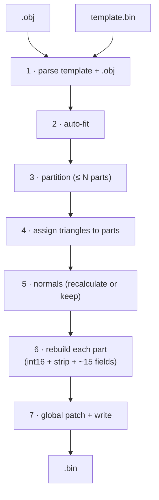
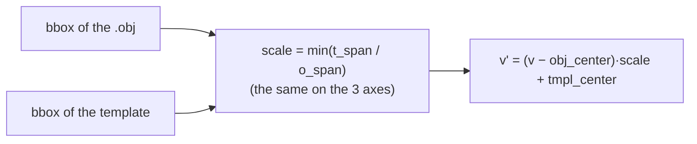
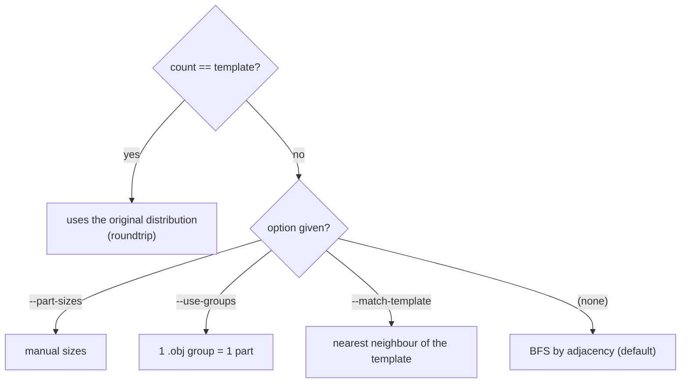
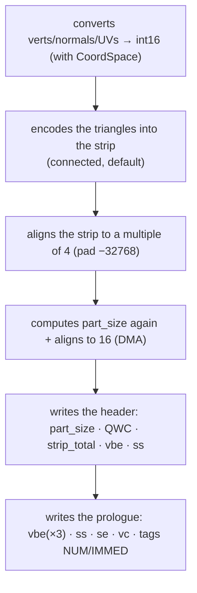
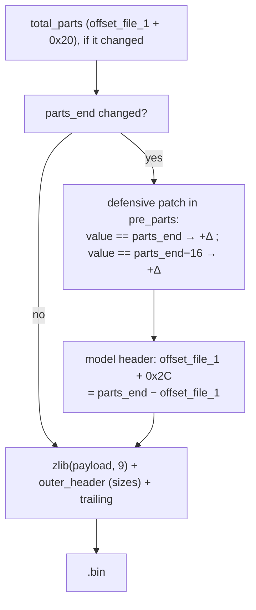
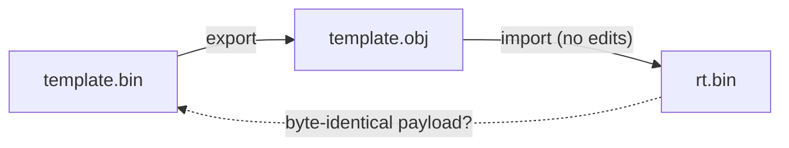

# 03 — Import pipeline

How the package turns an `.obj` into a PES PS2 `.bin`, phase by phase.



The main function is `shared/pipeline/importer._import`, driven by an
**AssetProfile** (face or trophy) — see [10 — Architecture](10-architecture.md).

---

## Phase 1 — Parsing the template and the OBJ

### Template (`bin_io.decompress_bin` + `model.parse_model`)

```python
payload, outer_header, trailing = decompress_bin(template_path)
template = parse_model(payload, model_offset)   # model_offset comes from profile.locate
```

The template is the **source of truth** for:

- The structure of the header and of the VIF prologue (we clone it with small
  updates).
- The texture bytes in `post_parts` (kept untouched).
- The bone bytes in "rich" templates (kept, we do not touch them).
- The bounding box / clipping matrix in the header floats.

### OBJ (`obj_io.parse_obj`)

```python
obj = parse_obj(obj_path)
# obj.vertices: List[(x, y, z) float]
# obj.uvs:      List[(u, v) float]
# obj.faces:    List[(a, b, c) 0-based]
# obj.face_groups + obj.group_names: for --use-groups
```

A minimal parser that accepts `v`, `vt`, `vn` (ignored — we compute them
again), `g`/`o` (groups) and `f`.

**Critical preconditions:**

- **1 UV per vertex.** The parser follows the `vt` index of each face corner:
  if the faces use different `v` and `vt` indices (Blender export, UV
  *seams*), each unique `(v, vt)` pair becomes a vertex — duplicated at the
  seams. `.obj` files that are already aligned (like the ones our export
  writes) are kept as they are. We only stop when the faces do **not**
  reference `vt` and the UV count is different from the vertex count; then we
  ask you to export the `.obj` again with UVs.
- **Faces with >3 vertices are fan-triangulated** automatically (the quad
  `f a b c d` → `(a,b,c)` + `(a,c,d)`). This works for convex polygons;
  concave ones must be triangulated in Blender first.

---

## Phase 2 — Auto-fit (`geometry.transform.auto_fit_vertices`)

`.obj` files from different sources come with an **arbitrary scale/position**.
Without a fix, the vertices end up outside the frustum → an invisible face, or
a giant/tiny one.



A **uniform scale (`min`)** keeps the face proportions — a per-axis scale
would distort the face. In most cases, **always use `--auto-fit`**.

---

## Phase 3 — Partition (`pipeline.partition.*`)

The `.obj` can have any number of vertices; each part needs ≤ 255. How do we
distribute them? Four strategies, in order of priority:



### Why vertices are duplicated at the *seams*

Triangles **cannot cross** the border between two parts (all 3 vertices must
be in the same part). When a triangle would sit on a border, the shared vertex
is **duplicated** in the neighbour part — same int16 position and UV, only the
index changes. No holes, and a small memory cost.

### Adding parts (`--max-verts-per-part`)

If the mesh is big, the BFS can go over 255 v/part. This option makes the
pipeline **create more parts** (cloning the last part of the template).
**Hard limit: 8 parts for faces** — above that, we stop
([Bug 12](06-bug-history.md#bug-12--more-than-8-parts--invisible-face)).
Trophies do not have this limit.

---

## Phase 4 — Assigning triangles (`partition.assign_triangles_to_parts`)

With the `[start_v, end_v)` ranges of each part, each triangle goes to the part
of its vertices and is turned into **local indices**. If the count matches the
template but the vertex **order** does not respect the borders (for example an
`.obj` from a QEM simplifier), we run an **automatic BFS** as a fallback.

---

## Phase 5 — Normals (`geometry.transform.compute_vertex_normals`)

With `--recalculate-normals` (recommended for new faces):

```
for each face (a,b,c):  n = cross(b−a, c−a)   # length ∝ area
   sum[a]+=n ; sum[b]+=n ; sum[c]+=n           # weighted by area
for each vertex v:      normalize(sum[v])
```

Without the option, the **template** normals are kept for the vertices in the
same position; new vertices use the fallback `(0,0,+1)`.

> ⚠ **[Bug 7](06-bug-history.md#bug-7--normal_scale-30-too-small):**
> `NORMAL_SCALE = 32767` (int16 max). Smaller values → wrong lighting.

---

## Phase 6 — Rebuilding each part (`model.rebuilder.rebuild_part`)

The heavy work: write the **~15 derived fields**
([full map](02-payload-anatomy.md#5-the-map-of-the-bytes-you-need-to-write))
and encode the new geometry.



### Strip: `connected` (default) or `list`

```python
# rebuild_part(..., strip_mode="connected")   # default since it was checked in the game
```

- **`connected`** (default): connected *triangle strips*, ~35% smaller. The
  mesh must be oriented first (flood-fill) — this is done automatically.
  Checked in the game.
- **`list`**: *triangle list* (3 indices per isolated triangle), robust and
  independent of the winding — the legacy format, with `--strip-mode list`.

Details and the reasons in [05 — Strip encoding](05-strip-encoding.md).

### Zero-diff passthrough (parts that were not edited)

Before encoding again, the pipeline checks if the part matches the template
**exactly** (`_part_is_faithful`: same vc, same int16 verts/UVs/normals, and
the same set of triangles). If it does, it **keeps the original strip** byte
by byte — this is the base of the [zero-diff roundtrip](#validation-roundtrip).
`--no-preserve-strips` turns this off and encodes everything again.

---

## Phase 7 — Global patch + write



The pointer patch is **defensive** (it scans `pre_parts` for any uint32 equal
to `parts_end` or `parts_end − 16`) — it catches the absolute pointers and
anything related. For trophies there is an extra patch of the section
directory (see [08 §4](08-trophies.md#4-resize-what-changes-when-the-obj-has-a-different-size)).
Then, for faces and trophies, the end of the parts **relative to the model**
(`offset_file_1 + 0x2C`) is written explicitly — the scan only caught it when
the model starts at `0x10`
([Bug 14](06-bug-history.md#bug-14--end-of-the-parts-relative-to-the-model)).

---

## Validation: roundtrip



There are **two levels** of roundtrip, and the difference matters:

| Case | Result |
|---|---|
| The `.obj` gives back the template **exactly** (not edited) | **zero-diff** — the passthrough keeps the original strip of every part; the **payload** of `rt.bin` is byte-identical to the one of `template.bin`. |
| The `.obj` has **edited** geometry (some vertices/triangles change) | only the changed parts are encoded again (`connected` strip); the **geometry** is kept, the **bytes** of the edited parts change. |

A practical test (export → import without edits → compare the payload):

```bash
python -m wepes3d export face.bin face.obj --type face
python -m wepes3d import face.bin face.obj rt.bin --type face
python -c "from wepes3d import decompress_bin as d; print(d('face.bin')[0] == d('rt.bin')[0])"
# True
```

> **What about the compressed `.bin`?** The import compresses again with
> Python's zlib (level 9). When it reproduces the compression of the original
> file, the `.bin` comes out identical and `cmp` passes — this is the case of
> the test trophy (`tests/seed/trophy.bin`). When it does not
> (`examples/face.bin`), only the compressed stream differs; the payload is the
> same. Details in [13 §4](13-face-byte-by-byte.md#4-roundtrip-what-identical-means-in-each-layer).

To check the **geometry** of an edited `.obj`, export `rt.bin` again and
compare the `v`/`vt`/`f` lines of the two `.obj` files (the top comment and the
`mtllib` line contain the file names, so they always differ).

---

## Next: the VU microcode

To understand why fields like `vbe` and `ss` are so critical:
[04 — VIF and VU1](04-vif-and-vu1.md).
