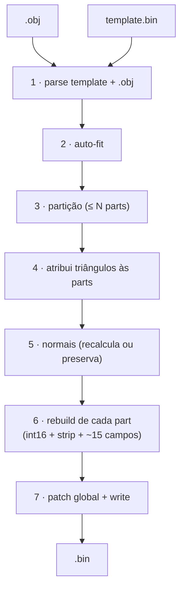
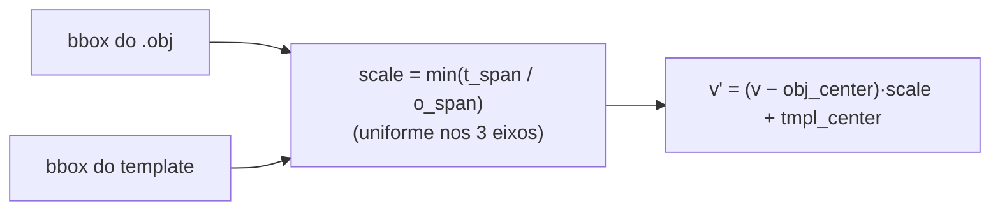
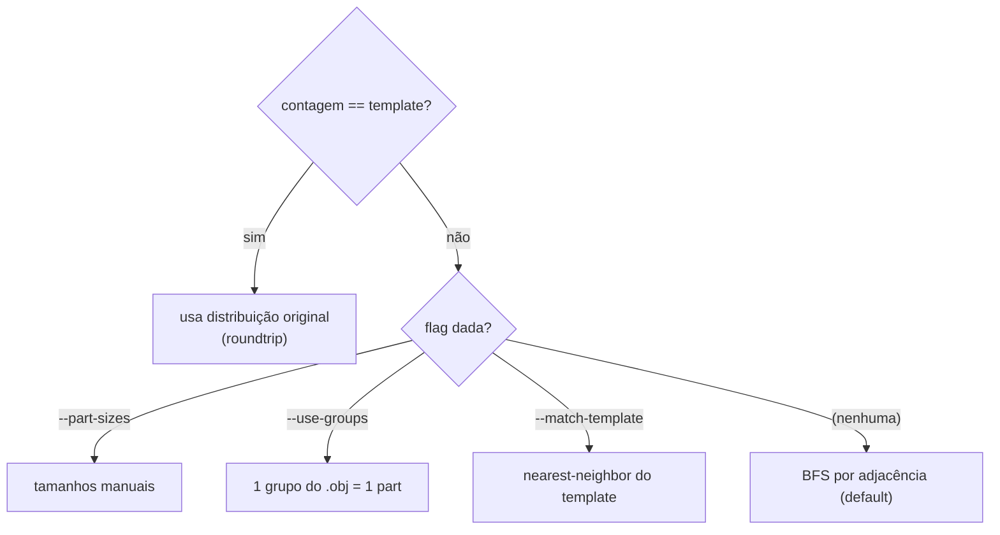
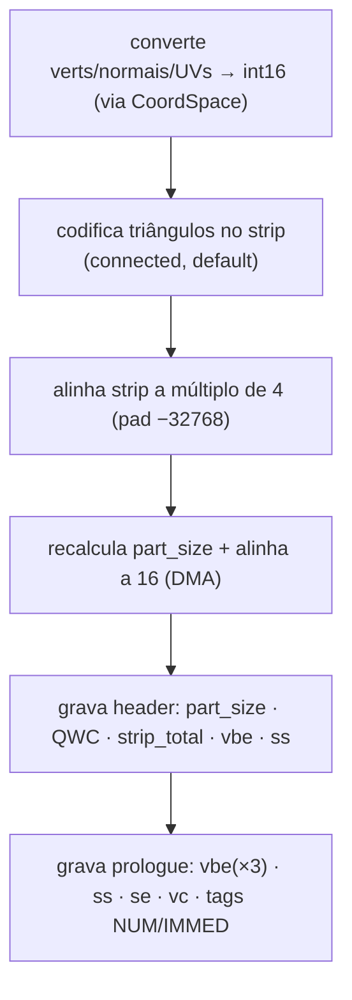
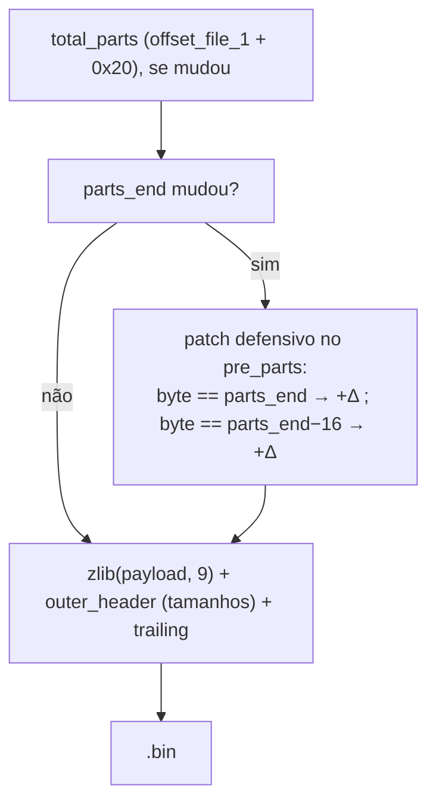
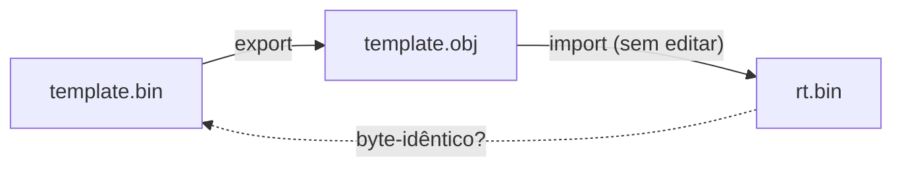

# 03 — Pipeline de importação

Como o pacote transforma um `.obj` em um `.bin` do PES PS2, fase por fase.



A função orquestradora é `shared/pipeline/importer._import`, parametrizada por um
**AssetProfile** (face ou troféu) — ver [11 — Arquitetura](11-arquitetura.md).

---

## Fase 1 — Parsing do template e do OBJ

### Template (`bin_io.decompress_bin` + `model.parse_model`)

```python
payload, outer_header, trailing = decompress_bin(template_path)
template = parse_model(payload, model_offset)   # model_offset vem do profile.locate
```

O template é a **fonte da verdade** para:

- Estrutura do header e do VIF prologue (clonamos com pequenas atualizações).
- Bytes de textura no `post_parts` (preservados intactos).
- Bytes de bones em templates "ricos" (preservados, não tocamos).
- Bounding box / clipping matrix nos floats do header.

### OBJ (`obj_io.parse_obj`)

```python
obj = parse_obj(obj_path)
# obj.vertices: List[(x, y, z) float]
# obj.uvs:      List[(u, v) float]
# obj.faces:    List[(a, b, c) 0-based]
# obj.face_groups + obj.group_names: para --use-groups
```

Parser minimalista que aceita `v`, `vt`, `vn` (ignoradas — recalculamos),
`g`/`o` (grupos) e `f`.

**Pré-condições críticas:**

- `len(vertices) == len(uvs)`. Se diferir, abortamos com mensagem clara sobre
  `Merge UVs by Distance` no Blender.
- **Faces com >3 vértices são trianguladas por leque** automaticamente (quad
  `f a b c d` → `(a,b,c)` + `(a,c,d)`). Funciona para polígonos convexos; côncavos
  devem ser triangulados no Blender antes.

---

## Fase 2 — Auto-fit (`geometry.transform.auto_fit_vertices`)

`.obj` de fontes diversas vem em **escala/posição arbitrária**. Sem ajuste, os
vértices caem fora do frustum → face invisível ou gigante/microscópica.



**Escala uniforme (`min`)** preserva as proporções faciais — escala por-eixo
distorceria o rosto. Para a maioria dos casos, **use sempre `--auto-fit`**.

---

## Fase 3 — Partição (`pipeline.partition.*`)

O `.obj` pode ter qualquer número de vértices; cada part precisa de ≤ 255. Como
distribuir? Quatro estratégias, em ordem de prioridade:



### Por que duplicar vértices nos *seams*

Triângulos **não podem cruzar** a fronteira de duas parts (todos os 3 vértices têm
de estar na mesma part). Quando um triângulo ficaria a cavalo, o vértice
compartilhado é **duplicado** na part vizinha — mesma posição int16 e UV, só o
índice muda. Sem buracos, custo pequeno de memória.

### Expansão de parts (`--max-verts-per-part`)

Se a malha é grande, o BFS pode estourar 255 v/part. Essa flag faz o pipeline
**criar mais parts** (clonando a última do template). **Limite hard: 8 parts em
faces** — acima disso, abortamos ([Bug 12](06-bugs-historicos.md#bug-12--mais-de-8-parts--face-invisível)). Troféus não têm esse limite.

---

## Fase 4 — Atribuição de triângulos (`partition.assign_triangles_to_parts`)

Com os ranges `[start_v, end_v)` por part, cada triângulo é atribuído à part dos
seus vértices e convertido para **índices locais**. Se a contagem bate com o
template mas a **ordem** dos vértices não respeita as fronteiras (caso de `.obj`
de simplifier QEM), aplicamos **BFS automático** como fallback.

---

## Fase 5 — Normais (`geometry.transform.compute_vertex_normals`)

Com `--recalculate-normals` (recomendado para faces novas):

```
para cada face (a,b,c):  n = cross(b−a, c−a)   # magnitude ∝ área
   sum[a]+=n ; sum[b]+=n ; sum[c]+=n            # pondera por área
para cada vértice v:     normalize(sum[v])
```

Sem a flag, as normais do **template** são preservadas para os vértices na mesma
posição; vértices novos usam fallback `(0,0,+1)`.

> ⚠ **[Bug 7](06-bugs-historicos.md#bug-7--normal_scale-30-menor-que-o-correto):** `NORMAL_SCALE = 32767` (int16 max). Valores menores → lighting errado.

---

## Fase 6 — Rebuild de cada part (`model.rebuilder.rebuild_part`)

O trabalho pesado: gravar os **~15 campos derivados** ([mapa completo](02-anatomia-payload.md#5-o-mapa-dos-bytes-que-você-precisa-gravar))
e codificar a geometria nova.



### Strip: `connected` (padrão) ou `list`

```python
# rebuild_part(..., strip_mode="connected")   # default desde a validação in-game
```

- **`connected`** (padrão): *triangle strips* conectados, ~35% menores. Exige
  orientar a malha (flood-fill) antes — feito automaticamente. Validado in-game.
- **`list`**: *triangle list* (3 índices/triângulo isolados), robusto e
  independente de winding — formato legado, via `--strip-mode list`.

Detalhes e o porquê em [05 — Strip encoding](05-strip-encoding.md).

### Passthrough zero-diff (parts não editadas)

Antes de recodificar, o pipeline checa se a part **reproduz exatamente** a do
template (`_part_is_faithful`: mesmos vc, verts/UVs/normais int16, e o mesmo
conjunto de triângulos). Se sim, **preserva o strip original** byte-a-byte — essa é
a base do [roundtrip zero-diff](#validação-roundtrip). `--no-preserve-strips`
desliga e recodifica tudo.

---

## Fase 7 — Patch global + write



O patch dos ponteiros é **defensivo** (varre o `pre_parts` procurando qualquer
uint32 que valha `parts_end` ou `parts_end − 16`) — pega ambos os ponteiros
conhecidos e qualquer outro relacionado. Para troféus, há um patch adicional do
diretório de seções (ver [08 §4](08-trofeus.md)).

---

## Validação: roundtrip



Há **dois níveis** de roundtrip, e a diferença é importante:

| Cenário | Resultado |
|---|---|
| `.obj` reproduz **exatamente** o template (não editado) | **zero-diff** — o passthrough preserva o strip original; `rt.bin` é byte-idêntico a `template.bin`. |
| `.obj` com geometria **editada** (alguns vértices/triângulos mudam) | só as parts alteradas são recodificadas (strip `connected`); a **geometria** é preservada, os **bytes** das parts editadas mudam. |

Teste prático (export → import sem editar → comparar):

```bash
python -m wepes3d export face.bin face.obj --type face
python -m wepes3d import face.bin face.obj rt.bin --type face
cmp face.bin rt.bin && echo "zero-diff ✓"
```

```python
# valida que a GEOMETRIA sobrevive (mesmo quando os bytes mudam):
from wepes3d import export_face
export_face("rt.bin", "rt.obj")
# compare rt.obj com face.obj — vértices/UVs/faces iguais
```

---

## Próximo: VU microcode

Para entender por que campos como `vbe` e `ss` são tão críticos:
[04 — VIF e VU1](04-vu-microcode.md).
