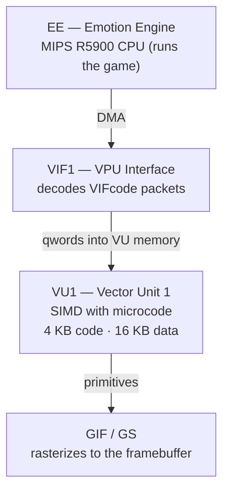

# 04 — The PS2 VIF and VU1: what the microcode does

Why the `.bin` has all these VIFcodes, and why fields like `vbe`, `ss` and
`STCYCL` are critical. This is the **most technical** document of the series —
read it if you want to understand the format in depth or if you are debugging
"unknown vifcmd" crashes.

---

## 1. PS2 graphics architecture



How a face gets drawn:

1. The EE runs `DMASTART` pointing to the `.bin` payload in RAM.
2. The DMA channel sends the bytes to the VIF1.
3. The **VIF1 decodes the VIFcodes**: STCYCL, STMOD, STMASK, UNPACKs.
4. The UNPACKs **write data into the VU1 data memory**.
5. The VU1 microcode reads the data, applies transformations and sends
   primitives to the GS.

**The `.bin` is a stream that goes STRAIGHT to the VIF1.** It is not a
"neutral" mesh like a glTF — it is a package already formatted for the PS2
hardware pipeline.

---

## 2. Anatomy of a VIFcode

Each VIFcode has 4 bytes (1 qword = 4 VIFcodes):

```
byte[0..1] = IMMED   (16-bit immediate, depends on CMD)
byte[2]    = NUM     (8-bit; number of elements in the following DMA data)
byte[3]    = bit 7 = I flag (interrupt) · bits 0..6 = CMD
```

### CMDs that matter for PES PS2

| CMD | Name | Function |
|---|---|---|
| `0x00` | NOP | fills empty slots |
| `0x01` | STCYCL | sets cl, wl (UNPACK cycle) |
| `0x05` | STMOD | 0=normal, 1=ADD, 2=ROW |
| `0x20` | STMASK | 32-bit mask for the next UNPACK |
| `0x60..0x7F` | UNPACK | sends data to VU memory |

### UNPACK formats (bits 0..3 of CMD)

| CMD | Format | Bytes/element |
|---|---|---|
| `0x60` | S-32 | 4 |
| `0x65` | V2-16 | 4 |
| `0x69` | V3-16 | 6 |
| `0x68` | V3-32 | 12 |
| `0x6C` | V4-32 | 16 |
| `0x6D` | V4-16 | 8 |

Bit 4 (`+0x10`) of CMD = **M flag** (mask): it uses the STMASK register to
decide which lanes of the qword are written.

### UNPACK IMMED

- bits 0..9 = `ADDR` (address in VU memory, in qwords)
- bit 14 (`0x4000`) = `USN` (unsigned)
- bit 15 (`0x8000`) = `FLG` (offset relative to TOPS)

In our format: vertices `0x8004`, normals `0x8005`, UVs `0x8007` (constant!)
and strip `0xC000 | (4×vc + 8)` (changes with `vc`).

---

## 3. STCYCL: the secret of the interleaved layout


`STCYCL CL=4 WL=1` (at `prologue[0x10C]`) makes each V3-16/V2-16 element use 4
slots in VU memory — 1 with data, 3 skipped. The microcode expects vertices,
normals and UVs **interleaved** in blocks of 4 qwords:

```
qw[4 + 4n + 0] = vertex n   ← UNPACK IMMED 0x8004
qw[4 + 4n + 1] = normal n   ← IMMED 0x8005
qw[4 + 4n + 2] = (skip)
qw[4 + 4n + 3] = uv     n   ← IMMED 0x8007
```

**Consequence:** the IMMEDs of the normals and UVs do **NOT** change with
`vc` — only `NUM` does. Assuming a sequential layout was
[Bug 5](06-bug-history.md#bug-5--wrong-immed-for-normalsuvs).

---

## 4. The microcode (inferred) and the 3 critical parameters

We do not have the microcode binary, but the structure of the `.bin` shows
what it does:

```
1. reads the parameters from the prologue:
     vbe = 4*vc + 4    ; vertex_block_end
     ss  = 4*vc + 8    ; strip_start
     se  = ss + sn     ; strip_end
2. for n = 0..vc-1:
     outputs (transform(vertex[n]), uv[n])  using normal[n]
3. for i = ss..se-1:
     decodes the strip and sends triangles to the GS
```

| Parameter | Formula | If it is wrong… |
|---|---|---|
| `vbe` | `4*vc + 4` | reads "ghost" vertices or stops too early |
| `ss` | `4*vc + 8` | reads the strip from the wrong address → exploded geometry |
| `se` | `ss + sn` | "float overflow" crash or missing triangles |

> **[Bug 10](06-bug-history.md#bug-10--copies-of-vbe-and-ss-in-the-part-header-not-updated):**
> `vbe` and `ss` appear THREE times (prologue `0xC2`/`0xC8` **and** header
> `0x2C`/`0x30`). In `face.bin` (vc=87 everywhere) they look fixed; in
> `face_X.bin` (different vc values) they change. Forgetting
> `header[0x2C]`/`[0x30]` → invisible face **in the game** (but visible in
> editors that ignore the microcode).

---

## 5. Hardware limits that become format limits

| Hardware limit | Format limit |
|---|---|
| `NUM` is a uint8 | **255 vertices/part**; 255 V4-16 elements in the strip |
| `IMMED ADDR` has 10 bits (1023 qwords) | `4*vc + 8 ≤ 1023` → `vc ≤ 253` |
| VU data memory = 16 KB = 1024 qwords | matches the ADDR limit |
| DMA moves multiples of 16 B | `part_size % 16 == 0` (hence the final pad) |

---

## 6. Backface culling and winding

The GS has back-face culling, controlled by the `PRIM` register. In PES PS2 it
is on: triangles with the opposite winding are **dropped** (invisible).

**Key fact (checked in the game): the GS flips the winding automatically in
strips**, one triangle after the other, like PC GPUs do. The original
`face.bin` strips decode with an alternating winding and still draw perfectly;
a `.bin` with our connected strips was later confirmed in PCSX2. (An old
version of these docs said the opposite.) The full story and the evidence are
in [05 — Strip encoding §3](05-strip-encoding.md#3-winding-in-strips-the-point-that-cost-the-most).

What this means in practice:
- **`strip_mode=connected`** (default) relies on this: it orients the mesh
  coherently and chains tristrips — the GS handles the alternation. Strips
  are ~35% smaller.
- The `.bin` coordinate system flips X (`ix = round(x/f × −1)`), which would
  flip **all** triangles; that is why the encoder applies a base winding flip.
  That was [Bug 8](06-bug-history.md#bug-8--reversed-triangle-winding).

---

## 7. Frustum culling: bbox in the part header

The 12 floats of `128.0` at `header[0x60..0x8C]` probably form a 3×4 bounding
box matrix, read by the engine for frustum culling. **We keep it from the
template**; `--auto-fit` makes sure the new geometry fits inside it.

---

## 8. Why all this complexity?

The PS2 had a lot of raw SIMD power in the VU, but limited RAM (32 MB) and a
critical DMA bandwidth. The `.bin` is optimized for that: zlib compression (it
fits on the DVD), a DMA-friendly format (it goes straight to the VIF, with no
CPU parsing), a tuned VU microcode (skinning + projection in parallel) and
connected strips (fewer bytes). It is "old", but the design is elegant.

---

## Next: triangle encoding

[05 — Strip encoding](05-strip-encoding.md): how triangles become int16
indices, the 3 cases of the decoder, and why `connected` is the default.
