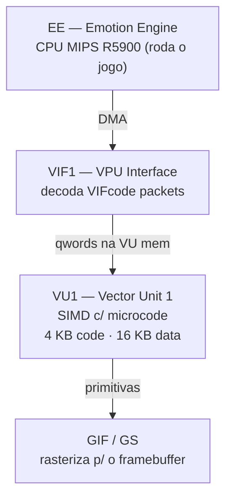
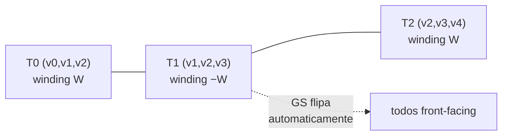

# 04 — VIF e VU1 do PS2: o que o microcode faz

Por que o `.bin` tem todos esses VIFcodes e por que campos como `vbe`, `ss`,
`STCYCL` são críticos. Este é o documento **mais técnico** da série — leia se quer
entender em profundidade ou está debugando crashes "unknown vifcmd".

---

## 1. Arquitetura gráfica do PS2



O fluxo de uma face renderizada:

1. EE faz `DMASTART` apontando para o payload do `.bin` na RAM.
2. O canal DMA transfere os bytes para o VIF1.
3. O **VIF1 decoda VIFcodes**: STCYCL, STMOD, STMASK, UNPACKs.
4. Os UNPACKs **escrevem dados na VU1 data memory**.
5. O microcode da VU1 lê os dados, aplica transformações e emite primitivas ao GS.

**O `.bin` é um stream que vai DIRETO para o VIF1.** Não é uma malha "neutra" como
um glTF — é um pacote pré-formatado para a pipeline de hardware do PS2.

---

## 2. Anatomia de um VIFcode

Cada VIFcode tem 4 bytes (1 qword = 4 VIFcodes):

```
byte[0..1] = IMMED   (16-bit immediate, depende do CMD)
byte[2]    = NUM     (8-bit; quantidade de elementos no DMA seguinte)
byte[3]    = bit 7 = I flag (interrupt) · bits 0..6 = CMD
```

### CMDs relevantes para PES PS2

| CMD | Nome | Função |
|---|---|---|
| `0x00` | NOP | preenche slots vazios |
| `0x01` | STCYCL | configura cl, wl (ciclo de UNPACK) |
| `0x05` | STMOD | 0=normal, 1=ADD, 2=ROW |
| `0x20` | STMASK | 32 bits de mask para o próximo UNPACK |
| `0x60..0x7F` | UNPACK | transfere dados para a VU mem |

### Formatos de UNPACK (bits 0..3 do CMD)

| CMD | Formato | Bytes/elemento |
|---|---|---|
| `0x60` | S-32 | 4 |
| `0x65` | V2-16 | 4 |
| `0x69` | V3-16 | 6 |
| `0x68` | V3-32 | 12 |
| `0x6C` | V4-32 | 16 |
| `0x6D` | V4-16 | 8 |

O bit 4 (`+0x10`) do CMD = **M flag** (mask): usa o STMASK register para decidir
quais lanes do qword serão escritas.

### IMMED do UNPACK

- bits 0..9 = `ADDR` (endereço na VU memory, em qwords)
- bit 14 (`0x4000`) = `USN` (unsigned)
- bit 15 (`0x8000`) = `FLG` (offset relativo a TOPS)

No nosso formato: vértices `0x8004`, normais `0x8005`, UVs `0x8007` (constantes!) e
strip `0xC000 | (4×vc + 8)` (varia com `vc`).

---

## 3. STCYCL: o segredo do layout interleaved


`STCYCL CL=4 WL=1` (em `prologue[0x10C]`) faz cada elemento V3-16/V2-16 ocupar 4
slots na VU memory — 1 com dado, 3 de skip. O microcode assume vértices, normais e
UVs **interleaved** em blocos de 4 qwords:

```
qw[4 + 4n + 0] = vértice n   ← UNPACK IMMED 0x8004
qw[4 + 4n + 1] = normal  n   ← IMMED 0x8005
qw[4 + 4n + 2] = (skip)
qw[4 + 4n + 3] = uv      n   ← IMMED 0x8007
```

**Consequência:** os IMMEDs de normais e UVs **NÃO mudam** com `vc` — só o `NUM`.
Assumir layout sequencial foi o [Bug 5](06-bugs-historicos.md#bug-5--immed-de-normaisuvs-alterado-erradamente).

---

## 4. O microcode (inferido) e os 3 parâmetros críticos

Não temos o binário do microcode, mas a estrutura do `.bin` revela o que ele faz:

```
1. lê parâmetros do prologue:
     vbe = 4*vc + 4    ; vertex_block_end
     ss  = 4*vc + 8    ; strip_start
     se  = ss + sn     ; strip_end
2. para n = 0..vc-1:
     emite (transform(vertice[n]), uv[n])  usando normal[n]
3. para i = ss..se-1:
     decodifica o strip e dispara triângulos para o GS
```

| Parâmetro | Fórmula | Se estiver errado… |
|---|---|---|
| `vbe` | `4*vc + 4` | lê vértices "fantasmas" ou para cedo |
| `ss` | `4*vc + 8` | lê o strip de endereço errado → geometria explodida |
| `se` | `ss + sn` | crash "float overflow" ou triângulos faltando |

> **[Bug 10](06-bugs-historicos.md#bug-10--cópias-de-vbe-e-ss-no-header-da-part-não-atualizadas):** `vbe` e `ss` aparecem TRÊS vezes (prologue `0xC2`/`0xC8` **e**
> header `0x2C`/`0x30`). Em `face.bin` (vc=87 constante) parecem fixos; em
> `face_X.bin` (vc variável) eles variam. Esquecer `header[0x2C]`/`[0x30]` → face
> invisível **no jogo** (mas visível em editores que ignoram o microcode).

---

## 5. Restrições do hardware que viram restrições do formato

| Restrição do HW | Limite no formato |
|---|---|
| `NUM` é uint8 | **255 vértices/part**; 255 elementos V4-16 no strip |
| `IMMED ADDR` tem 10 bits (1023 qwords) | `4*vc + 8 ≤ 1023` → `vc ≤ 253` |
| VU data memory = 16 KB = 1024 qwords | bate com o limite de ADDR |
| DMA transfere múltiplos de 16 B | `part_size % 16 == 0` (daí o pad final) |

---

## 6. Backface culling e winding (revisado — o GS **faz** flip)

O GS tem back-face culling controlado pelo registrador `PRIM`. No PES PS2, está
ligado: triângulos com winding inverso ao esperado são **descartados** (invisíveis).

> 🔬 **Correção baseada em dados (validada in-game).** Uma versão antiga deste
> documento afirmava que "a VU1/GS **não** faz flip automático de winding em
> strips". **Isso é falso.** Decodificando o strip do `face.bin` original *sem*
> flip, o winding sai **alternado** (`+−+−`) e só ~51% dos triângulos ficariam
> front-facing — mas o `face.bin` renderiza perfeitamente no jogo. Logo o GS
> (primitiva `triangle_strip`) **alterna o winding a cada triângulo**, como as GPUs
> de PC. Confirmado depois carregando no PCSX2 um `.bin` com strips conectados.



**Implicação prática:**
- **`strip_mode=connected`** (padrão) usa essa propriedade: orienta a malha
  coerentemente e encadeia tristrips — o GS resolve a alternância. Strips ~35%
  menores. Ver [05](05-strip-encoding.md).
- O sistema de coordenadas do `.bin` inverte X (`ix = round(x/f × −1)`), o que
  inverteria **todos** os triângulos; por isso o encoder aplica um flip de winding
  base. Foi o [Bug 8](06-bugs-historicos.md#bug-8--winding-dos-triângulos-invertido).

---

## 7. Frustum culling: bbox no header da part

Os 12 floats de `128.0` em `header[0x60..0x8C]` formam uma matriz 3×4 de bounding
box (provável), lida pelo engine para frustum culling. **Preservamos do template**;
`--auto-fit` garante que a geometria nova cabe dentro dele.

---

## 8. Por que essa complexidade toda?

O PS2 tinha muito poder bruto SIMD na VU, mas RAM limitada (32 MB) e bandwidth de
DMA crítico. O `.bin` é otimizado para esse contexto: compressão zlib (cabe no
DVD), formato DMA-friendly (vai direto pro VIF, sem parsing na CPU), microcode VU
afinado (skinning + projeção em paralelo) e strips conectados (menos bytes). É
"antigo", mas o design é elegante.

---

## Próximo: encoding de triângulos

[05 — Strip encoding](05-strip-encoding.md): como os triângulos viram índices
int16, os 3 casos do decoder, e por que `connected` é o padrão.
