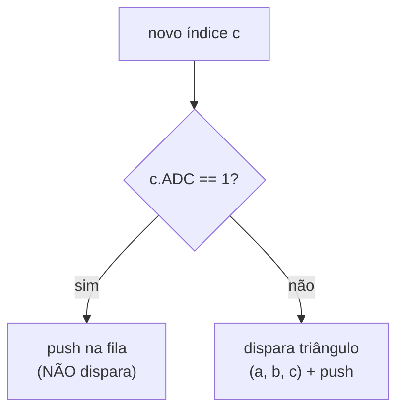
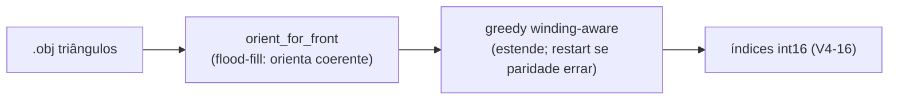

# 05 — Encoding do triangle strip

Como triângulos são codificados como uma sequência de índices `int16`, e por que o
padrão é *triangle strip* **conectado** (com *triangle list* disponível como modo
legado).

---

## 1. O formato bruto

O strip data é uma sequência de **int16** (little-endian). Cada índice:

```
 15  14                              0
┌───┬─────────────────────────────────┐
│ADC│  (vertex_local + 1) × 4         │
└───┴─────────────────────────────────┘
```

- **Bit 15 = ADC** (Address Don't Connect / restart): se 1, o vértice entra na fila
  **sem** disparar triângulo.
- **Bits 0..14**: o índice do vértice local, codificado como `(idx + 1) × 4`.

### Por que `(idx + 1) × 4`?

- O **`+1`** evita o valor 0 (sentinela/padding).
- O **`×4`** alinha com o **stride do layout interleaved** na VU (cada vértice
  ocupa 4 qwords — ver [04 §3](04-vu-microcode.md)).

---

## 2. O decoder da VU1: janela deslizante de 3

O microcode mantém uma janela de 3 índices `[a, b, c]`. A cada novo índice, decide:



Há 3 padrões ("casos"):

| Caso | Índices | Ação |
|---|---|---|
| **1** `[neg, neg, pos]` | 2 restarts + 1 | dispara 1 triângulo `(v0,v1,v2)` — strip isolado |
| **2** `[neg, pos, pos]` | 1 restart no meio | transição entre strips conectados |
| **3** `[pos, pos, pos]` | continuação | cada novo índice dispara 1 triângulo com os 2 anteriores |

### Eficiência

- **Strip conectado**: ~N+2 índices para N triângulos.
- **Triangle list (caso 1 puro)**: 3N índices para N triângulos.

Strip economiza ~3× em bytes.

---

## 3. O winding em strips (o ponto que custou caro)

Para um triângulo `(a,b,c)`, o **winding** (ordem horária/anti-horária) decide se o
back-face culling o mantém ou descarta. Em *triangle strips*, o winding **alterna**
naturalmente a cada triângulo:


> 🔬 **Fato validado in-game.** O GS do PS2 (primitiva `triangle_strip`) **flipa o
> winding automaticamente** a cada triângulo, como as GPUs de PC. Prova: o
> `face.bin` original, decodificado *sem* flip, tem winding alternado (só ~51%
> front-facing) e mesmo assim renderiza perfeito — só funciona se o GS flipa.
> Confirmado depois no PCSX2 com um `.bin` de strips conectados (ver [04 §6](04-vu-microcode.md#6-backface-culling-e-winding-revisado--o-gs-faz-flip)).

### Então por que um strip ingênuo produz buracos?

Não é o hardware. São dois motivos reais:

1. **A malha de entrada não é coerentemente orientada.** `.obj` da comunidade tem
   só **18–32%** das arestas internas com winding consistente. Tristrip só encadeia
   em malha coerente.
2. **Um greedy ingênuo ignora a paridade.** Estender o strip sem checar se a
   posição (par/ímpar) bate com o winding desejado quebra a alternância.

**A peça que faltava:** *orientar a malha (flood-fill) ANTES de stripificar* e
*encerrar o strip (restart) quando a paridade daria winding errado*.

---

## 4. Modo padrão: `connected` (strips conectados)



Implementado em `shared/model/strip_connected.py` (orientação + encoder) e acionado
pelo `rebuild_part(strip_mode="connected")` (default). **Geometria preservada e
winding correto por construção** (verificado por `verify()`).

### Resultado medido (897 triângulos, 8 parts)

| | índices | redução |
|---|---|---|
| triangle list | 2692 | — |
| **tristrip conectado** | **1736** | **−35,5%** |

Média ~2,2 triângulos/strip — baixa porque malhas low-poly decimadas + partição em
ilhas fragmentam a conectividade. O ganho no `.bin` final é modesto (~2–5% após
zlib, pois o strip é ~13% do payload), mas é o formato **nativo** do jogo.

---

## 5. Modo legado: `list` (triangle list)

Cada triângulo é seu próprio segmento isolado (caso 1 puro):

```python
# shared/model/strip.triangles_to_pes_strip
Triangulo (a, b, c)  →  [neg(a), neg(c), pos(b)]   # flip de winding (a,b,c)→(a,c,b)

def encode_neg(v): return ((v + 1) * 4 | 0x8000) - 0x10000   # int16 negativo
def encode_pos(v): return  (v + 1) * 4                       # int16 positivo
```

O flip `(a,b,c)→(a,c,b)` compensa a inversão de X dos vértices ([Bug 8](06-bugs-historicos.md#bug-8--winding-dos-triângulos-invertido)).

**Vantagens:** robusto (independe da orientação da malha), correção garantida sem
suposições. **Custo:** 3 índices/triângulo → `strip_NUM = ceil(3N/4)` → limite
**~340 triângulos/part** (`strip_NUM ≤ 255`).

Use com `--strip-mode list`:

```bash
python -m wepes3d import face.bin meu.obj list.bin \
    --allow-recount --recalculate-normals --auto-fit --strip-mode list
```

> Compare os dois no emulador: gere `strip.bin` (default connected) e `list.bin`
> (`--strip-mode list`) do mesmo `.obj` — geometria idêntica, só o strip difere.

---

## 6. Padding e preservação de tamanho

### Alinhamento V4-16

Cada elemento V4-16 = 4 índices = 8 bytes. O total de índices deve ser múltiplo de
4; pad com `-32768` (`0x8000` = só bit ADC → no-op seguro):

```python
def align_strip_to_v4(indices):
    rem = len(indices) % 4
    return indices if rem == 0 else indices + [-32768] * (4 - rem)
```

### Preservação de `part_size` (roundtrip)

Quando `vc` não muda, o strip é paddeado com `-32768` até o tamanho do template,
mantendo `part_size` idêntico — assim os ponteiros absolutos do `pre_parts` nem
precisam de patch. É a base do [zero-diff](03-pipeline.md#validação-roundtrip)
junto com o passthrough.

---

## 7. Apêndice: auditar o encoding

`shared/model/strip.decode_strip` replica o decoder oficial — útil para conferir:

```python
from wepes3d.shared.model.strip import (
    triangles_to_pes_strip, align_strip_to_v4, decode_strip,
)

original = [(0, 1, 2), (0, 2, 3), (1, 4, 5)]
encoded  = align_strip_to_v4(triangles_to_pes_strip(original))
decoded  = decode_strip(encoded, vc=10)
print(decoded)   # [(0, 2, 1), (0, 3, 2), (1, 5, 4)]  ← com flip de winding
```

O flip é intencional: após o X-flip implícito no rendering, o winding final é o
desejado.

---

## Próximo: bugs históricos

[06 — Bugs históricos](06-bugs-historicos.md): como cada bug do encoding foi
descoberto e diagnosticado.
