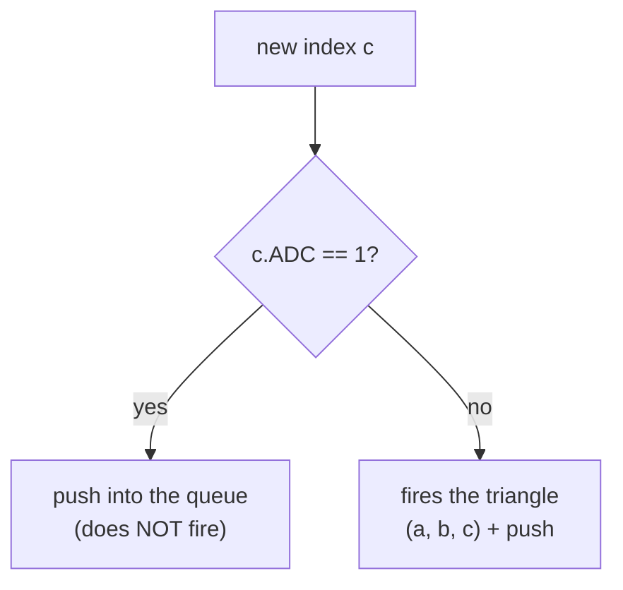
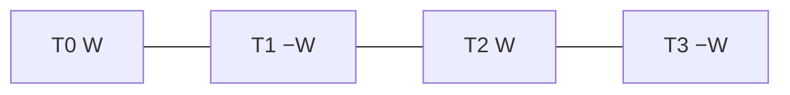
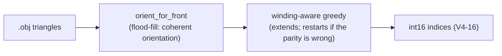

# 05 — Triangle strip encoding

How triangles are encoded as a sequence of `int16` indices, and why the
default is the **connected** *triangle strip* (with the *triangle list* still
available as a legacy mode).

---

## 1. The raw format

The strip data is a sequence of **int16** values (little-endian). Each index:

```
 15  14                              0
┌───┬─────────────────────────────────┐
│ADC│  (vertex_local + 1) × 4         │
└───┴─────────────────────────────────┘
```

- **Bit 15 = ADC** (Address Don't Connect / restart): if it is 1, the vertex
  enters the queue **without** firing a triangle.
- **Bits 0..14**: the local vertex index, encoded as `(idx + 1) × 4`.

### Why `(idx + 1) × 4`?

- The **`+1`** avoids the value 0 (sentinel/padding).
- The **`×4`** matches the **stride of the interleaved layout** in the VU (each
  vertex uses 4 qwords — see [04 §3](04-vif-and-vu1.md#3-stcycl-the-secret-of-the-interleaved-layout)).

---

## 2. The VU1 decoder: a sliding window of 3

The microcode keeps a window of 3 indices `[a, b, c]`. For each new index it
decides:



There are 3 patterns ("cases"):

| Case | Indices | Action |
|---|---|---|
| **1** `[neg, neg, pos]` | 2 restarts + 1 | fires 1 triangle `(v0,v1,v2)` — an isolated strip |
| **2** `[neg, pos, pos]` | 1 restart in the middle | transition between connected strips |
| **3** `[pos, pos, pos]` | continuation | each new index fires 1 triangle with the 2 previous ones |

### Efficiency

- **Connected strip**: ~N+2 indices for N triangles.
- **Triangle list (pure case 1)**: 3N indices for N triangles.

A strip saves ~3× in bytes.

---

## 3. Winding in strips (the point that cost the most)

For a triangle `(a,b,c)`, the **winding** (clockwise/counter-clockwise order)
decides if back-face culling keeps it or drops it. In *triangle strips*, the
winding naturally **alternates** from one triangle to the next:



> 🔬 **Fact checked in the game.** The PS2 GS (`triangle_strip` primitive)
> **flips the winding automatically** for each triangle, like PC GPUs. Proof:
> the original `face.bin`, decoded *without* a flip, has an alternating
> winding (only ~51% of the triangles face forward) and still draws perfectly
> — that only works if the GS flips. This was later confirmed in PCSX2 with a
> `.bin` made of our connected strips. (An old version of these docs said the
> GS does **not** flip; that was wrong.)

### So why does a naive strip create holes?

It is not the hardware. There are two real reasons:

1. **The input mesh is not coherently oriented.** Community `.obj` files have
   only **18–32%** of the inner edges with a consistent winding. A tristrip can
   only keep going on a coherent mesh.
2. **A naive greedy algorithm ignores parity.** Extending the strip without
   checking if the position (even/odd) matches the wanted winding breaks the
   alternation.

**The missing piece:** *orient the mesh (flood-fill) BEFORE making the strips*
and *end the strip (restart) when the parity would give the wrong winding*.

---

## 4. Default mode: `connected` (connected strips)



Implemented in `shared/model/strip_connected.py` (orientation + encoder) and
used by `rebuild_part(strip_mode="connected")` (the default). **Geometry kept
and correct winding by construction** (checked by `verify()`).

### Measured result (897 triangles, 8 parts)

| | indices | reduction |
|---|---|---|
| triangle list | 2692 | — |
| **connected tristrip** | **1736** | **−35.5%** |

About 2.2 triangles per strip on average — low, because decimated low-poly
meshes and the split into islands break the connectivity. The gain in the
final `.bin` is small (~2–5% after zlib, since the strip is ~13% of the
payload), but it is the game's **native** format.

---

## 5. Legacy mode: `list` (triangle list)

Each triangle is its own isolated segment (pure case 1):

```python
# shared/model/strip.triangles_to_pes_strip
Triangle (a, b, c)  →  [neg(a), neg(c), pos(b)]   # winding flip (a,b,c)→(a,c,b)

def encode_neg(v): return ((v + 1) * 4 | 0x8000) - 0x10000   # negative int16
def encode_pos(v): return  (v + 1) * 4                       # positive int16
```

The `(a,b,c)→(a,c,b)` flip compensates for the X flip of the vertices
([Bug 8](06-bug-history.md#bug-8--reversed-triangle-winding)).

**Advantages:** robust (it does not depend on the mesh orientation), correct
with no assumptions. **Cost:** 3 indices/triangle → `strip_NUM = ceil(3N/4)` →
limit of **~340 triangles/part** (`strip_NUM ≤ 255`).

Use it with `--strip-mode list`:

```bash
python -m wepes3d import face.bin my.obj list.bin \
    --allow-recount --recalculate-normals --auto-fit --strip-mode list
```

> Compare both in the emulator: create `strip.bin` (default, connected) and
> `list.bin` (`--strip-mode list`) from the same `.obj` — the geometry is
> identical, only the strip differs.

---

## 6. Padding and keeping the size

### V4-16 alignment

Each V4-16 element = 4 indices = 8 bytes. The total number of indices must be
a multiple of 4; the padding is `-32768` (`0x8000` = only the ADC bit → a safe
no-op):

```python
def align_strip_to_v4(indices):
    rem = len(indices) % 4
    return indices if rem == 0 else indices + [-32768] * (4 - rem)
```

### Keeping `part_size` (roundtrip)

When `vc` does not change, the strip is padded with `-32768` up to the
template size, so `part_size` stays the same — then the absolute pointers in
`pre_parts` do not even need a patch. Together with the passthrough, this is
the base of the [zero-diff roundtrip](03-import-pipeline.md#validation-roundtrip).

---

## 7. Appendix: checking the encoding

`shared/model/strip.decode_strip` copies the official decoder — useful to
check things:

```python
from wepes3d.shared.model.strip import (
    triangles_to_pes_strip, align_strip_to_v4, decode_strip,
)

original = [(0, 1, 2), (0, 2, 3), (1, 4, 5)]
encoded  = align_strip_to_v4(triangles_to_pes_strip(original))
decoded  = decode_strip(encoded, vc=10)
print(decoded)   # [(0, 2, 1), (0, 3, 2), (1, 5, 4)]  ← with the winding flip
```

The flip is on purpose: after the implicit X flip at render time, the final
winding is the one we want.

---

## Next: bug history

[06 — Bug history](06-bug-history.md): how each bug of the format was found
and diagnosed.
