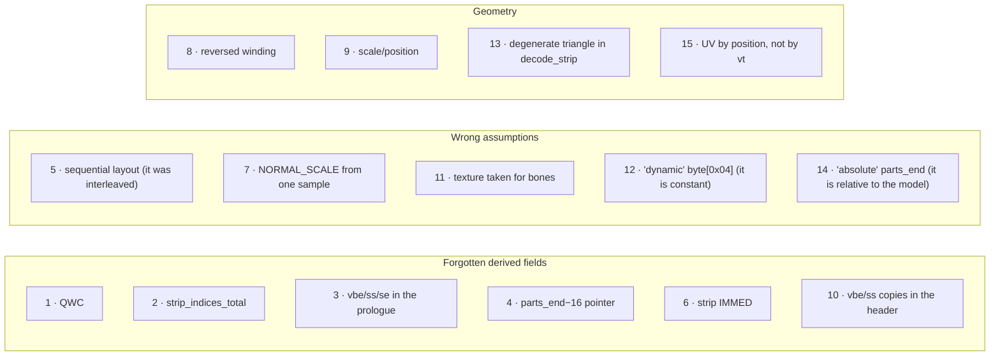
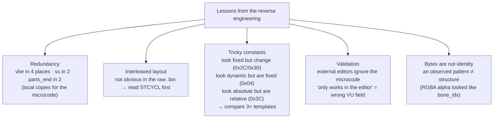

# 06 — Bug history

Fifteen bugs found and fixed during the reverse engineering of the format (the
last three during the review before publishing the project). Each one tells a
story: the **symptom**, the **investigation** that led to the diagnosis, and
the **fix**. This is the most valuable part to understand **why** the code is
the way it is — and how to approach new bugs.



---

## Bug 1 — QWC not updated

**Symptom:** the DMA stopped in the middle of the part / "DMA chain overrun"
in the PCSX2 logs. **Diagnosis:** `header[0x0C]` is the **QWC** (Quadword
Count) of the DMA chain — derived from `part_size`, not copied from the
template. **Fix:** `header[0x0C] = (part_size − 0xB0)/16`. **Lesson:** many
fields are **derived**; updating the "main" one is not enough.

## Bug 2 — `strip_indices_total` not updated

**Symptom:** "Vertex Trace: float overflow" crash / missing triangles.
**Diagnosis:** `header[0x10]` = total number of **indices** in the strip
(`strip_NUM × 4`), read by the microcode as a loop count. **Fix:**
`header[0x10] = strip_NUM × 4`.

## Bug 3 — VU parameters in the prologue out of date

**Symptom:** "float overflow", but only when `vc` changed. **Diagnosis:** the
prologue has **5 uint16** values that depend on `vc`/`sn` (`0xC2`, `0xC8`,
`0xCA`, `0xF6`, `0xF8`) — with **3 copies** of `vbe`. **Fix:** compute the 5
again in `rebuild_part`. **Lesson:** **redundancy** is the rule — local copies
avoid branches in the microcode.

## Bug 4 — Second parts_end pointer not updated

**Symptom:** after the parts changed size, community editors crashed when
opening the `.bin` (even though the game loaded it). **Diagnosis:**
`pre_parts` has `payload[0x0C] = parts_end` (updated) **and**
`payload[0x3C] = parts_end − 16` (forgotten). The two always change together.
**Fix:** a defensive search in `pre_parts`:

```python
for off in range(0, pre_parts_size, 4):
    val = uint32_at(off)
    if val == orig_parts_end:        write_uint32(off, new_parts_end)
    elif val == orig_parts_end - 16: write_uint32(off, new_parts_end - 16)
```

> **Revision ([Bug 14](#bug-14--end-of-the-parts-relative-to-the-model)):**
> `0x3C` is not "`parts_end − 16`": it is the end of the parts **relative to
> the model** (`offset_file_1 + 0x2C`). It only equals `−16` because
> `face.bin` has its model at `0x10`.

## Bug 5 — Wrong IMMED for normals/UVs

**Symptom:** "unknown vifcmd" crash when `vc != 87`. **Diagnosis:** the script
assumed a **sequential layout** and remapped the IMMED of the normals as
`0x8000 + 4 + vc`. Comparing `face.bin` (vc=87) with `face_X.bin`
(vc=16/60/109/…), the IMMED is **always `0x8005`** — the layout is
**interleaved** (each element = 4 qwords, see
[04 §3](04-vif-and-vu1.md#3-stcycl-the-secret-of-the-interleaved-layout)).
**Fix:** keep the IMMEDs constant and update only `NUM`. **Lesson:** check a
layout guess with **several** templates.

## Bug 6 — Strip tag IMMED not updated with `vc`

**Symptom:** the strip loaded at the wrong address → triangles with vertices
from other parts. **Diagnosis:** the strip tag has
`IMMED = 0xC000 | (4×vc + 8)`; unlike the vertices/normals/UVs, it **changes**
with `vc` (the strip comes after the interleaved block). **Fix:** update the
tag in `rebuild_part`.

## Bug 7 — `NORMAL_SCALE` 30× too small

**Symptom:** wrong lighting / face invisible from some cameras.
**Diagnosis:** the script used `1108` (measured from **one** normal). Checking
the 696 normals of `face.bin`: all of them have length `32767 ± 1` (= int16
max). **Fix:** `NORMAL_SCALE = 32767`. **Lesson:** reverse engineering from a
single sample is dangerous.

## Bug 8 — Reversed triangle winding

**Symptom:** a completely invisible face (correct geometry and headers).
**Diagnosis:** the `.bin` flips X (`ix = round(x/f × −1)`), which reverses the
winding of **all** triangles → all of them face backwards → all of them are
culled. **Fix:** an intentional winding flip in the encoder
`(a,b,c) → (a,c,b)`. See [05](05-strip-encoding.md).

## Bug 9 — OBJ position/scale out of range

**Symptom:** invisible face in the editor + wrong proportions in the game
(Blender OBJs with the default scale). **Diagnosis:** the OBJ bbox was outside
the template frustum. **Fix:** the `--auto-fit` option (uniform scale +
translation). See [03 §2](03-import-pipeline.md#phase-2--auto-fit-geometrytransformauto_fit_vertices).

## Bug 10 — Copies of `vbe` and `ss` in the part header not updated

**Symptom:** the face works in **community editors** but is **invisible in the
game**. **Diagnosis:** the key question was *"why does it work in the editor
but not in the game?"* — editors read the geometry directly and ignore the
microcode; the game goes through VIF→VU. Comparing the headers of `face.bin`
(vc=87) and `face_1.bin` (vc=16 in P0, vc=109 in P3):

| Offset | face.bin P0 | face_1 P0 (vc=16) | face_1 P3 (vc=109) |
|---|---|---|---|
| `0x2C` | 352 | 68 | 440 |
| `0x30` | 356 | 72 | 444 |

`352 = 4×87+4`; `68 = 4×16+4`; `440 = 4×109+4` → **`header[0x2C] = vbe`!**
(and `0x30 = ss`). They are copies of the prologue values, read in another
stage of the microcode. In `face.bin` (constant vc) they **looked constant**.
**Fix:** update `header[0x2C]` and `[0x30]`. Confirmed in the game by the
user: the face appeared. **Lesson:** values that look constant in one
template may change in another.

## Bug 11 — `rebuild_bone_weights` corrupted the texture

**Symptom:** corrupted texture after "rebuilding bone weights".
**Diagnosis:** the old function assumed the bones were at `post_parts[0x80..]`
(4-byte entries, with a "constant" byte[3]=`0x80`). Comparing with `h2.bin`,
byte[3] changed (0x39, 0x32, 0x6a…) with no pattern. **Conclusion:** this area
is **TEXTURE** — the `0x80` was the **alpha** channel of RGBA pixels (by
chance). The real bones live in **pre_parts** (8-byte entries). **Fix:** the
function was removed. **Lesson:** bytes are not identity — context matters.

## Bug 12 — More than 8 parts → invisible face

**Symptom:** `--max-verts-per-part 87` on a big `.obj` created 13 parts →
invisible in the game (visible in editors). **Diagnosis:** comparing
`byte[0x04]` in several examples:

| File | total_parts | `byte[0x04]` |
|---|---|---|
| face | 8 | 8 |
| h2 | **4** | 8 |
| h4 | **5** | 8 |
| face_X | 6 | 8 |

`byte[0x04] = 8` in **ALL** of them, whatever `total_parts` is → it is a
**constant** (fixed buffer size), not a dynamic value. **Fix:** stop if the
expansion would need > 8 parts, with an explanation. **Lesson:** check with 3+
examples before you change a "discovered" field.

## Bug 13 — Degenerate triangle in `decode_strip`

**Symptom:** importing an exported `.obj` again, **without edits**, re-encoded
untouched parts (2 of 8 in `face.bin`, 2 of 14 in the test trophy): the
payload grew and the roundtrip was not zero-diff. **Diagnosis:** the
passthrough compares the `.obj` triangles with the ones of the original strip,
decoded by `decode_strip` — but the `.obj` comes from the export reader
(`read_part_geometry`), and the two disagreed on **1 triangle per part**.
`decode_strip` tested `a != b` on the still **encoded** indices; `neg(v)` and
`pos(v)` only differ in their sign, so a degenerate triangle passed (in
`face.bin`, one that only uses vertices 31 and 72) — the export reader drops
it. **Fix:** require the 3 **decoded** indices to be different. The roundtrip
payload is now byte-identical (and the `.bin` of the test trophy is
`cmp`-identical). **Lesson:** two decoders of the same format must agree —
test one against the other on real files.

## Bug 14 — End of the parts relative to the model

**Symptom:** the same as [Bug 4](#bug-4--second-parts_end-pointer-not-updated)
(community editors may not open the `.bin`), but only in templates whose model
is **not at `0x10`** — trophies and faces like `h2`/`face_1` — so it went
unnoticed with `face.bin`. Found while checking a re-imported trophy: after
the recount of `sec0`, `sec0 + 0x2C` still had the template value (`0x9160`;
it should be `0x7D90`). **Diagnosis:** in 55 real models (faces with the model
at `0x10` and at `0x20`, the 9 sections of 4 trophies, kits and stadiums),
`model + 0x2C == parts_end − model_offset` in **all** of them: it is the end of
the parts relative to the model, the sibling of `parts_start_rel` at `+0x24`.
The "`parts_end − 16`" of Bug 4 only worked because `face.bin` has its model
at `0x10`; with the model at `0x20` the defensive search did not find it, and
for trophies it did not even look at the model header. **Fix:** write
`offset_file_1 + 0x2C = parts_end − offset_file_1` explicitly in the import
(faces and trophies), after the pointer patch. **Lesson:** an "absolute −
constant" value may be a **relative** value — test with the structure at
another offset.

## Bug 15 — `.obj` UVs taken by position, not by `vt`

**Symptom:** mixed-up textures on meshes exported from Blender, **with no
error at all** — it was enough for the `.obj` to have the same number of `v`
and `vt`. **Diagnosis:** `parse_obj` only read the vertex index of each face
corner and assumed that the UV of vertex `i` was `vt` number `i`. That is true
for the `.obj` of our export (always `f i/i`), but Blender writes `v` and `vt`
in its own orders: in a real export, 3262 of 3264 corners had different
indices. With different counts (seams), the import stopped and asked for
`Merge UVs by Distance` — which does not fix the order. **Fix:** `parse_obj`
follows the `vt` of each corner and creates 1 vertex per unique `(v, vt)`
pair (duplicated at seams); `.obj` files that are already aligned are kept as
they are. The same logic writes the result to disk with
`convert_obj_to_vertex_uv`. **Lesson:** checking **counts** does not check
**correspondence**.

---

## Patterns across the bugs (general lessons)



1. **Redundant derived fields** — the same value copied in 2–4 places, each
   one read by a different stage. Suspect *any* uint32 of the header.
2. **The interleaved layout** is not obvious in the raw `.bin` — read `STCYCL`
   (0x10C) first.
3. **Tricky constants** — only by comparing 3+ templates (ideally with the
   structure at different offsets) can you tell what is derived, what is
   fixed and what is relative.
4. **External editors do not check the microcode** — "works in the editor,
   fails in the game" points to a field read by the VU (parameters, IMMEDs,
   bbox).
5. **Bytes are not identity** — an observed pattern can be a coincidence
   (Bug 11).

---

## Next: debugging guide

[07 — Debugging guide](07-debugging-guide.md): "if you see X, start by looking
at Y".
