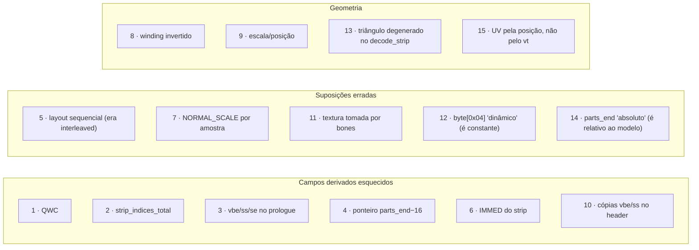
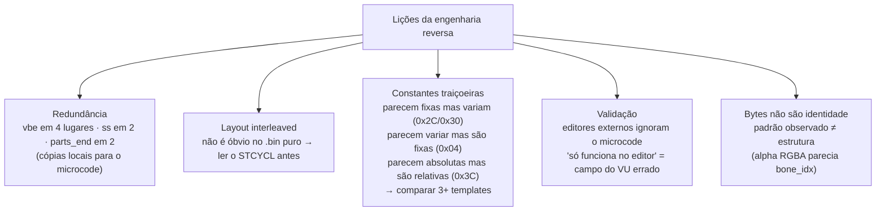

# 06 — Histórico de bugs

Quinze bugs encontrados e resolvidos durante a engenharia reversa do formato (os três
últimos na revisão para publicar o projeto). Cada um conta uma história: o
**sintoma**, a **investigação** que levou ao diagnóstico, e o **fix**. É a parte mais
valiosa para entender **por que** o código é como é — e como abordar bugs novos.



---

## Bug 1 — QWC não atualizado

**Sintoma:** DMA truncava no meio da part / "DMA chain overrun" nos logs do PCSX2.
**Diagnóstico:** `header[0x0C]` é o **QWC** (Quadword Count) da DMA chain — derivado
de `part_size`, não copiado do template. **Fix:** `header[0x0C] = (part_size − 0xB0)/16`.
**Lição:** muitos campos são **derivados**; atualizar o "principal" não basta.

## Bug 2 — `strip_indices_total` não atualizado

**Sintoma:** crash "Vertex Trace: float overflow" / triângulos faltando.
**Diagnóstico:** `header[0x10]` = total de **índices** no strip (`strip_NUM × 4`),
lido pelo microcode como loop count. **Fix:** `header[0x10] = strip_NUM × 4`.

## Bug 3 — Parâmetros do VU no prologue desatualizados

**Sintoma:** "float overflow", mas só quando `vc` mudava. **Diagnóstico:** o prologue
tem **5 uint16** dependentes de `vc`/`sn` (`0xC2`, `0xC8`, `0xCA`, `0xF6`, `0xF8`) —
com **3 cópias** de `vbe`. **Fix:** recalcular os 5 em `rebuild_part`. **Lição:**
**redundância** é a regra — cópias locais evitam branches no microcode.

## Bug 4 — Segundo ponteiro `parts_end − 16` não atualizado

**Sintoma:** após mudar tamanho das parts, editores da comunidade crashavam ao abrir
o `.bin` (embora o jogo carregasse). **Diagnóstico:** o `pre_parts` tem `payload[0x0C]
= parts_end` (atualizado) **e** `payload[0x3C] = parts_end − 16` (esquecido). Os dois
sempre mudam juntos. **Fix:** busca defensiva no `pre_parts`:

```python
for off in range(0, pre_parts_size, 4):
    val = uint32_at(off)
    if val == orig_parts_end:        write_uint32(off, new_parts_end)
    elif val == orig_parts_end - 16: write_uint32(off, new_parts_end - 16)
```

> **Revisão ([Bug 14](#bug-14--fim-das-parts-relativo-ao-modelo)):** o `0x3C` não é
> "`parts_end − 16`": é o fim das parts **relativo ao modelo**
> (`offset_file_1 + 0x2C`). Só coincide com `−16` porque o `face.bin` tem o modelo
> em `0x10`.

## Bug 5 — IMMED de normais/UVs alterado erradamente

**Sintoma:** crash "unknown vifcmd" quando `vc != 87`. **Diagnóstico:** o script
assumia **layout sequencial** e re-mapeava o IMMED das normais como `0x8000 + 4 + vc`.
Comparando `face.bin` (vc=87) com `face_X.bin` (vc=16/60/109/…), o IMMED é **constante
`0x8005`** — o layout é **interleaved** (cada elemento = 4 qwords, ver [04 §3](04-vu-microcode.md)).
**Fix:** manter IMMEDs constantes, atualizar só o `NUM`. **Lição:** validar inferência
de layout com **vários** templates.

## Bug 6 — IMMED do strip tag não atualizado com `vc`

**Sintoma:** strip carregado em endereço errado → triângulos com vértices de outras
parts. **Diagnóstico:** a tag do strip tem `IMMED = 0xC000 | (4×vc + 8)`; diferente
dos vértices/normais/UVs, **varia** com `vc` (o strip vem depois do bloco
interleaved). **Fix:** atualizar a tag em `rebuild_part`.

## Bug 7 — `NORMAL_SCALE` 30× menor que o correto

**Sintoma:** iluminação errada / face invisível em algumas câmeras. **Diagnóstico:**
o script usava `1108` (medido de **uma** normal). Validando as 696 normais de
`face.bin`: todas têm magnitude `32767 ± 1` (= int16 max). **Fix:** `NORMAL_SCALE =
32767`. **Lição:** engenharia reversa por amostra única é perigosa.

## Bug 8 — Winding dos triângulos invertido

**Sintoma:** face completamente invisível (geometria e headers corretos).
**Diagnóstico:** o `.bin` inverte X (`ix = round(x/f × −1)`), o que inverte o winding
de **todos** os triângulos → todos back-facing → todos culled. **Fix:** flip de
winding intencional no encoder `(a,b,c) → (a,c,b)`. Ver [05](05-strip-encoding.md).

## Bug 9 — Posição/escala do OBJ fora do esperado

**Sintoma:** face invisível no editor + desproporcional no jogo (OBJs do Blender em
escala default). **Diagnóstico:** bbox do OBJ fora do frustum do template. **Fix:**
flag `--auto-fit` (escala uniforme + translação). Ver [03 §2](03-pipeline.md#fase-2--auto-fit).

## Bug 10 — Cópias de `vbe` e `ss` no header da part não atualizadas

**Sintoma:** face funciona em **editores da comunidade** mas fica **invisível no
jogo**. **Diagnóstico:** o fio do meio foi *"por que funciona no editor mas não no
jogo?"* — editores lêem geometria direto e ignoram o microcode; o jogo passa pelo
VIF→VU. Comparando headers de `face.bin` (vc=87) e `face_1.bin` (vc=16 P0, vc=109 P3):

| Offset | face.bin P0 | face_1 P0 (vc=16) | face_1 P3 (vc=109) |
|---|---|---|---|
| `0x2C` | 352 | 68 | 440 |
| `0x30` | 356 | 72 | 444 |

`352 = 4×87+4`; `68 = 4×16+4`; `440 = 4×109+4` → **`header[0x2C] = vbe`!** (idem
`0x30 = ss`). São cópias do prologue, lidas em outra etapa do microcode. Em
`face.bin` (vc constante) **pareciam constantes**. **Fix:** atualizar `header[0x2C]` e
`[0x30]`. Confirmado in-game pelo usuário: a face apareceu. **Lição:** constantes que
parecem constantes em um template podem ser variáveis em outro.

## Bug 11 — `rebuild_bone_weights` corrompia textura

**Sintoma:** textura corrompida após "regenerar bone weights". **Diagnóstico:** a
função antiga assumia bones em `post_parts[0x80..]` (entries de 4 B, byte[3]=`0x80`
"constante"). Comparando com `h2.bin`, byte[3] variava (0x39, 0x32, 0x6a…) sem
padrão. **Conclusão:** essa área é **TEXTURA** — o `0x80` era o canal **alpha** de
pixels RGBA (coincidência). Bones de verdade ficam no **pre_parts** (entries de 8 B).
**Fix:** removida a função. **Lição:** bytes não são identidade — contexto importa.

## Bug 12 — Mais de 8 parts → face invisível

**Sintoma:** `--max-verts-per-part 87` num `.obj` grande gerou 13 parts → invisível
no jogo (visível em editores). **Diagnóstico:** comparando `byte[0x04]` em vários
exemplos:

| Arquivo | total_parts | `byte[0x04]` |
|---|---|---|
| face | 8 | 8 |
| h2 | **4** | 8 |
| h4 | **5** | 8 |
| face_X | 6 | 8 |

`byte[0x04] = 8` em **TODOS**, independente de `total_parts` → é **constante**
(capacidade fixa do buffer), não dinâmico. **Fix:** abortar se a expansão exigiria
> 8 parts, com mensagem explicativa. **Lição:** valide com 3+ exemplos antes de
mexer num campo "descoberto".

## Bug 13 — Triângulo degenerado no `decode_strip`

**Sintoma:** reimportar um `.obj` exportado, **sem editar**, recodificava parts
intactas (2 de 8 no `face.bin`, 2 de 14 no troféu de teste): o payload crescia e o
roundtrip não dava zero-diff. **Diagnóstico:** o passthrough compara os triângulos
do `.obj` com os do strip original decodificado pelo `decode_strip` — mas o `.obj`
vem do leitor do export (`read_part_geometry`), e os dois discordavam em **1
triângulo por part**. O `decode_strip` testava `a != b` nos índices ainda
**codificados**; `neg(v)` e `pos(v)` diferem só no sinal, então passava um triângulo
degenerado (no `face.bin`, só com os vértices 31 e 72) que o leitor do export
descarta. **Fix:** exigir os 3 índices **decodificados** distintos. O payload do
roundtrip agora sai byte-idêntico (e o `.bin` do troféu de teste, `cmp`-idêntico).
**Lição:** dois decoders do mesmo formato precisam concordar — confronte um com o
outro nos arquivos reais.

## Bug 14 — Fim das parts relativo ao modelo

**Sintoma:** o do [Bug 4](#bug-4--segundo-ponteiro-parts_end---16-não-atualizado)
(editores da comunidade podem não abrir o `.bin`), mas só em templates com o modelo
**fora de `0x10`** — troféus e faces como `h2`/`face_1` — por isso passava batido com
o `face.bin`. Achado auditando um troféu reimportado: após o recount da `sec0`,
`sec0 + 0x2C` seguia com o valor do template (`0x9160`; devia ser `0x7D90`).
**Diagnóstico:** em 55 modelos reais (faces com o modelo em `0x10` e em `0x20`, as 9
seções de 4 troféus, kits e estádios), `modelo + 0x2C == parts_end − offset_do_modelo`
em **todos**: é o fim das parts relativo ao modelo, irmão do `parts_start_rel` em
`+0x24`. O "`parts_end − 16`" do Bug 4 só valia porque o `face.bin` tem o modelo em
`0x10`; com o modelo em `0x20` a busca defensiva não o achava, e no troféu ela nem
olhava o model header. **Fix:** gravar `offset_file_1 + 0x2C = parts_end −
offset_file_1` explicitamente no import (face e troféu), depois do patch dos
ponteiros. **Lição:** um valor "absoluto − constante" pode ser um valor **relativo** —
teste com a estrutura em outro offset.

## Bug 15 — UV do `.obj` pela posição, não pelo `vt`

**Sintoma:** textura embaralhada em malhas exportadas do Blender, **sem nenhum erro**
— bastava o `.obj` ter o mesmo número de `v` e `vt`. **Diagnóstico:** o `parse_obj`
lia só o índice do vértice de cada canto da face e assumia que o UV do vértice `i`
era o `vt` `i`. Isso vale para o `.obj` do export (sempre `f i/i`), mas o Blender
grava `v` e `vt` em ordens próprias: num export real, 3262 de 3264 cantos tinham
índices diferentes. Com contagens diferentes (seams), o import abortava pedindo
`Merge UVs by Distance` — o que não resolve a ordem. **Fix:** o `parse_obj` segue o
`vt` de cada canto e cria 1 vértice por par `(v, vt)` único (duplicado nos seams);
`.obj` já alinhados passam intactos. A mesma lógica grava o resultado em disco via
`convert_obj_to_vertex_uv`. **Lição:** validar **contagens** não valida
**correspondência**.

---

## Padrões transversais (lições gerais)



1. **Redundância de campos derivados** — o mesmo valor copiado em 2–4 lugares,
   cada um lido por uma etapa. Suspeite de *qualquer* uint32 do header.
2. **Layout interleaved** não é óbvio no `.bin` puro — leia o `STCYCL` (0x10C).
3. **Constantes traiçoeiras** — só comparando 3+ templates (de preferência com a
   estrutura em offsets diferentes) dá para saber o que é derivado, o que é fixo e
   o que é relativo.
4. **Editores externos não validam o microcode** — "funciona no editor, falha no
   jogo" aponta para um campo lido pelo VU (params, IMMEDs, bbox).
5. **Bytes não são identidade** — padrão observado pode ser coincidência (Bug 11).

---

## Próximo: guia de debugging

[07 — Guia de debugging](07-debugging-guide.md): "se você vê X, comece investigando Y".
