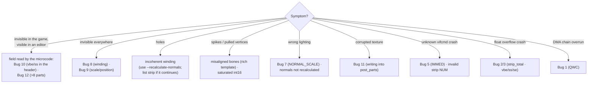
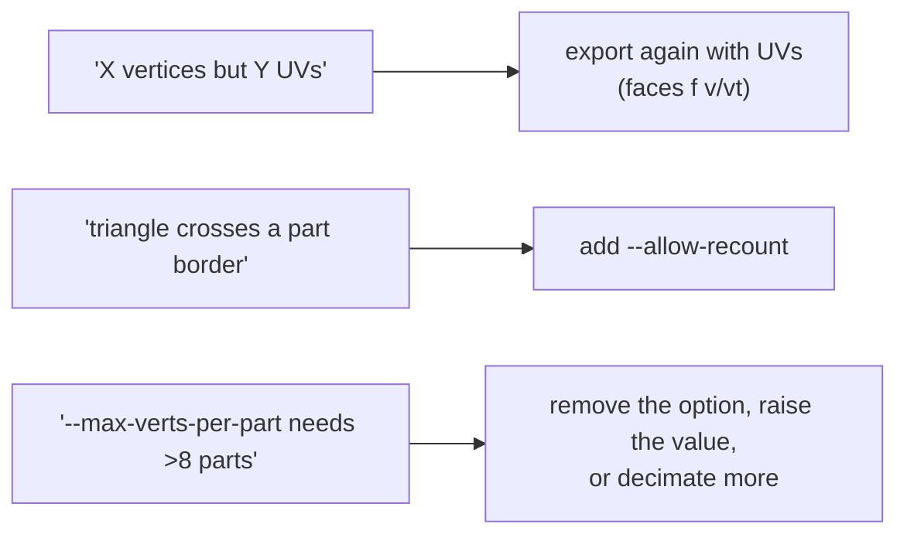

# 07 — Debugging guide

A practical manual: if you see **X** in the game or in the editor, start by
looking at **Y**.



---

## Symptoms → causes table

| Symptom | Likely causes (in order) |
|---|---|
| Face **invisible in the game**, visible in an editor | Bug 10 (vbe/ss copies); Bug 12 (>8 parts) |
| Face **invisible everywhere** | Bug 8 (winding); Bug 9 (scale/position) |
| Face with **holes** | mesh with an incoherent winding; try `--recalculate-normals`, or `--strip-mode list` |
| Face with **spikes** | misaligned bones (rich templates); saturated int16 |
| Face with **wrong proportions** | Bug 9 (`--auto-fit` missing) |
| **Strange lighting** | Bug 7 (NORMAL_SCALE); normals not recalculated |
| **Corrupted texture** | Bug 11 (wrong writes into post_parts) |
| **"unknown vifcmd"** crash | Bug 5 (wrong IMMED); strip with an invalid NUM |
| **"Vertex Trace: float overflow"** crash | Bug 2 (strip_indices_total); Bug 3 (vbe/ss/se) |
| **DMA chain overrun** | Bug 1 (wrong QWC) |
| A community editor does not open the `.bin` | Bug 4 / Bug 14 (end of the parts in the model header, `offset_file_1 + 0x2C`) |
| **Mixed-up texture** on a mesh from Blender | Bug 15 (UVs taken by vertex position — fixed; update the package) |

Each bug is described in detail in [06 — Bug history](06-bug-history.md).

---

## Diagnosis steps

### 1. Check the roundtrip first

If the pipeline is healthy, exporting and importing again **without edits**
must give a zero-diff **payload** (the passthrough keeps the strip — see
[03 §Validation](03-import-pipeline.md#validation-roundtrip)):

```bash
python -m wepes3d export face.bin face.obj --type face
python -m wepes3d import face.bin face.obj rt.bin --type face
python -c "from wepes3d import decompress_bin as d; print(d('face.bin')[0] == d('rt.bin')[0])"
# True = the pipeline is healthy
```

The `import` log must show **every** part as `IDENTICAL to the template`. If a
roundtrip without edits is **not** zero-diff, something is wrong in the
parser/encoder — investigate that before you touch your mesh. (Comparing the
`.bin` with `cmp` is not a valid test: the zlib stream may differ even when the
payload is identical.)

### 2. Read the `import` output

The key lines of the log:

```
[2/7] Loading .obj file: my.obj
      Vertices: 1094, UVs: 1094, Faces (triangles): 2033   ← does it match your .obj?
      Uniform scale: 0.5987 (sx=..., sy=..., sz=...)       ← a very low scale = a giant OBJ
[3/7] Calculating vertex distribution across parts...
      Vertices: 1094 -> 1303 (+209 duplicated at seams)    ← many duplicates = a fragmented mesh
[6/7] Converting and rebuilding parts...
      Part 0: 87 -> 147 v, size ..., 254 tris               ← 147<255 and 254<340: there is room
```

### 3. Check the generated `.bin` (with the package only)

```python
# audit.py — uses only this package, nothing external
import sys, struct
from wepes3d import decompress_bin

payload, _, _ = decompress_bin(sys.argv[1])
of1         = struct.unpack_from("<I", payload, 8)[0]
byte_04     = struct.unpack_from("<I", payload, 4)[0]
total_parts = struct.unpack_from("<I", payload, of1 + 0x20)[0]
parts_end   = struct.unpack_from("<I", payload, 0x0C)[0]
end_rel     = struct.unpack_from("<I", payload, of1 + 0x2C)[0]

print(f"byte[0x04]   = {byte_04}        (expected: 8)")
print(f"total_parts  = {total_parts}    (expected: <= 8 for a face)")
print(f"parts_end    = 0x{parts_end:X}")
print(f"model+0x2C   = 0x{end_rel:X}    (expected: parts_end - offset_file_1 = 0x{parts_end-of1:X})")

assert byte_04 == 8,               "byte[0x04] changed → the face will be invisible!"
assert end_rel == parts_end - of1, "end of the parts in the model header is out of date (Bug 4/14)!"
print("OK ✓")
```

This audit is for **faces** (for a trophy, `payload[8]` points to the container,
not to the model).

### 4. Compare with a good example

Take a `.bin` that works in the game and compare `pre_parts` field by field
(use `decompress_bin` on both). Differences outside the expected fields
(`parts_end`, `total_parts`, `offset_file_1 + 0x2C`) are suspicious.

---

## Common mistakes when making the `.obj` in Blender



- **"the .obj has X vertices but Y UVs"** → the faces do not reference `vt`
  (`f 1 2 3`) and the UV count is different from the vertex count. Export
  again **with UVs**; if the faces reference `vt`, seams are handled
  automatically (the vertex is duplicated). To save vertices: `Select All` →
  `UV → Merge UVs by Distance` (threshold ~0.0001).
- **"Triangle X crosses a part border"** → add `--allow-recount` (the
  automatic partition takes care of the borders).
- **"--max-verts-per-part X needs Y parts, but the maximum is 8"** → remove the
  option (it distributes into 8 automatically), raise the value, or
  **decimate** the mesh.

---

## Advanced diagnosis: GS dump in PCSX2


This is the deepest level: you see exactly where the face "disappears" in the
graphics pipeline (which VIFcode failed, which triangles were culled).

---

## When you ask for help

Include: **the full command**, **the full output** of the `import`, **the
first 256 bytes of the payload** (the audit snippet above), a **screenshot** of
the problem and, if possible, **the `.obj`**. Most new bugs are variations of
the ones in [06 — Bug history](06-bug-history.md).
