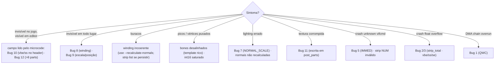
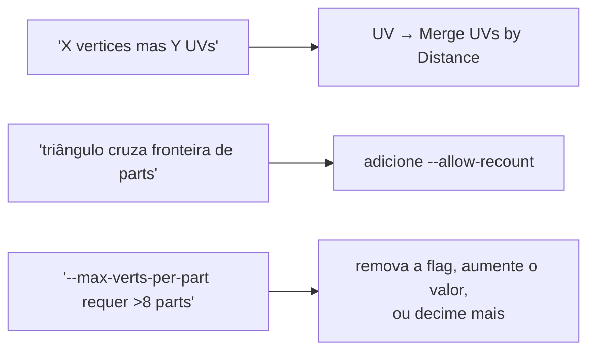
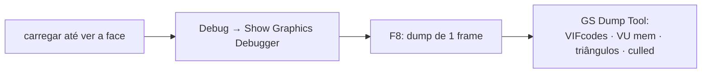

# 07 — Guia de debugging

Manual prático: se você vê **X** no jogo ou no editor, comece investigando **Y**.



---

## Tabela de sintomas → causas

| Sintoma | Causas prováveis (em ordem) |
|---|---|
| Face **invisível no jogo**, visível em editor | Bug 10 (cópias vbe/ss); Bug 12 (>8 parts) |
| Face **invisível em todo lugar** | Bug 8 (winding); Bug 9 (escala/posição) |
| Face com **buracos** | malha com winding incoerente; tente `--recalculate-normals`, ou `--strip-mode list` |
| Face com **picos** | bones desalinhados (templates ricos); int16 saturado |
| Face **desproporcional** | Bug 9 (faltou `--auto-fit`) |
| **Lighting estranho** | Bug 7 (NORMAL_SCALE); normais não recalculadas |
| **Textura corrompida** | Bug 11 (escrita indevida em post_parts) |
| Crash **"unknown vifcmd"** | Bug 5 (IMMED errado); strip com NUM inválido |
| Crash **"Vertex Trace: float overflow"** | Bug 2 (strip_indices_total); Bug 3 (vbe/ss/se) |
| **DMA chain overrun** | Bug 1 (QWC errado) |
| Editor da comunidade não abre o `.bin` | Bug 4 (ponteiro `parts_end − 16`) |

Cada bug está detalhado em [06 — Bugs históricos](06-bugs-historicos.md).

---

## Roteiro de diagnóstico

### 1. Confirme o roundtrip primeiro

Se o pipeline está íntegro, exportar e reimportar **sem editar** deve dar zero-diff
(o passthrough preserva o strip — ver [03 §Validação](03-pipeline.md#validação-roundtrip)):

```bash
python -m wepes3d export face.bin face.obj --type face
python -m wepes3d import face.bin face.obj rt.bin --type face
cmp face.bin rt.bin && echo "zero-diff ✓ (pipeline íntegro)"
```

Se **não** der zero-diff num roundtrip sem edição, há algo errado no parser/encoder —
investigue antes de mexer na sua malha.

### 2. Leia o output do `import`

Os pontos críticos do log:

```
[2/7] Lendo .obj: meu.obj
      Vertices: 1094, UVs: 1094, Faces: 2033        ← bate com seu .obj?
      OBJ bbox / Template bbox / Escala: 0.5987      ← escala muito baixa = OBJ gigante
[3/7] ...
      Vertices: 1094 -> 1303 (+209 nos seams)        ← muitas duplicatas = malha fragmentada
[6/7] ...
      Part 0: 87 -> 147 v, ..., 254 tris             ← 147<255 e 254<340: tem folga
```

### 3. Audite o `.bin` gerado (só com o pacote)

```python
# audit.py — usa só o próprio pacote, nada externo
import sys, struct
from wepes3d import decompress_bin

payload, _, _ = decompress_bin(sys.argv[1])
of1         = struct.unpack_from("<I", payload, 8)[0]
byte_04     = struct.unpack_from("<I", payload, 4)[0]
total_parts = struct.unpack_from("<I", payload, of1 + 0x20)[0]
parts_end   = struct.unpack_from("<I", payload, 0x0C)[0]
ptr_3c      = struct.unpack_from("<I", payload, 0x3C)[0]

print(f"byte[0x04]   = {byte_04}        (esperado: 8)")
print(f"total_parts  = {total_parts}    (esperado: <= 8 em face)")
print(f"parts_end    = 0x{parts_end:X}")
print(f"ptr[0x3C]    = 0x{ptr_3c:X}     (esperado: parts_end - 16 = 0x{parts_end-16:X})")

assert byte_04 == 8,             "byte[0x04] mudado → invisibilidade garantida!"
assert ptr_3c == parts_end - 16, "ptr[0x3C] desatualizado (Bug 4)!"
print("OK ✓")
```

### 4. Compare com um exemplo bom

Pegue um `.bin` que funciona no jogo e compare o `pre_parts` campo a campo
(use `decompress_bin` nos dois). Diferenças fora dos campos esperados
(`parts_end`, `total_parts`, `byte[0x3C]`) são suspeitas.

---

## Erros comuns ao criar o `.obj` no Blender



- **"O .obj tem X vertices mas Y UVs"** → UV *seams*. No UV Editor: `Select All` →
  `UV → Merge UVs by Distance` (threshold ~0.0001) → reexporte.
- **"Triângulo X cruza fronteira de parts"** → adicione `--allow-recount` (deixa o
  particionamento automático cuidar das fronteiras).
- **"--max-verts-per-part X requer Y parts, mas o máximo é 8"** → remova a flag
  (distribui em 8 automaticamente), aumente o valor, ou **decime** a malha.

---

## Diagnóstico avançado: GS dump no PCSX2



É o nível mais profundo: você vê exatamente onde a face "some" no pipeline gráfico
(qual VIFcode falhou, quais triângulos foram culled).

---

## Quando pedir ajuda

Inclua: **o comando completo**, **o output completo** do `import`, **os primeiros
256 bytes do payload** (snippet de auditoria acima), **screenshot** do problema e,
se possível, **o `.obj`**. A maioria dos bugs novos é variação dos catalogados em
[06 — Bugs históricos](06-bugs-historicos.md).
