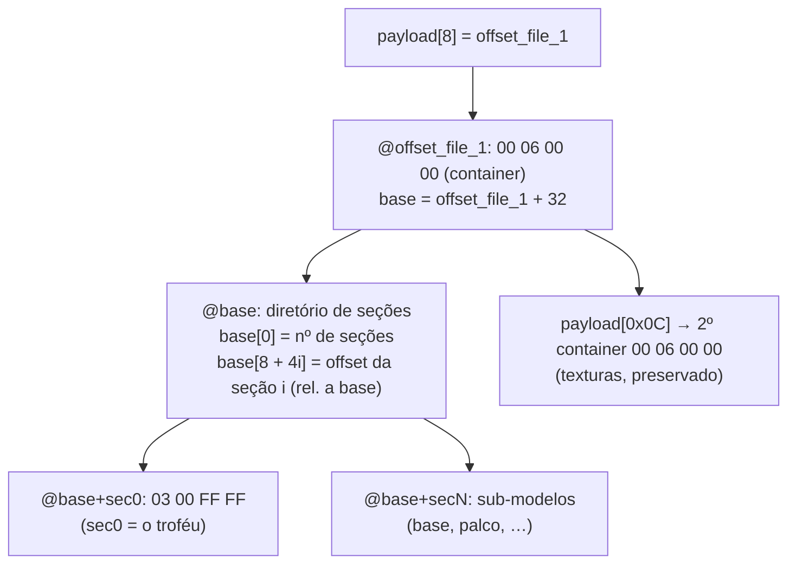
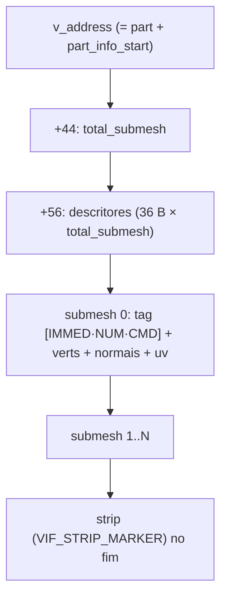
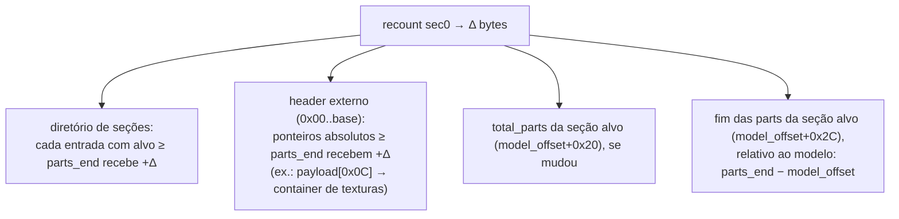

# 08 — Troféus (container aninhado)

Como o pacote importa/exporta `.bin` de **troféus** do PES PS2. O modelo 3D interno
é **idêntico** ao das faces; o que muda é o **invólucro (container)** e o
**CoordSpace**.

> Conhecimento derivado do plugin de troféus da comunidade (PES Indie Team) +
> análise de arquivos reais do jogo. Implementação em `adapters/pesweps2/trophies/`.

---

## 1. Container: o modelo não está "na superfície"

Numa **face**, `payload[8]` aponta direto para o `MAGIC_MODEL` (`03 00 FF FF`). Num
**troféu**, ali está o magic de **container** `00 06 00 00`, e o modelo está mais
fundo:



`model.parser.locate_model` resolve isso automaticamente (face ou troféu) e devolve
o offset do `03 00 FF FF`. A partir daí, **parts/VIF/normais/UVs/strip são parseados
igual às faces** — todo o motor de `shared/` é reaproveitado.

---

## 2. O troféu é uma COLEÇÃO de sub-modelos (.mdl)

Cada seção é um `03 00 FF FF` completo. Observando dois troféus reais:

| Seção | troféu A | troféu B | O que é |
|---|---|---|---|
| **sec0** | 1416 v / 14 parts | 1984 v / 19 parts | **O troféu** (taça/figura) — varia por troféu |
| sec1 | 72 v | 72 v | peça compartilhada |
| sec4 | 764 v | 764 v | base / pedestal |
| … | … | … | bancada, palco, etc. |

`sec1..secN` têm contagens **idênticas entre troféus** = objetos comuns da cena.
**`sec0` é o que distingue cada troféu.** Por isso `import_trophy(..., section=0)`
substitui o troféu principal por padrão; use `--section N` para outro sub-modelo.

> Diferente da face (limite de 8 parts, `byte[0x04]=8`), troféus têm **14–31 parts**
> por sub-modelo — **sem** o limite rígido de 8. O limite por part continua: 255
> vértices e ~340 triângulos.

---

## 3. Geometria de uma part: o leitor UNIVERSAL

Uma part NÃO é sempre um bloco único de vértices. A estrutura geral é uma lista de
**sub-meshes**:



O **CMD** do tag de cada sub-mesh diz o formato dos vértices:

| CMD | Formato | Bytes/vértice |
|---|---|---|
| `0x69` | V3-16 (3× int16) | 6 |
| `0x68` | V3-32 (3× int32) | 12 |

Faces e o troféu sec0 são o caso `total_submesh == 1`. Props (sec2/3/6/7 e parts do
sec5) têm vários sub-meshes; sec4/5/8 usam V3-32.

**Strip multi-submesh:** o strip indexa a UNIÃO dos sub-meshes pelos **endereços da
VU**. A correção `diff = max(idx) − total_verts + 1` recupera o índice global sem o
endereço base (single-block → `diff = 0`).

`model.reader.read_part_geometry` é o **leitor único e universal** (sem fallback):
detecta `total_submesh`, lê cada sub-mesh ciente do formato (6/12 B; int16/int32) e
decodifica o strip com a correção `diff`. Devolve ints crus; a escala/eixos vêm do
`profile.coord`. Usado por todo export.

---

## 4. Resize: o que muda quando o `.obj` tem tamanho diferente

Ao reconstruir sec0 com **Δ** bytes a mais/menos, tudo após o `parts_end` da seção
alvo **desliza Δ**. O `patch_resize` de `trophies/profile.py` e o importer corrigem:



Validado: após um recount, **as seções continuam caindo em `03 00 FF FF`** e o
container de texturas em `00 06 00 00`, deslocado por Δ exato; as demais seções
ficam byte-a-byte intactas (o fim das parts delas é relativo ao próprio modelo, então
não muda). O D4 só passou a ser gravado com o
[Bug 14](06-bugs-historicos.md#bug-14--fim-das-parts-relativo-ao-modelo).

---

## 5. Coordenadas (diferente da face)

| | Face | Troféu |
|---|---|---|
| Fator | `−0.001553` (flip X) | `+0.001553` (nega Y) |
| stored → obj | `(+s2·f, −s0·f, −s1·f)` | `(+s0·f, −s2·f, +s1·f)` |

Implementado como `CoordSpace` em `adapters/pesweps2/trophies/profile.py`. Verificado
**lossless**. UVs iguais aos da face (V invertido). Detalhes em [12 — Coordenadas](12-coordenadas.md).

---

## 6. Uso

```bash
# inspecionar (quantas seções):
python -m wepes3d list trofeu.bin --type trophy

# exportar a taça (sec0) ou outro sub-modelo:
python -m wepes3d export trofeu.bin taca.obj --type trophy --section 0
python -m wepes3d export trofeu.bin base.obj --type trophy --section 4

# importar uma taça nova em sec0 (corrige o container automaticamente):
python -m wepes3d import trofeu.bin taca_nova.obj saida.bin \
    --type trophy --section 0 --allow-recount --recalculate-normals --auto-fit
```

```python
from wepes3d import import_trophy, export_trophy, trophy_section_offsets

export_trophy("trofeu.bin", "taca.obj", section=0)        # .obj + .mtl
import_trophy("trofeu.bin", "taca.obj", "saida.bin", section=0,
              allow_recount=True, recalculate_normals=True, auto_fit=True)
```

**Prepare o `.obj`** como nas faces: triangulado, 1 UV/vértice, sem seams (ver
[00 — Guia de uso](00-guia-de-uso.md)).

---

## 7. Status

- ✅ **Export** de qualquer seção.
- ✅ **Roundtrip passthrough** (zero-diff) dos troféus de exemplo.
- ✅ **Recount** em sec0: estrutura íntegra (seções + texturas reapontadas por Δ),
  demais sub-modelos preservados byte-a-byte. Sem regressão de face.
- ⏳ **Validação in-game (PCSX2)**: geometria/UVs corretos por construção; winding/
  iluminação seguem as regras da face (ver [04](04-vu-microcode.md)/[05](05-strip-encoding.md)).

---

## Próximo

O modelo interno (parts/VIF/strip) é o mesmo das faces:
[02](02-anatomia-payload.md) · [04](04-vu-microcode.md) · [05](05-strip-encoding.md).
