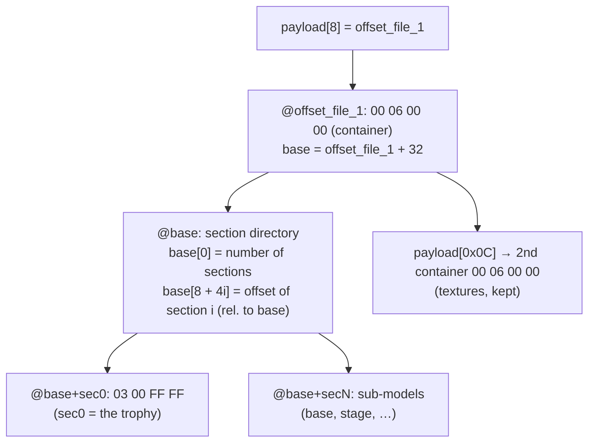
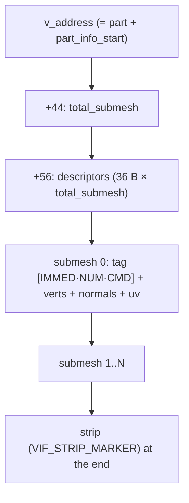
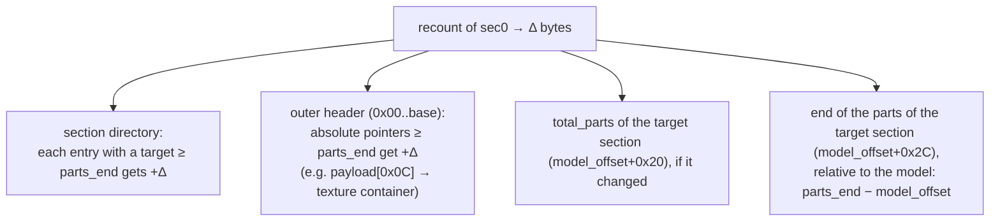

# 08 — Trophies (nested container)

How the package imports/exports PES PS2 **trophy** `.bin` files. The internal
3D model is **the same** as in faces; what changes is the **wrapper
(container)** and the **CoordSpace**.

> This knowledge comes from the community trophy plugin (PES Indie Team) +
> analysis of real game files. Implementation in `adapters/pesweps2/trophies/`.

---

## 1. Container: the model is not "on the surface"

In a **face**, `payload[8]` points straight to the `MAGIC_MODEL`
(`03 00 FF FF`). In a **trophy**, that position holds the **container** magic
`00 06 00 00`, and the model is deeper:



`model.parser.locate_model` handles this automatically (face or trophy) and
returns the offset of the `03 00 FF FF`. From there, **parts/VIF/normals/UVs/
strip are parsed exactly like in faces** — the whole `shared/` engine is
reused.

---

## 2. A trophy is a COLLECTION of sub-models (.mdl)

Each section is a complete `03 00 FF FF` model. Looking at two real trophies:

| Section | trophy A | trophy B | What it is |
|---|---|---|---|
| **sec0** | 1416 v / 14 parts | 1984 v / 19 parts | **The trophy** (cup/figure) — different in each trophy |
| sec1 | 72 v | 72 v | shared piece |
| sec4 | 764 v | 764 v | base / pedestal |
| … | … | … | stand, stage, etc. |

`sec1..secN` have the **same counts in every trophy** = common objects of the
scene. **`sec0` is what makes each trophy different.** That is why
`import_trophy(..., section=0)` replaces the main trophy by default; use
`--section N` for another sub-model.

> Unlike faces (limit of 8 parts, `byte[0x04]=8`), trophies have **14–31
> parts** per sub-model — **without** the hard limit of 8. The per-part limit
> still applies: 255 vertices and ~340 triangles.

---

## 3. Geometry of a part: the universal reader

A part is NOT always a single block of vertices. The general structure is a
list of **sub-meshes**:



The **CMD** of the tag of each sub-mesh gives the vertex format:

| CMD | Format | Bytes/vertex |
|---|---|---|
| `0x69` | V3-16 (3× int16) | 6 |
| `0x68` | V3-32 (3× int32) | 12 |

Faces and the trophy sec0 are the `total_submesh == 1` case. Props
(sec2/3/6/7 and parts of sec5) have several sub-meshes; sec4/5/8 use V3-32.

**Multi-submesh strip:** the strip indexes the UNION of the sub-meshes by **VU
address**. The fix `diff = max(idx) − total_verts + 1` gives back the global
index without the base address (single block → `diff = 0`).

`model.reader.read_part_geometry` is the **single, universal reader** (no
fallback): it finds `total_submesh`, reads each sub-mesh according to its
format (6/12 B; int16/int32) and decodes the strip with the `diff` fix. It
returns raw ints; the scale/axes come from `profile.coord`. Every export uses
it.

---

## 4. Resize: what changes when the `.obj` has a different size

When sec0 is rebuilt with **Δ** more/fewer bytes, everything after the
`parts_end` of the target section **moves by Δ**. The `patch_resize` of
`trophies/profile.py` and the importer fix:



Checked: after a recount, **the sections still land on `03 00 FF FF`** and the
texture container on `00 06 00 00`, moved by exactly Δ; the other sections
stay byte-for-byte untouched (their end of parts is relative to their own
model, so it does not change). D4 is only written since
[Bug 14](06-bug-history.md#bug-14--end-of-the-parts-relative-to-the-model).

---

## 5. Coordinates

Same int16 size as faces (`0.001553`), but other axes: stored `(s0, s1, s2)` →
OBJ `(+s0·f, −s2·f, +s1·f)` (Y is negated, no X flip). UVs are the same as in
faces. Implemented as a `CoordSpace` in `adapters/pesweps2/trophies/profile.py`,
checked to be **lossless**. The table of all assets is in
[11 — Coordinates](11-coordinates.md).

---

## 6. Usage

```bash
# inspect (how many sections):
python -m wepes3d list trophy.bin --type trophy

# export the cup (sec0) or another sub-model:
python -m wepes3d export trophy.bin cup.obj  --type trophy --section 0
python -m wepes3d export trophy.bin base.obj --type trophy --section 4

# import a new cup into sec0 (the container is fixed automatically):
python -m wepes3d import trophy.bin new_cup.obj out.bin \
    --type trophy --section 0 --allow-recount --recalculate-normals --auto-fit
```

```python
from wepes3d import import_trophy, export_trophy, trophy_section_offsets

export_trophy("trophy.bin", "cup.obj", section=0)        # .obj + .mtl
import_trophy("trophy.bin", "cup.obj", "out.bin", section=0,
              allow_recount=True, recalculate_normals=True, auto_fit=True)
```

**Prepare the `.obj`** like for faces: triangulated and decimated (see
[00 — User guide](00-user-guide.md)).

---

## 7. Status

- ✅ **Export** of any section.
- ✅ **Passthrough roundtrip** (zero-diff) of the sample trophies — the test
  trophy even comes out `cmp`-identical.
- ✅ **Recount** in sec0: the structure stays valid (sections + textures moved
  by Δ, end of parts updated), the other sub-models are kept byte-for-byte.
  No regression for faces.
- ⏳ **In-game check (PCSX2)**: geometry/UVs are correct by construction;
  winding/lighting follow the face rules (see
  [04](04-vif-and-vu1.md)/[05](05-strip-encoding.md)).

---

## Next

The internal model (parts/VIF/strip) is the same as for faces:
[02](02-payload-anatomy.md) · [04](04-vif-and-vu1.md) · [05](05-strip-encoding.md).
