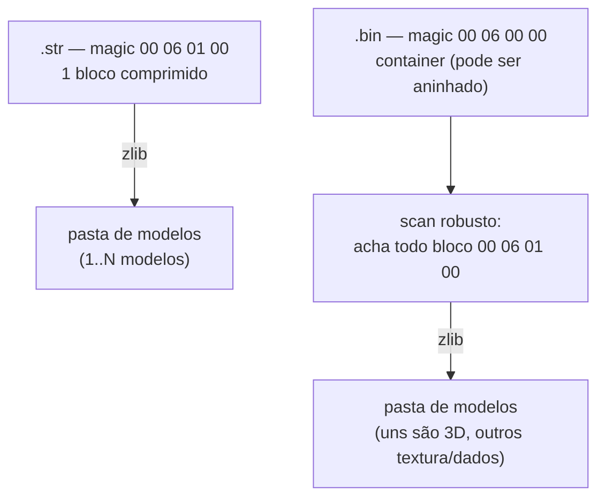

# 09 — Estádios (export)

Como o pacote exporta a geometria 3D de **estádios** (e dos modelos relacionados:
torcida/crowd e placas/adboard) para `.obj`. O modelo 3D interno (parts/VIF/strip) é
**o mesmo** de faces/troféus — o leitor universal `model.reader.read_part_geometry`
já cobre. O que muda é o **invólucro** e o **CoordSpace**.

> Conhecimento derivado do plugin de estádios da comunidade (PES Indie Team).
> Implementação em `adapters/pesweps2/stadiums/`.

---

## 1. Dois invólucros



- **`.str`** (`00 06 01 00`, igual face/troféu): UM bloco comprimido → payload com
  1..N modelos.
- **`.bin`** (`00 06 00 00`): um **container** (sistema de "pastas" do PES, podendo
  ser **aninhado**) cujas folhas são blocos `00 06 01 00` — uns são modelos 3D,
  outros texturas/dados.

### Pasta de modelos

Dentro de cada bloco descomprimido:

```
payload[0]        = total de modelos
payload[8 + 4*i]  = offset (no payload) do modelo i   (0 = vazio, pula)
@offset:  03 00 FF FF  → +0x20 total_parts, +0x24 offset das parts
```

`shared/io/pes_archive.py` resolve os dois invólucros. Para o `.bin`, em vez de
navegar a árvore frágil de TOCs aninhadas, faz um **scan robusto**: acha todos os
blocos `00 06 01 00` e valida cada um pela própria descompactação (tamanho == campo
`decomp_size`). Pega tudo em qualquer profundidade.

### Tipos de arquivo (observados em arquivos reais do jogo)

| Arquivo | Magic | É |
|---|---|---|
| crowd `.str` | `00 06 01 00` | **torcida** — folha curva de quads, 1–3 modelos |
| estádio `.bin` | `00 06 00 00` | **estrutura do estádio** (~15 modelos: tigela, arquibancadas, cobertura) |
| dados `.bin` | `00 06 00 00` | textura/dados (0 modelos 3D) |
| adboard `.bin` | `00 06 00 00` | **placas** de publicidade (2 blocos × 2 modelos) |

---

## 2. Coordenadas (escala grande)

| | Estádio |
|---|---|
| Fator | `1/256 = 0.00390625` (escala muito maior) |
| stored → obj | `(+s0·f, +s2·f, −s1·f)` |

Implementado em `adapters/pesweps2/stadiums/profile.py`. UVs iguais (V invertido). A
escala maior reflete o tamanho da estrutura. Ver [12 — Coordenadas](12-coordenadas.md).

---

## 3. Uso

```bash
# estrutura (blocos, modelos, parts):
python -m wepes3d list estadio.bin --type stadium

# 1 modelo (bloco B, modelo M):
python -m wepes3d export estadio.bin saida.obj --type stadium --block 0 --model 0

# estádio INTEIRO num .obj só:
python -m wepes3d export estadio.bin estadio.obj --type stadium --all

# 1 .obj por modelo (OUT vira prefixo):
python -m wepes3d export estadio.bin out/estadio --type stadium --parts
```

```python
from wepes3d import (
    list_stadium, stadium_index,
    export_stadium, export_stadium_complete, export_stadium_parts, export_stadium_scene,
)
list_stadium("estadio.bin")                              # imprime a estrutura
export_stadium("crowd_h.str", "torcida.obj")            # 1 modelo
export_stadium_complete("estadio.bin", "estadio.obj")   # tigela completa
export_stadium_scene(["estadio.bin", "crowd_h.str"], "cena.obj")  # vários juntos
```

Validado renderizando: `.str` = arquibancada/torcida; o `.bin` de estádio = estrutura
completa (formato oval, gramado no centro, anel de arquibancadas).

---

## 4. Status

- ✅ **Export** de `.str` (crowd) e `.bin` (estádio/adboard) — por modelo, completo
  e por partes. Todas as parts lidas pelo leitor universal (0 puladas).
- ⏳ **Import** de estádio — ainda não. O `profile.patch_resize` é no-op para mesmo
  tamanho e levanta `NotImplementedError` para resize; o import por partes exigirá
  deslizar a TOC dos modelos + (no `.bin`) a TOC do container.

---

## Próximo

Modelo interno = o das faces ([04](04-vu-microcode.md)/[05](05-strip-encoding.md)).
Leitor universal: [08 §3](08-trofeus.md#3-geometria-de-uma-part-o-leitor-universal).
Kits usam a mesma engine: [10 — Kits](10-kits.md).
