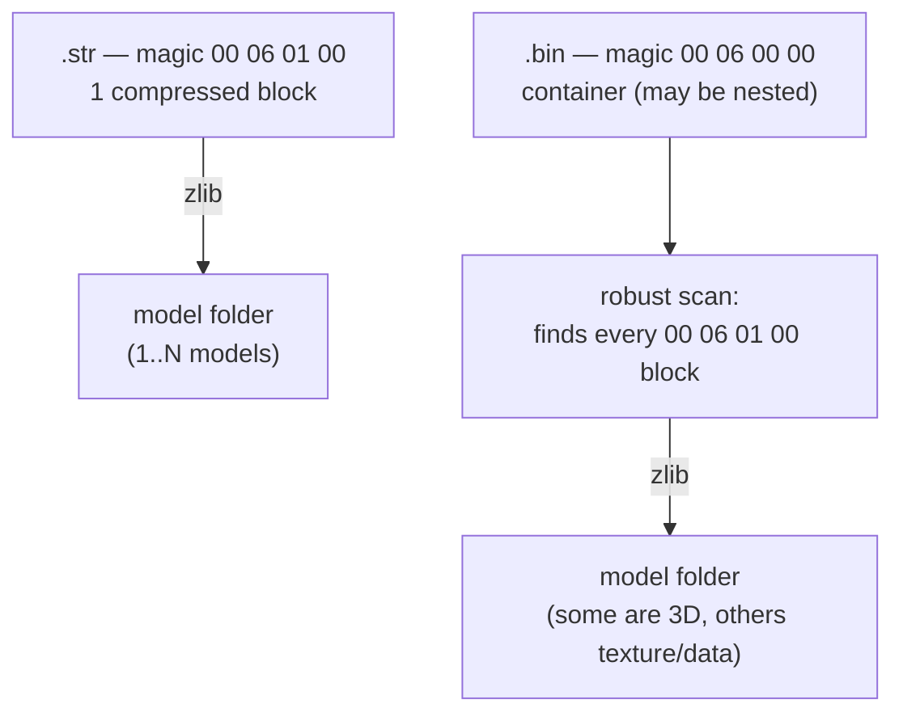

# 09 — Stadiums and kits (model folders, export)

How the package exports the 3D geometry of **stadiums** (and the related
models: crowd and advertising boards) and of **kits** (player uniform: shirt/body
and hands) to `.obj`.

Stadiums and kits use the **same engine**: both are **"model folders"**, and
the internal 3D model (parts/VIF/strip) is **the same** as in faces/trophies —
the universal reader `model.reader.read_part_geometry` already covers it. They
**only differ in the CoordSpace**.

> This knowledge comes from the community stadium plugin (PES Indie Team) +
> analysis of real game files. Implementation: the shared engine is in
> `shared/io/pes_archive.py` + `shared/pipeline/folder.py`; the thin adapters
> are `adapters/pesweps2/stadiums/` and `adapters/pesweps2/kits/`.

---

## 1. Two wrappers



- **`.str`** (`00 06 01 00`, like faces/trophies): ONE compressed block → a
  payload with 1..N models. Kit files are also single compressed blocks.
- **`.bin`** (`00 06 00 00`): a **container** (the PES "folder" system, which
  can be **nested**) whose leaves are `00 06 01 00` blocks — some are 3D
  models, others are textures/data.

### Model folder

Inside each decompressed block:

```
payload[0]              = number of models
payload[4]              = offset of the table of contents (TOC) — 8 in every file we saw
payload[TOC + 4*i]      = offset (in the payload) of model i    (0 or not a model = skipped)
@offset:  03 00 FF FF   → +0x20 total_parts, +0x24 offset of the parts
```

`shared/io/pes_archive.py` handles both wrappers. For the `.bin`, instead of
walking the fragile tree of nested TOCs, it does a **robust scan**: it finds
every `00 06 01 00` block and checks each one by decompressing it (size ==
the `decomp_size` field). It finds everything at any depth.

---

## 2. File types (seen in real game files)

| File | Magic | What it is | Models |
|---|---|---|---|
| crowd `.str` | `00 06 01 00` | **crowd** — a curved sheet of quads | 1–3 |
| stadium `.bin` | `00 06 00 00` | **stadium structure** (bowl, stands, roof) | ~15 |
| adboard `.bin` | `00 06 00 00` | **advertising boards** | 2 blocks × 2 |
| data `.bin` | `00 06 00 00` | texture/data | 0 3D models |
| kit shirt/body | `00 06 01 00` | **uniform** | 5 (LODs; m0 ≈ 79 parts / 3620 v) |
| kit hands | `00 06 01 00` | **hands** | 4 |
| kit data/texture | `00 06 01 00` | texture | 0 (the zlib scan confirms it) |

Kit models are usually **LODs** (the same piece at different levels of
detail), not different pieces — that is why they look "duplicated" when you
see them on top of each other in wireframe.

---

## 3. Coordinates

- **Stadium:** factor `1/256 = 0.00390625` (a much bigger scale, because the
  structure is huge); stored `(s0, s1, s2)` → OBJ `(+s0·f, +s2·f, −s1·f)`.
  Implemented in `adapters/pesweps2/stadiums/profile.py`.
- **Kit:** the **same as the face** (a kit is player equipment, in the same
  space as the body): it reuses `adapters/pesweps2/faces/profile.COORD`
  (factor `−0.001553`, face axes).

UVs are the same as in every PS2 asset (V flipped). The table of all assets is
in [11 — Coordinates](11-coordinates.md).

Checked by rendering: the crowd `.str` = stands/crowd; the stadium `.bin` =
the full structure (oval shape, pitch in the middle, ring of stands); the
shirt = a standing torso (shoulders, sleeves, collar); the hands = hands with
fingers.

---

## 4. Usage

```bash
# structure (blocks, models, parts):
python -m wepes3d list stadium.bin --type stadium
python -m wepes3d list kit_shirt   --type kit

# the WHOLE file in one .obj (default, or --all):
python -m wepes3d export stadium.bin stadium.obj --type stadium --all
python -m wepes3d export kit_shirt   shirt.obj   --type kit --all

# 1 model (global index; --block B narrows it to one block of the container):
python -m wepes3d export stadium.bin out.obj --type stadium --block 0 --model 0
python -m wepes3d export kit_shirt   m.obj   --type kit --model 0

# 1 .obj per model (OUT becomes a prefix):
python -m wepes3d export stadium.bin out/stadium --type stadium --parts
python -m wepes3d export kit_shirt   out/kit     --type kit --parts      # 1 .obj per LOD
```

Two useful options to inspect the models in Blender:

- `--groups` — writes **1 object (`o part_NN`) per part** (turn each piece
  on/off).
- `--dedup` — removes duplicated **double-sided** panels (a cleaner `.obj`,
  but less faithful to the game data).

```python
from wepes3d import (
    list_stadium, stadium_index,
    export_stadium, export_stadium_complete, export_stadium_parts, export_stadium_scene,
    list_kit, export_kit, export_kit_complete, export_kit_parts, export_kit_scene,
)
list_stadium("stadium.bin")                                    # prints the structure
export_stadium("crowd_h.str", "crowd.obj")                     # 1 model
export_stadium_complete("stadium.bin", "stadium.obj")          # the full bowl
export_stadium_scene(["stadium.bin", "crowd_h.str"], "scene.obj")  # several together

list_kit("kit_shirt")
export_kit_complete("kit_shirt", "shirt.obj")
export_kit_scene(["kit_shirt", "kit_hands"], "full_kit.obj")
```

---

## 5. Status

- ✅ **Export** of `.str` (crowd), `.bin` (stadium/adboard) and kits — by
  model, complete, by parts and as a multi-file scene. All parts are read by
  the universal reader (0 skipped).
- ⏳ **Import** — not yet. The stadium `profile.patch_resize` does nothing for
  the same size and raises `NotImplementedError` for a resize; importing by
  parts will need to move the TOC of the models + (in the `.bin`) the TOC of
  the container. The same applies to kits.

---

## Next

The internal model = the one of faces ([04](04-vif-and-vu1.md)/[05](05-strip-encoding.md)).
Universal reader: [08 §3](08-trophies.md#3-geometry-of-a-part-the-universal-reader).
