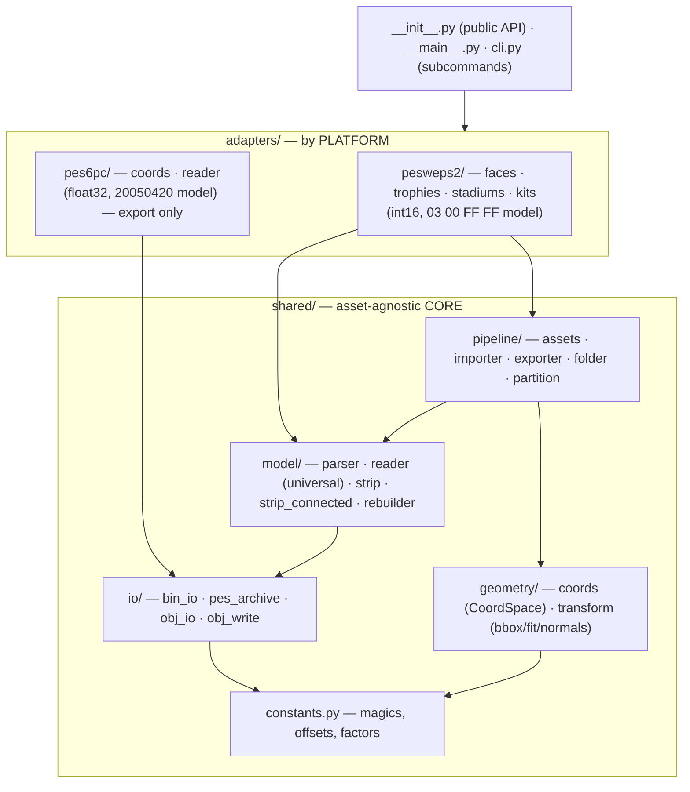
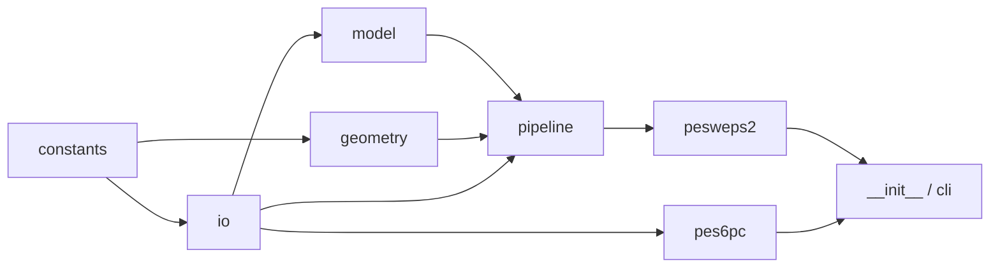
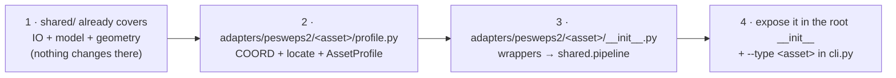

# 10 — Architecture

A modular layout by responsibility, with the adapters kept apart by
**platform**. Each sub-package has an `__init__.py` that re-exports its API;
outside code imports from the sub-package (e.g. `from ..model import
parse_model`), never from the inner file directly.



---

## File tree

```
wepes3d/                   repository root
  wepes3d/                 the PACKAGE (the code)
    __init__.py            public API (import_/export_ for every asset)
    __main__.py            entry point of `python -m`
    cli.py                 argparse: export / import / list subcommands

    shared/                asset-agnostic CORE
      constants.py         magics, offsets, factors (cross-cutting)
      io/
        bin_io.py            .bin (de)compression (zlib + header)
        pes_archive.py       PES "file system" (containers, load_blocks, model_offsets)
        obj_io.py            .obj reading → ObjMesh + convert_obj_to_vertex_uv (1 UV/vertex)
        obj_write.py         .obj (+ .mtl) writing, with optional groups
      geometry/
        coords.py            CoordSpace type (int16↔float) + UV + clamp16
        transform.py         bbox, auto-fit, per-vertex normals
      model/
        parser.py            Part/Model, parse_model/write_model, detect/locate
        reader.py            UNIVERSAL geometry reader (read_part_geometry/read_model_*)
        strip.py             strip encode/decode (triangle list)
        strip_connected.py   connected tristrips (default mode)
        rebuilder.py         rebuilds a part with new geometry
      pipeline/
        assets.py            AssetProfile (engine ↔ asset interface)
        importer.py          _import: .obj → .bin (face/trophy)
        exporter.py          _export: .bin → .obj (face/trophy)
        folder.py            "model folder" export (stadium/kit)
        partition.py         partition strategies

    adapters/              by PLATFORM
      pesweps2/            PES/WE PS2 (int16, 03 00 FF FF model, VIF)
        __init__.py          re-exports the PS2 API
        faces/  trophies/  stadiums/  kits/
          profile.py           coord + navigation + AssetProfile
          __init__.py          import_/export_ wrappers (call the shared/ engine)
      pes6pc/             PES6/WE PC (float32, 20050420 model) — export only
        coords.py            PC transform (float)
        reader.py            PC parser (find_parts / parse_model / vertex groups)
        __init__.py          list_pc / export_pc / export_pc_complete / export_pc_parts

  tests/                   pytest suite (+ seed/: real game files)
  docs/                    this documentation
  examples/                sample face.bin
  README.md · LICENSE · pyproject.toml · requirements-dev.txt
```

The code paths quoted in the docs (`shared/...`, `adapters/...`) are relative
to the `wepes3d/` package.

> **Why are PC and PS2 separate?** They are **different** binary formats. PC
> does **not** reuse the PS2 engine (`shared/pipeline`, `shared/model`) — only
> the common I/O (`shared/io`: zlib decompression + `.obj` writing). Keeping
> each platform in its own folder avoids coupling and makes it clear what can
> be shared. See [12 — PES6 PC](12-pes6-pc.md).

---

## Layers (dependency graph, no cycles)



Each layer only imports from the layers below it, always with an explicit
path (`from ..model.parser import ...`), never through the `__init__.py` of
its own package.

---

## Where to change things (quick map)

| Task | File |
|---|---|
| New vertex format / geometry decoding (PS2) | `shared/model/reader.py` |
| Bug when parsing a part/model (PS2) | `shared/model/parser.py` |
| Strip (encode/decode/keep) | `shared/model/strip.py` · `strip_connected.py` |
| Coordinates of a PS2 asset | `adapters/pesweps2/<asset>/profile.py` (`COORD`) |
| Container navigation (stadium/kit) | `shared/io/pes_archive.py` |
| "Model folder" export | `shared/pipeline/folder.py` |
| Import pipeline (.obj→.bin) | `shared/pipeline/importer.py` |
| PC format | `adapters/pes6pc/reader.py` · `coords.py` |
| New PS2 asset (e.g. ball, gloves) | a new folder `adapters/pesweps2/<asset>/` |
| CLI options / subcommands | `cli.py` |

---

## Adding a new PS2 asset



1. `shared/` usually does **not** change (IO + model + geometry are already
   generic).
2. `profile.py`: define `COORD` (CoordSpace) and the navigation
   (`locate`/`model_offsets`), and build an `AssetProfile`.
3. `__init__.py`: wrappers that call `shared.pipeline.importer._import` /
   `exporter._export` (face/trophy) **or** `shared.pipeline.folder.*` (model
   folder), passing the `COORD`.
4. Expose it in the root `__init__.py` and add `--type <asset>` to `cli.py`.

> For a new **platform** (not only a new asset), create
> `adapters/<platform>/` with its own reader if the binary format is
> different — like we did for PC.
