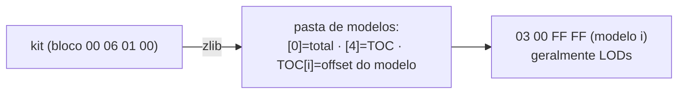

# 10 — Kits / Uniforme (export)

Export da geometria 3D do **kit** (uniforme do jogador: camisa/corpo e mãos) para
`.obj`. **Mesma engine de estádio** — estádio e kit são "pastas de modelos" e só
diferem no **CoordSpace**. Implementação em `adapters/pesweps2/kits/`.

---

## 1. Estrutura (igual estádio)



Cada arquivo de kit é um bloco comprimido `00 06 01 00` que descompacta para uma
"pasta de modelos". Lido por `shared/io/pes_archive.py` (`load_blocks` +
`model_offsets`) e exportado por `shared/pipeline/folder.py` (genérico, recebe um
`CoordSpace`). O modelo 3D interno usa o leitor universal — **0 parts puladas**.

Os modelos costumam ser **LODs** (mesma peça em níveis de detalhe), não peças
distintas — por isso, sobrepostos no wireframe, parecem "duplicados".

---

## 2. Coordenada = a da FACE

Kit é equipamento do jogador, no **mesmo espaço do corpo**. Por isso reusa a coord da
face (`adapters/pesweps2/faces/profile.COORD`): fator `−0.001553`, eixos da face.
Validado renderizando: o modelo de camisa aparece como torso em pé (ombros, mangas,
gola); o de mãos, como mãos com dedos. Ver [12 — Coordenadas](12-coordenadas.md).

---

## 3. Tipos de arquivo (observados em arquivos reais do jogo)

| Arquivo | É | Modelos |
|---|---|---|
| camisa/corpo | **uniforme** | 5 (LODs; m0 ≈ 79 parts / 3620 v) |
| mãos | **mãos** | 4 |
| dados/textura | textura | 0 (varredura zlib confirma) |

---

## 4. Uso

```bash
python -m wepes3d list   kit_camisa --type kit              # estrutura
python -m wepes3d export kit_camisa camisa.obj --type kit --all
python -m wepes3d export kit_camisa m.obj      --type kit --model 0
python -m wepes3d export kit_camisa out/kit    --type kit --parts   # 1 .obj por LOD
```

Duas opções úteis para inspecionar no Blender:

- `--groups` — grava **1 objeto (`o part_NN`) por part** (liga/desliga cada pedaço).
- `--dedup` — remove painéis **double-sided** duplicados (`.obj` mais limpo, perde
  fidelidade ao dado do jogo).

```python
from wepes3d import (
    list_kit, export_kit, export_kit_complete, export_kit_parts, export_kit_scene,
)
list_kit("kit_camisa")
export_kit_complete("kit_camisa", "camisa.obj")
export_kit_scene(["kit_camisa", "kit_maos"], "kit_completo.obj")
```

---

## 5. Status

- ✅ **Export** (modelo / completo / por partes / cena multi-arquivo).
- ⏳ **Import** — não implementado (precisa de patch da TOC, como estádio).

---

## Próximo

Engine compartilhada: `shared/io/pes_archive.py` + `shared/pipeline/folder.py`
(estádio e kit). Leitor universal de part: [08 §3](08-trofeus.md#3-geometria-de-uma-part-o-leitor-universal).
Coordenada da face: [12 — Coordenadas](12-coordenadas.md).
