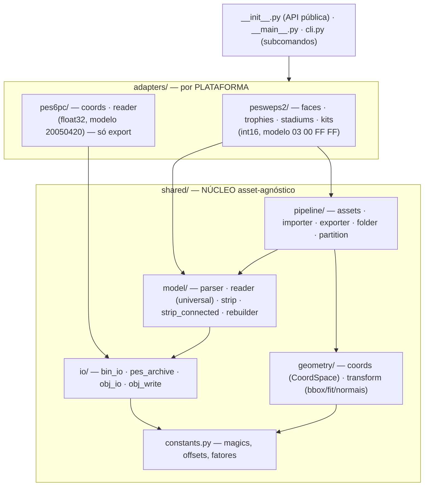
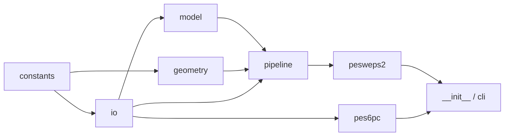
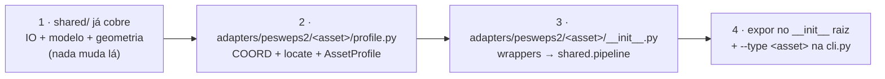

# 11 — Arquitetura do módulo

Layout modular por responsabilidade, isolado por **plataforma** nos adapters. Cada
subpacote tem um `__init__.py` que re-exporta sua API; o código externo importa do
subpacote (ex.: `from ..model import parse_model`), nunca do arquivo interno direto.



---

## Árvore de arquivos

```
wepes3d/                   raiz do repositório
  wepes3d/                 o PACOTE (o código)
    __init__.py            API pública (import_/export_ de todos os assets)
    __main__.py            entry-point do `python -m`
    cli.py                 argparse: subcomandos export / import / list

    shared/                NÚCLEO asset-agnóstico
      constants.py         magics, offsets, fatores (cross-cutting)
      io/
        bin_io.py            (de)compressão .bin (zlib + header)
        pes_archive.py       "sistema de arquivos" PES (containers, load_blocks, model_offsets)
        obj_io.py            leitura .obj → ObjMesh + convert_obj_to_vertex_uv (1 UV/vértice)
        obj_write.py         escrita .obj (+ .mtl), com grupos opcionais
      geometry/
        coords.py            tipo CoordSpace (int16↔float) + UV + clamp16
        transform.py         bbox, auto-fit, normais por vértice
      model/
        parser.py            Part/Model, parse_model/write_model, detect/locate
        reader.py            leitor UNIVERSAL de geometria (read_part_geometry/read_model_*)
        strip.py             (de)codifica strip (triangle list)
        strip_connected.py   tristrips conectados (modo padrão)
        rebuilder.py         reconstrói uma part com geometria nova
      pipeline/
        assets.py            AssetProfile (interface motor ↔ asset)
        importer.py          _import: .obj → .bin (face/troféu)
        exporter.py          _export: .bin → .obj (face/troféu)
        folder.py            export de "pasta de modelos" (estádio/kit)
        partition.py         estratégias de particionamento

    adapters/              por PLATAFORMA
      pesweps2/            PES/WE PS2 (int16, modelo 03 00 FF FF, VIF)
        __init__.py          re-exporta a API PS2
        faces/  trophies/  stadiums/  kits/
          profile.py           coord + navegação + AssetProfile
          __init__.py          wrappers import_/export_ (delegam ao motor shared/)
      pes6pc/             PES6/WE PC (float32, modelo 20050420) — só export
        coords.py            transform PC (float)
        reader.py            parser PC (find_parts / parse_model / vertex groups)
        __init__.py          list_pc / export_pc / export_pc_complete / export_pc_parts

  tests/                   suíte pytest (+ seed/: arquivos reais do jogo)
  docs/                    esta documentação
  examples/                face.bin de exemplo
  README.md · LICENSE · pyproject.toml · requirements-dev.txt
```

Os caminhos de código citados nas docs (`shared/...`, `adapters/...`) são
relativos ao pacote `wepes3d/`.

> **Por que PC e PS2 separados?** São formatos binários **diferentes**. O PC **não**
> reaproveita o motor PS2 (`shared/pipeline`, `shared/model`) — só a I/O comum
> (`shared/io`: descompressão zlib + escrita de `.obj`). Manter cada plataforma na
> sua pasta evita acoplamento e deixa claro o que é compartilhável. Ver [13](13-pes6-pc.md).

---

## Camadas (DAG de dependências, sem ciclos)



Cada camada só importa das de baixo, sempre por caminho explícito
(`from ..model.parser import ...`), nunca via o `__init__.py` do próprio pacote.

---

## Onde mexer (mapa rápido)

| Tarefa | Arquivo |
|---|---|
| Novo formato de vértice / decode de geometria (PS2) | `shared/model/reader.py` |
| Bug no parse de part/modelo (PS2) | `shared/model/parser.py` |
| Strip (encode/decode/preserve) | `shared/model/strip.py` · `strip_connected.py` |
| Coordenada de um asset PS2 | `adapters/pesweps2/<asset>/profile.py` (`COORD`) |
| Navegação de container (estádio/kit) | `shared/io/pes_archive.py` |
| Export "pasta de modelos" | `shared/pipeline/folder.py` |
| Pipeline de import (.obj→.bin) | `shared/pipeline/importer.py` |
| Formato PC | `adapters/pes6pc/reader.py` · `coords.py` |
| Novo asset PS2 (ex.: bola, luva) | nova pasta `adapters/pesweps2/<asset>/` |
| Flags / subcomandos da CLI | `cli.py` |

---

## Adicionar um novo asset PS2



1. `shared/` normalmente **não muda** (IO + modelo + geometria já são genéricos).
2. `profile.py`: defina `COORD` (CoordSpace) e a navegação (`locate`/`model_offsets`),
   monte um `AssetProfile`.
3. `__init__.py`: wrappers que chamam `shared.pipeline.importer._import` /
   `exporter._export` (face/troféu) **ou** `shared.pipeline.folder.*` (pasta de
   modelos), passando o `COORD`.
4. Exponha no `__init__.py` raiz e adicione `--type <asset>` na `cli.py`.

> Para uma nova **plataforma** (não só asset), crie `adapters/<plataforma>/` com seu
> próprio reader se o formato binário diferir — como foi feito para o PC.
