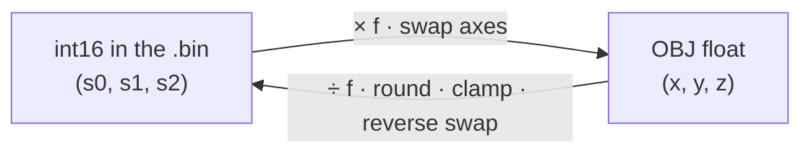
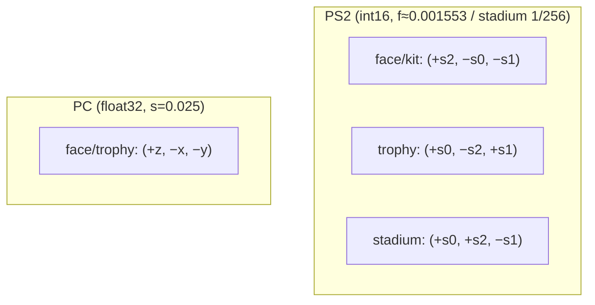

# 11 — Coordinates (CoordSpace)

The PS2 `.bin` stores vertices, normals and UVs as **16-bit integers**
(`int16`). To edit them in Blender we need **floats** (OBJ space). The
`CoordSpace` is the **`int16 ↔ float` bijection** of each asset — and it is
**lossless**: converting `int16 → obj → int16` gives back the original bytes
exactly.

Every asset has the **same byte format**; only the **scale** and the **axis
convention** change. That is why the 3D engine is shared and only the
`CoordSpace` changes (`shared/geometry/coords.py` defines the type; each
`adapters/.../profile.py` builds its own). **This is the reference page for
coordinates**; the asset docs only link here.



---

## Vertices

Stored = the `int16` triplet in file order `(s0, s1, s2)`; `f` = scale factor.

| Asset | `f` | stored `(s0,s1,s2)` → obj `(x, y, z)` | Note |
|---|---|---|---|
| **face / hair** (PS2) | `0.001553` | `( +s2·f , −s0·f , −s1·f )` | player body scale (X flip) |
| **kit** (PS2) | `0.001553` | `( +s2·f , −s0·f , −s1·f )` | **same as the face** (player equipment) |
| **trophy** (PS2) | `0.001553` | `( +s0·f , −s2·f , +s1·f )` | same size, different axes (Y negated) |
| **stadium / crowd / boards** (PS2) | `1/256 = 0.00390625` | `( +s0·f , +s2·f , −s1·f )` | much bigger scale (huge structure) |
| **PES6 PC** (face / trophy) | `0.025` (the vertex is already `float32`) | `( +z·s , −x·s , −y·s )` | different format — see [12](12-pes6-pc.md) |



> In the code, the face constant is `VERTEX_FACTOR = −0.001553` (negative),
> plus a separate X flip (`shared/constants.py`). The table shows the net
> result: `f = 0.001553` with the signs written out.

The reverse conversion (`obj → int16`, used by the **import**) is the exact
inverse of each row, with `round()` and a *clamp* to `[-32768, 32767]`. The
exact form (and its inverse) for each asset is in its
`adapters/.../profile.py`.

> **Why is it lossless?** The conversion is linear (`obj = s·f`), so
> `round(s·f / f) == s` for any `s` in the `int16` range. This makes sure that
> importing an exported `.obj` without edits gives back the same vertex bytes
> (a precondition of the
> [zero-diff roundtrip](03-import-pipeline.md#validation-roundtrip)).

---

## UVs (the same for every PS2 asset)

`UV_FACTOR = 0.000244`, with **V flipped** (origin at the top, as on PS2):

```
stored (u, v) → obj    (u·0.000244,  1 − v·0.000244)
obj    (u, v) → stored (round(u/0.000244),  round((1−v)/0.000244))
```

On PC, the UV is already `float32` and only `v → 1 − v` is applied.

---

## Normals

Normals follow the **same axis order** as the vertices of each asset, scaled
by `NORMAL_SCALE = 32767` (`shared/constants.py`). In the import, with
`--recalculate-normals` they are computed from the new geometry; otherwise
the template normals are kept. (The value 32767 was
[Bug 7](06-bug-history.md#bug-7--normal_scale-30-too-small).)

---

## Where these numbers come from

- **Face**: reverse engineering of the community face plugin (factor
  `−0.001553`, X flip). See [04](04-vif-and-vu1.md) and the winding bug
  ([06 §Bug 8](06-bug-history.md#bug-8--reversed-triangle-winding)).
- **Trophy**: from the trophy plugin (PES Indie Team). See [08](08-trophies.md).
- **Stadium/kit**: from the stadium plugin
  (`x,z,y = unpack(3h); v = (x·F, y·F, −z·F)`, `F = 1/256`). See
  [09](09-stadiums-and-kits.md).
- **PC**: from the PC face plugin (`x = z·0.025; y = −x·0.025; z = −y·0.025`).
  See [12](12-pes6-pc.md).

All of them were **checked visually** (render/Blender): the face stands up and
is mirrored correctly; the trophy has the right orientation; the stadium has
the pitch on the ground plane and the stands around it.
