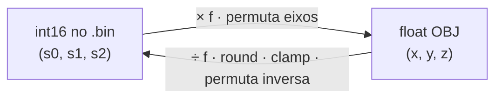
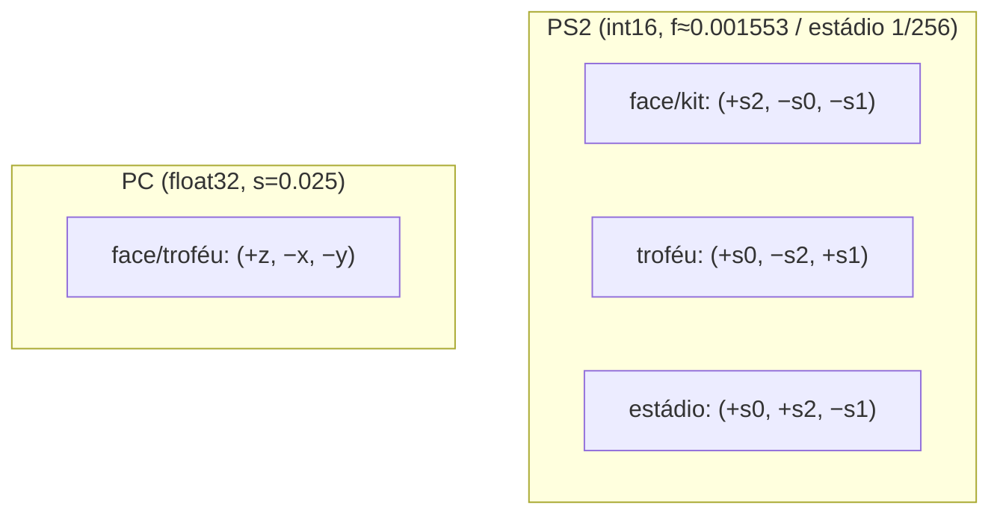

# 12 — Coordenadas (CoordSpace)

O `.bin` do PS2 guarda vértices, normais e UVs como **inteiros de 16 bits**
(`int16`). Para editar no Blender precisamos de **floats** (espaço OBJ). O
`CoordSpace` é a **bijeção `int16 ↔ float`** de cada asset — e é **lossless**:
converter `int16 → obj → int16` recupera os bytes originais exatamente.

Cada asset tem o **mesmo formato de bytes**; muda só a **escala** e a **convenção de
eixos**. Por isso o motor 3D é compartilhado e só o `CoordSpace` varia
(`shared/geometry/coords.py` define o tipo; cada `adapters/.../profile.py` constrói
o seu).



---

## Vértices

Stored = a tripla de `int16` na ordem do arquivo `(s0, s1, s2)`; `f` = fator de
escala.

| Asset | `f` | stored `(s0,s1,s2)` → obj `(x, y, z)` | Observação |
|---|---|---|---|
| **face / cabelo** (PS2) | `0.001553` | `( +s2·f , −s0·f , −s1·f )` | escala do corpo do jogador (flip de X) |
| **kit** (PS2) | `0.001553` | `( +s2·f , −s0·f , −s1·f )` | **igual à face** (equipamento do jogador) |
| **troféu** (PS2) | `0.001553` | `( +s0·f , −s2·f , +s1·f )` | mesma magnitude, eixos diferentes (nega Y) |
| **estádio / torcida / placas** (PS2) | `1/256 = 0.00390625` | `( +s0·f , +s2·f , −s1·f )` | escala muito maior (estrutura gigante) |
| **PES6 PC** (face / troféu) | `0.025` (vértice já é `float32`) | `( +z·s , −x·s , −y·s )` | formato diferente — ver [13](13-pes6-pc.md) |



A conversão inversa (`obj → int16`, usada no **import**) é o inverso exato de cada
linha, com `round()` e *clamp* em `[-32768, 32767]`. A forma exata (e a inversa) de
cada asset está no respectivo `adapters/.../profile.py`.

> **Por que lossless?** A conversão é linear (`obj = s·f`), então
> `round(s·f / f) == s` para qualquer `s` no range `int16`. Isso garante que
> reimportar um `.obj` exportado sem editar reproduza os mesmos bytes de vértice
> (pré-condição do [roundtrip zero-diff](03-pipeline.md#validação-roundtrip)).

---

## UVs (iguais para todos os assets PS2)

`UV_FACTOR = 0.000244`, com o **V invertido** (origem no topo, como no PS2):

```
stored (u, v) → obj   (u·0.000244,  1 − v·0.000244)
obj    (u, v) → stored (round(u/0.000244),  round((1−v)/0.000244))
```

No PC, o UV já é `float32` e aplica-se só `v → 1 − v`.

---

## Normais

Normais seguem a **mesma permutação de eixos** dos vértices de cada asset, escaladas
por `NORMAL_SCALE = 32767` (`shared/constants.py`). No import, com
`--recalculate-normals` são calculadas da geometria nova; senão, as do template são
preservadas. (O valor 32767 foi o [Bug 7](06-bugs-historicos.md#bug-7--normal_scale-30-menor-que-o-correto).)

---

## De onde vêm esses números

- **Face**: engenharia reversa do plugin de faces da comunidade (fator `−0.001553`,
  flip de X). Ver [04](04-vu-microcode.md) e o bug do winding ([06 §Bug 8](06-bugs-historicos.md#bug-8--winding-dos-triângulos-invertido)).
- **Troféu**: do plugin de troféus (PES Indie Team). Ver [08](08-trofeus.md).
- **Estádio/kit**: do plugin de estádios (`x,z,y = unpack(3h); v = (x·F, y·F, −z·F)`,
  `F = 1/256`). Ver [09](09-estadios.md) / [10](10-kits.md).
- **PC**: do plugin de faces PC (`x = z·0.025; y = −x·0.025; z = −y·0.025`). Ver [13](13-pes6-pc.md).

Todos **validados visualmente** (render/Blender): a face fica em pé e espelhada
corretamente; o troféu na orientação certa; o estádio com o gramado no plano e as
arquibancadas em volta.
