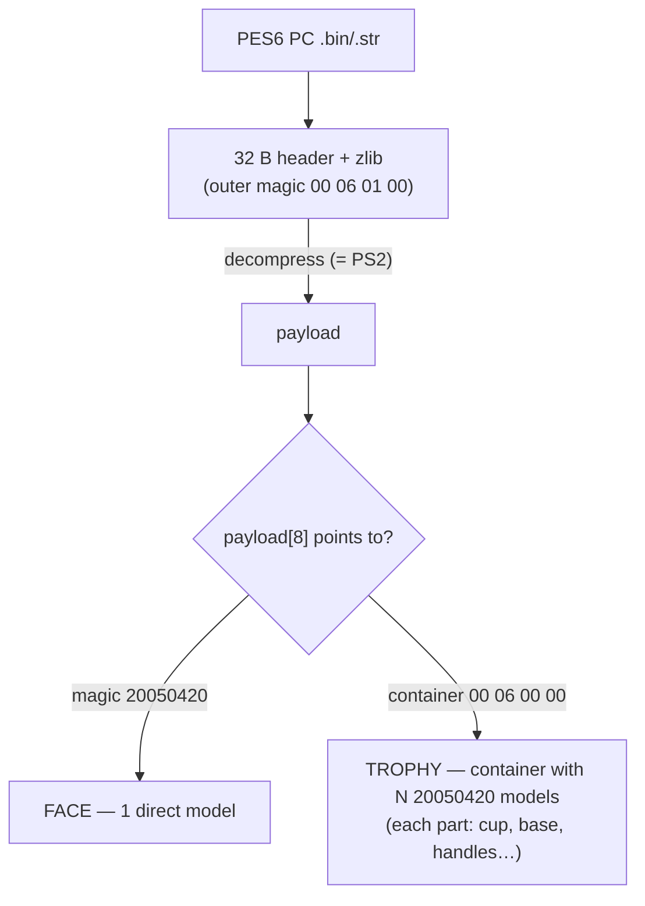
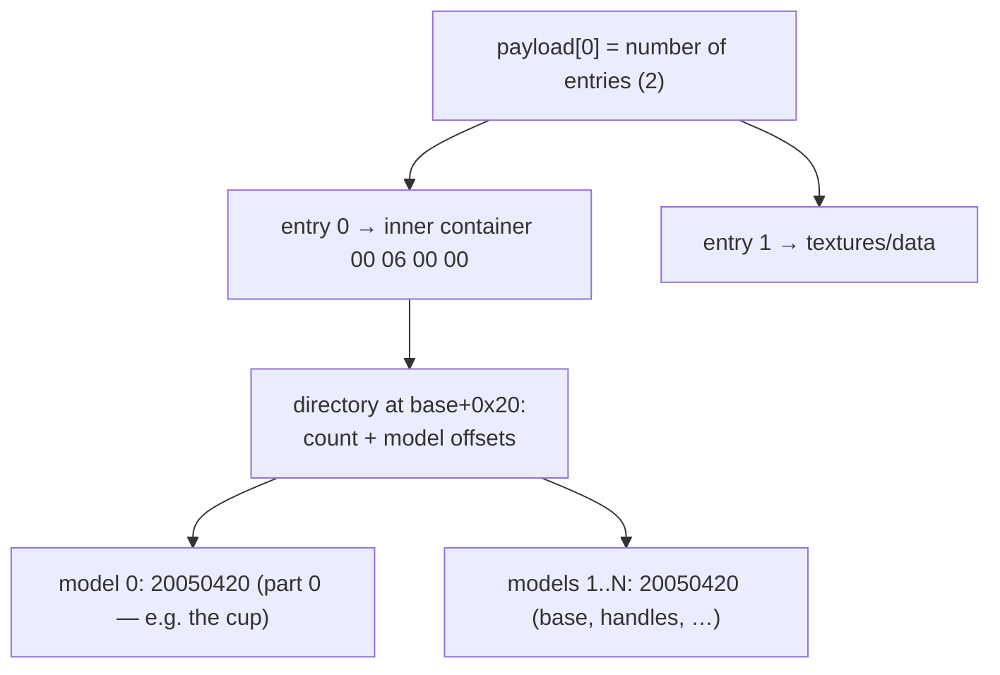
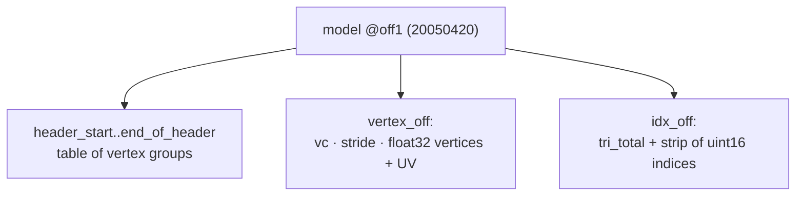
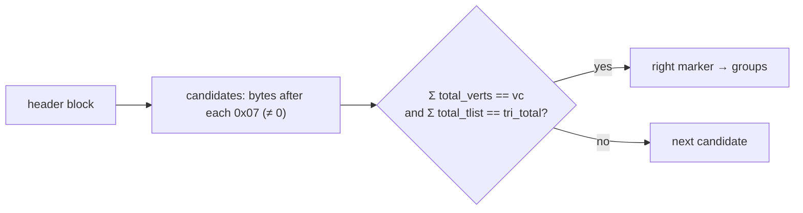

# 12 — PES6 / WE PC

PES6 (and Winning Eleven) for **PC** uses a 3D format that is **different**
from PS2. This document covers what we found and the current support
(**export only**, `.bin/.str → .obj`). PC is a **source** of models: the goal
is to bring them to **PES PS2** (export from PC → Blender → import into a PS2
`.bin`, see [00 — Recipe 7](00-user-guide.md#recipe-7--bring-a-pes6-pc-model-to-ps2)).
The implementation lives on its own in
`adapters/pes6pc/` — it does **not** share the PS2 engine, only the common I/O
(`shared/io`).

> ⚠ **PC ≠ PS2.** Do not mix up the formats. PS2 uses `int16` + the
> `03 00 FF FF` model + VIF/VU microcode. PC uses `float32` + the `20050420`
> model + strips per *vertex group*. The original reference for the PC format
> is the community face exporter.

---

## 1. Overview



- **Decompression is the same as on PS2**: skip 32 bytes, then zlib.
  (`shared/io.decompress_bin` works for both.)
- What changes is the **internal model** (`magic 20050420`, `float32`) and,
  for trophies, the **nested container**.

| | PC face | PC trophy |
|---|---|---|
| `payload[8]` points to | the `20050420` (direct model) | container `00 06 00 00` |
| Number of models | 1 | N (one part per model) |

---

## 2. Trophy container (nested)

The PC trophy is a nested container with a **model directory**:



In practice, the reader does a **robust scan** for the `20050420` magic in the
payload — it finds all the parts without walking the directory (the same idea
as the stadium scan). `find_parts()` returns the offsets; face → 1,
trophy → N.

---

## 3. The PES6 PC model (magic `20050420`)

Each model has a header of 6 `uint32` values after the magic, all **relative
to the start of the model** (`off1`):

```
off1+0  : magic 20 05 04 20
off1+4  : end_of_header, _, mat_info, vertex_off, idx_off, header_start  (6× uint32)
```



### 3.1 Vertices and UVs (float32)

At `vertex_off`: `vc` (uint16) = number of vertices, `vs` = stride in bytes.
Each vertex:

```
3× float32  (x, y, z)          # 12 bytes
(vs − 20) bytes                # padding / normals / weights
2× float32  (u, v)             # 8 bytes  → total = vs
```

### 3.2 Vertex groups + strip (the subtle part)

The triangles are a *triangle strip* split into **vertex groups**. Each group
is a **`07 <m>`** marker in the header block, followed by 4× `uint16`:
`total_tlist, vert_start, total_verts, total_f`.

> **The second byte of the marker changes** between models — faces use
> `07 05`, trophies use `07 26`. Instead of fixing it, the reader **finds**
> the `<m>` that makes the sums match: `Σ total_verts == vc` **and**
> `Σ total_tlist == tri_total`. This avoids false positives (e.g. the `07 00`
> of the `0d 00 07 00` anchor).



The strip indices are **global** (`vert_start` is not added); the strip is
broken at the group borders, and degenerate triangles (restarts) are skipped —
exactly like the reference PC face exporter.

---

## 4. Coordinates

PC faces and trophies use the **same** space: scale `0.025` (the vertex is
already `float32`), raw `(x,y,z)` → OBJ `( +z·0.025 , −x·0.025 , −y·0.025 )`,
UV `(u, 1 − v)`. Checked by rendering: the cup stands up with handles and
base; the face stands up. Implemented in `adapters/pes6pc/coords.py`; all
assets are compared in [11 — Coordinates](11-coordinates.md).

---

## 5. Usage (export only)

PC works like a "model folder" (like stadiums/kits) — `--type pc`:

```bash
python -m wepes3d list   pl.str   --type pc                       # structure (parts)
python -m wepes3d export pl.str   trophy.obj  --type pc --all     # all parts
python -m wepes3d export pl.str   cup.obj     --type pc --model 0 # only part 0
python -m wepes3d export pl.str   out/trophy  --type pc --parts   # 1 .obj per part
python -m wepes3d export face.bin face.obj    --type pc           # PC face (1 model)
```

```python
from wepes3d import list_pc, export_pc, export_pc_complete, export_pc_parts

list_pc("pl.str")                                  # prints the parts (verts/faces)
export_pc_complete("pl.str", "trophy.obj")         # all of them (1 'o part_NN' per part)
export_pc("pl.str", "cup.obj", model=0)            # only part 0
export_pc("face.bin", "face.obj")                  # face = 1 model
```

---

## 6. Status

- ✅ **Export** of PC faces (1 model) and PC trophies (N parts) — by model,
  complete and by parts. The triangle count matches the `total_f` declared in
  each part.
- ➖ **Import into PC files** — not a goal: the target of the project is
  PES PS2.

> PC is **export-only**: `--type pc` exists in the `export` and `list`
> subcommands, but `import` rejects it. To use a PC model in PES PS2, import
> its `.obj` into a PS2 template
> ([Recipe 7](00-user-guide.md#recipe-7--bring-a-pes6-pc-model-to-ps2)).

---

## Next

Coordinates of all assets compared: [11 — Coordinates](11-coordinates.md).
Architecture (why PC is kept apart): [10 — Architecture](10-architecture.md).
