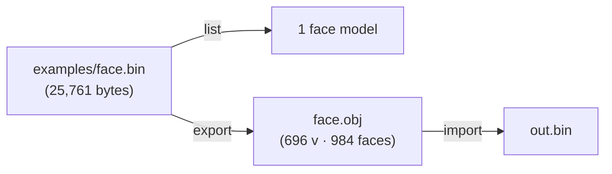
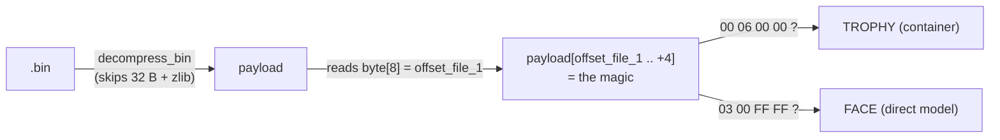
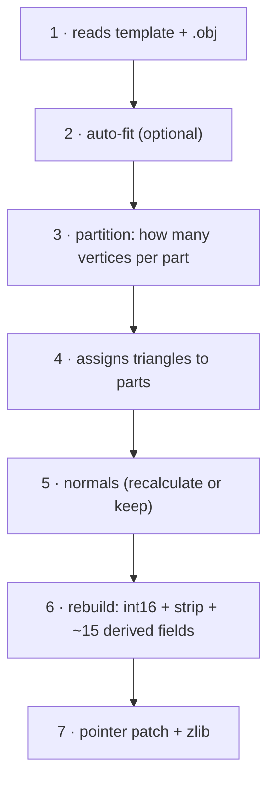
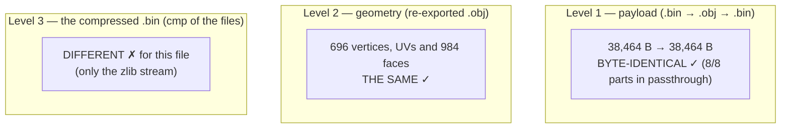
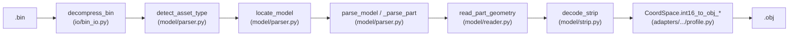

# 13 — Step-by-step example: a face, byte by byte

This document is a **guided tour**. It uses **a real sample file** that comes
with the package — [`examples/face.bin`](../examples/) — and shows the three
operations (`list`, `export`, `import`) **byte by byte**, always saying
**which function of the code reads or writes each byte**.

> **Every number on this page is real.** They were taken from the
> `examples/face.bin` that comes with the package. You can reproduce each one
> with the commands shown here.

Background reading (optional, but it helps):

- [01 — The `.bin` format](01-bin-format.md): the 3 layers of the file.
- [02 — Payload anatomy](02-payload-anatomy.md): the full field map.
- [03 — Import pipeline](03-import-pipeline.md): the 7 phases of `import`.
- [11 — Coordinates](11-coordinates.md): the `int16 ↔ float` conversion.

> **Notation** (the same as in [02](02-payload-anatomy.md)): `byte[X]` =
> absolute offset in the payload; `header[X]` = offset relative to the start of
> a part; `prologue[X]` = offset relative to the start of the part (the VIF
> prologue area). Everything is **little-endian** (the least significant byte
> comes first).

---

## 0. The sample file



Facts about the file (measured):

| Property | Value |
|---|---|
| `.bin` size (compressed) | **25,761 bytes** |
| Payload size (decompressed) | **38,464 bytes** |
| Type | PS2 face/hair (direct model) |
| Parts (geometry sub-blocks) | **8** |
| Vertices per part | **87** in all of them |
| Total vertices | **696** (= 8 × 87) |
| Total triangles | **984** |

Run the commands from the repository root:

```bash
python -m wepes3d list   examples/face.bin --type face
python -m wepes3d export examples/face.bin face.obj --type face
python -m wepes3d import examples/face.bin face.obj out.bin --type face
```

---

## 1. `list` — the minimum number of bytes to identify the file

`list` reads **very few bytes** and says what kind of file it is. Real output:

```text
$ python -m wepes3d list examples/face.bin --type face
examples/face.bin: PS2 face/hair — 1 model (use export to see vertices/faces).
```

### Which bytes it reads



The decision is made in `detect_asset_type` (in
[`shared/model/parser.py`](../wepes3d/shared/model/parser.py)):

1. It reads `byte[8]` of the payload. It is a `uint32` called
   **`offset_file_1`**. In our file it is `0x10` (16).
2. It reads 4 bytes at `payload[0x10]`. They are `03 00 FF FF` → that is the
   **`MAGIC_MODEL`**, so the file is a **face** (the 3D model starts right
   there).
3. If they were `00 06 00 00` (`CONTAINER_MAGIC`), it would be a **trophy**
   (the model is deeper, inside a container — see [08](08-trophies.md)).

### Comparison: face × trophy

The same `list` operation on a trophy reads the **section directory** and
shows several sub-models (real output with the test trophy):

```text
$ python -m wepes3d list trophy.bin --type trophy
trophy.bin: PS2 trophy — 9 section(s) (sub-models).
  section  0: offset 0x60  (main)
  section  1: offset 0x8600
  ...
  section  8: offset 0x23AC0
```

| | Face (`examples/face.bin`) | Trophy |
|---|---|---|
| `payload[8]` points to | the model (`03 00 FF FF`) | a container (`00 06 00 00`) |
| How many models | **1** | **N** (here, 9 sections) |
| Function that reads it | `detect_asset_type` | `trophy_section_offsets` |

---

## 2. `export` (reading): from `.bin` to `.obj`, byte by byte

`export` goes **`.bin → .obj`**. It walks through the **3 layers** of the file.


### 2.1 — Layer 1: decompress (`decompress_bin`)

The **first 32 bytes** of the `.bin` are the *outer header* (they are not
compressed). After them comes the `zlib` blob. The real hex of the 32 bytes:

```text
offset │ 00 01 02 03  04 05 06 07  08 09 0A 0B  0C .. 1F
───────┼──────────────────────────────────────────────────
 0x00  │ 00 06 01 00  81 64 00 00  40 96 00 00  00 .. 00
        └─ magic ───┘ └ comp_size ┘ └ deco_size ┘ └ zeros ┘
          00 06 01 00   0x6481      0x9640
          (PES)         = 25,729    = 38,464
```

| Field | Bytes | Value | Meaning |
|---|---|---|---|
| magic | `0x00..0x04` | `00 06 01 00` | "compressed PES asset" |
| `comp_size` | `0x04..0x08` | `25,729` | size of the zlib blob |
| `deco_size` | `0x08..0x0C` | `38,464` | size of the payload (matches the table above) |

`decompress_bin` (in [`shared/io/bin_io.py`](../wepes3d/shared/io/bin_io.py))
returns three things: the **payload** (the 38,464 decompressed bytes), the
**outer header** (these 32 bytes, kept untouched for the way back) and the
**trailing** data (empty here).

### 2.2 — Layer 2: find the model and read the parts (`parse_model`)

The payload starts with **272 bytes** of header — the `pre_parts`. The real
hex of its beginning:

```text
        00 01 02 03  04 05 06 07  08 09 0A 0B  0C 0D 0E 0F
 0x00 │ 02 00 00 00  08 00 00 00  10 00 00 00  c0 41 00 00
 0x10 │ 03 00 ff ff  08 00 00 00  80 00 00 00  01 00 00 00
 0x30 │ 08 00 00 00  00 01 00 00  00 00 00 00  b0 41 00 00
```

The fields that the code uses (real values of this file):

| Offset | Value | Name | Who reads it / why |
|---|---|---|---|
| `byte[0x00]` | `2` | flag/version | kept |
| `byte[0x04]` | `8` | **`MAX_PARTS_HARD`** | fixed buffer size. **Never** change it. |
| `byte[0x08]` | `0x10` | **`offset_file_1`** | where the model starts |
| `byte[0x0C]` | `0x41C0` | **`parts_end`** | pointer to the end of the parts |
| `byte[0x10]` | `03 00 FF FF` | **`MAGIC_MODEL`** | start of the model |
| `byte[0x30]` | `8` | **`total_parts`** | at `offset_file_1 + 0x20` = `0x10+0x20` |
| `byte[0x34]` | `0x100` | `parts_start_rel` | where the 1st part starts (relative) |
| `byte[0x3C]` | `0x41B0` | **end of the parts (relative)** | at `offset_file_1 + 0x2C`: `0x41C0 − 0x10` (see [02 §2](02-payload-anatomy.md#why-does-parts_end-show-up-twice)) |

`parse_model` reads `total_parts` (= 8) and the offset of the 1st part, and
then slices the payload:

```text
payload (38,464 B)
┌──────────────┬───────────────────────────────────────┬──────────────────────┐
│  pre_parts   │            8 parts (geometry)          │      post_parts      │
│   272 B      │   16,560 B  (~2 KB each)               │     21,632 B         │
│ 0x0000       │ 0x0110                          0x41C0 │ 0x41C0       0x9640  │
└──────────────┴───────────────────────────────────────┴──────────────────────┘
                       ▲                                    ▲
                       parts_start (byte[0x34]+offset)      parts_end (byte[0x0C])
```

The 8 parts, measured (all with 87 vertices):

| Part | Offset | Size | vertices | strip (V4-16 elements) |
|---|---|---|---|---|
| 0 | `0x00110` | 2,048 | 87 | 43 |
| 1 | `0x00910` | 2,048 | 87 | 43 |
| 2 | `0x01110` | 2,080 | 87 | 48 |
| 3 | `0x01930` | 2,080 | 87 | 48 |
| 4 | `0x02150` | 2,080 | 87 | 47 |
| 5 | `0x02970` | 2,080 | 87 | 47 |
| 6 | `0x03190` | 2,064 | 87 | 46 |
| 7 | `0x039A0` | 2,080 | 87 | 48 |

### 2.3 — Layer 3: inside a part

Let us open **Part 0** (offset `0x110`, size 2,048). A part has 4 zones:

```text
Part 0  (2,048 bytes)
┌──────────────────────────────────────────────────────────────────────┐
│ +0x000  HEADER (176 B)                                                 │
│         part_size · QWC · strip_total · vbe/ss copies · 12 floats      │
├──────────────────────────────────────────────────────────────────────┤
│ +0x0B0  VIF PROLOGUE (96 B)                                            │
│         a "recipe" for the PS2 VU1: vbe · ss · se · vc · STCYCL        │
├──────────────────────────────────────────────────────────────────────┤
│ +0x110  GEOMETRY                                                       │
│         tag+vertices (87×6 B) · tag+normals (87×6 B) · tag+UVs (87×4 B)│
├──────────────────────────────────────────────────────────────────────┤
│ +...    STRIP                                                          │
│         marker (8 B) · tag (4 B) · indices (43 × 8 B)                  │
└──────────────────────────────────────────────────────────────────────┘
```

**Part header** — the real hex of the first 0x14 bytes (relative to the part):

```text
        +0x00       +0x04       +0x08       +0x0C       +0x10
 +0x00 │ 00 08 00 00 00 00 00 00 b0 00 00 00 75 00 00 00 ac 00 00 00
         └ part_size┘             └ 0xB0 ───┘ └ 0x75 ───┘ └ 0xAC ───┘
           0x800=2048               prologue   QWC=117     strip_total=172
```

| `header[X]` | Value | Formula | Function that writes it |
|---|---|---|---|
| `0x00` part_size | `2048` | total size, aligned to 16 | `rebuild_part` |
| `0x08` part_info_start | `0xB0` | where the prologue starts | (template constant) |
| `0x0C` QWC | `117` | `(part_size − 0xB0) / 16` | `rebuild_part` |
| `0x10` strip_total | `172` | `strip_num × 4` = `43 × 4` | `rebuild_part` |
| `0x2C` vbe (copy) | `352` | `4 × vc + 4` = `4×87+4` | `rebuild_part` |
| `0x30` ss (copy) | `356` | `4 × vc + 8` = `4×87+8` | `rebuild_part` |

**VIF prologue** — the numbers that the PS2 VU1 uses to decode the geometry
(see [04 — VIF and VU1](04-vif-and-vu1.md)). Real values (Part 0, `vc = 87`):

| `prologue[X]` | Value | Hex | Formula |
|---|---|---|---|
| `0xC2` vbe | `352` | `0x160` | `4 × vc + 4` |
| `0xC8` ss | `356` | `0x164` | `4 × vc + 8` |
| `0xCA` se | `399` | `0x18F` | `ss + strip_num` = `356 + 43` |
| `0xF6` vbe (copy) | `352` | `0x160` | `4 × vc + 4` |
| `0xF8` vbe (copy) | `352` | `0x160` | `4 × vc + 4` |
| `0x108` vc (1 byte) | `87` | `0x57` | `vc` |
| `0x10C` STCYCL | — | `04 01 00 01` | CL=4 WL=1 (interleaved layout) |

> **Why does `vbe` appear 3 times** (`0xC2`, `0xF6`, `0xF8`) **and again in the
> header (`0x2C`)?** Because different stages of the hardware read the value
> from different places. Forget **one** copy → invisible face in the game.
> This redundancy is the
> [heart of the problem](02-payload-anatomy.md#5-the-map-of-the-bytes-you-need-to-write)
> that the package solves for you.

**The 3 geometry tags.** Right after the prologue, 3 VIF "labels" of 4 bytes
mark each block. The format is `IMMED(2) · NUM(1) · CMD(1)`:

```text
vertices │ 04 80 57 69 │ IMMED=0x8004 · NUM=0x57=87 · CMD=0x69 (V3-16, 3×int16)
normals  │ 05 80 57 69 │ IMMED=0x8005 · NUM=0x57=87 · CMD=0x69 (V3-16)
UVs      │ 07 80 57 65 │ IMMED=0x8007 · NUM=0x57=87 · CMD=0x65 (V2-16, 2×int16)
```

`NUM = 0x57 = 87` is the number of vertices. `CMD` gives the format of each
element (`0x69` = 3 16-bit integers; `0x65` = 2 16-bit integers).

**The geometry bytes.** The real hex right after the vertex tag (offset
`+0x110`):

```text
 +0x110 │ 04 80 57 69 │ 25 01 aa fb 00 00 │ 09 02 f3 fb 00 00 │ ...
           └ tag ────┘   └ vertex 0 ─────┘   └ vertex 1 ─────┘
                          (0x0125, 0xFBAA, 0x0000)
                          = (293, −1110, 0)   ← stored order: (y, z, x)
```

`read_part_geometry` (in [`shared/model/reader.py`](../wepes3d/shared/model/reader.py))
reads these integers. **Vertex 0** is `(y, z, x) = (293, −1110, 0)`.

**The strip.** At the end of the part come the indices that join the vertices
into triangles. The first bytes of the strip (Part 0):

```text
marker (8 B) + tag (4 B) + indices...
01 00 00 05 01 01 00 01 │ 64 c1 2b 6d │ 04 80 │ 0c 80 │ 08 00 │ ...
└─ VIF_STRIP_MARKER ───┘   └ tag ────┘  index0  index1  index2
                            IMMED=0xC164
                            NUM=0x2B=43
                            CMD=0x6D (V4-16)
```

Each index is an `int16`. Bit 15 (the highest) is a **control flag**, and the
rest is `(local_vertex + 1) × 4`. Decoding the first 3:

```text
0x8004 → bit15=1 (does not fire) · (4 & 0x7FFF)/4 − 1 = vertex 0
0x800C → bit15=1 (does not fire) · (0x0C)/4 − 1      = vertex 2
0x0008 → bit15=0 (FIRES!)        · (0x08)/4 − 1      = vertex 1
                                   → triangle (0, 2, 1)
```

The full details of the strip (the 3 cases of the decoder, the *winding*) are
in [05 — Strip encoding](05-strip-encoding.md).

### 2.4 — `int16 → float`: the `CoordSpace` (layer 3 → `.obj`)

The integers become Blender coordinates through the **face CoordSpace**
([`adapters/pesweps2/faces/profile.py`](../wepes3d/adapters/pesweps2/faces/profile.py)).
For the face, with `f = −0.001553`:

```text
stored (y, z, x) → obj (x, y, z) = ( x · f · −1 ,  y · f ,  z · f )
```

Applied to **vertex 0** = `(y, z, x) = (293, −1110, 0)`:

```text
obj.x =     0 · (−0.001553) · (−1) =  0.000000
obj.y =   293 · (−0.001553)        = −0.455029
obj.z = −1110 · (−0.001553)        =  1.723830
```

And that is exactly the **first line** of the exported `.obj`:

```text
v 0.000000 -0.455029 1.723830     ← it matches!
```

The stored **UV 0** is `(u, v) = (2047, 69)`. With `UV_FACTOR = 0.000244` and
V flipped (see [11](11-coordinates.md)):

```text
obj.u =     2047 · 0.000244  = 0.499468
obj.v = 1 − (69 · 0.000244)  = 0.983164
→  vt 0.499468 0.983164           ← it matches the .obj!
```

> **Why does this never lose information?** The math is linear
> (`obj = s · f`), so `round(obj / f) == s` for every `s` in the `int16` range.
> Going back from `.obj` to `.bin` gives the **same integers**. This is the
> base of the roundtrip (section 4).

### 2.5 — The `.obj` that comes out

The real header and first lines of the export:

```text
# face section 0 of examples/face.bin
# wepes3d export — v=696 vt=696 f=984

mtllib face.mtl
usemtl material1

v 0.000000 -0.455029 1.723830
v 0.000000 -0.809113 1.610461
...
vt 0.499468 0.983164
...
f 1/1 3/3 2/2
```

> The face `f 1/1 3/3 2/2` uses **1-based** indices (the `.obj` standard). In
> base 0 it is the triangle `(0, 2, 1)` — the **same** one we decoded from the
> strip in section 2.3.

And the `.mtl` (it points to the texture, which you extract separately):

```text
# generated by wepes3d

newmtl material1
	map_Kd face.png
```

---

## 3. `import` (conversion): from `.obj` to `.bin`

`import` goes the other way, **`.obj → .bin`**, in **7 phases** (details in
[03 — Import pipeline](03-import-pipeline.md)). Real output (shortened) when
importing `face.obj` again without edits:

```text
[1/7] Loading face .bin template: examples/face.bin
      Parts: 8, total vertices: 696
[2/7] Loading .obj file: face.obj
      Vertices: 696, UVs: 696, Faces (triangles): 984
[3/7] Calculating vertex distribution across parts...
      Count matches the template — using the original distribution.
[4/7] Assigning triangles to parts...
      Part 0: 130 faces (triangles) ...
[5/7] Preserving template normals...
[6/7] Converting and rebuilding parts...
      Part 0: 87 v IDENTICAL to the template — original strip kept (zero-diff)
      ...                                                (the same for all 8 parts)
[7/7] Writing .bin...
      Payload: 38464 bytes (the template had 38464)
      Parts with identical size — no pointers to fix
=== COMPLETED SUCCESSFULLY ===
```

Without edits, **all 8 parts pass through** (*passthrough*): no byte of the
payload is encoded again. To see the rebuild in action, move the 1st vertex of
`face.obj` (`v 0.000000 …` → `v 0.100000 …`) and import again — only its part
changes:

```text
[6/7] Converting and rebuilding parts...
      Part 0: 87 -> 87 v, size 2048 -> 2144 +96, 130 tris
      Part 1: 87 v IDENTICAL to the template — original strip kept (zero-diff)
      ...
[7/7] Writing .bin...
      Payload: 38560 bytes (the template had 38464)
      Part sizes have changed: 0x41C0 -> 0x4220
      Container pointers fixed: 2
      Model header parts_end (rel.): 0x4210
```

### What each phase does



### The "derived bytes" that `import` writes again

When a part changes size (e.g. the edited Part 0 went from 2,048 → 2,144
bytes), the code computes and writes **several fields at once** — forgetting
one breaks the model in the game. `rebuild_part` takes care of the part
fields:

```text
                          vc=87 (did not change)        strip_num changed
                          ──────────────────────        ─────────────────
header[0x2C] = 4·vc+4     prologue[0xC2] = 4·vc+4       header[0x10]   = strip_num·4
header[0x30] = 4·vc+8     prologue[0xC8] = 4·vc+8       prologue[0xCA] = ss + strip_num
                          prologue[0xF6] = 4·vc+4       strip tag NUM  = strip_num
header[0x00] = part_size  prologue[0xF8] = 4·vc+4
header[0x0C] = QWC        prologue[0x108] = vc
```

Then the `importer` fixes the **global pointers** in `pre_parts` (the
`parts_end` values we saw in section 2.2): since the end of the parts moved
from `0x41C0` to `0x4220`, it adds the same `Δ` to `byte[0x0C]` (absolute) and
writes the end **relative to the model** at `byte[0x3C]`
(`offset_file_1 + 0x2C` = `0x4220 − 0x10` = `0x4210`) — these are the last
three lines of the output above.

> The **full map** of these ~15 bytes, with formulas, is in
> [02 §5](02-payload-anatomy.md#5-the-map-of-the-bytes-you-need-to-write).

---

## 4. Roundtrip: what "identical" means in each layer

Exporting and importing again **without edits** is the best test of
faithfulness. But "identical" has **three different levels**, and it is
important not to mix them up. Real measurements of this `examples/face.bin`:



| Level | What is compared | Result | Why |
|---|---|---|---|
| **1. Payload** | template payload × output payload | **identical** | without edits, every part passes through (the original strip is kept) |
| **2. Geometry** | the `v`/`vt`/`f` lines of the two `.obj` files | **identical** | the `CoordSpace` is a bijection (section 2.4) |
| **3. `.bin`** | `cmp original_file new_file` | **differs** | only the compression — see below |

**Why Level 3 (the final `.bin`) differs**, even with an identical payload: the
`import` compresses again with Python's zlib (level 9), which writes a valid
stream that is **different** from the one PES wrote for this file — here,
25,748 bytes against 25,761 for the original. Both decompress to the same
payload; only the **compressed bytes** do not match. For other files Python's
zlib reproduces the original and the `.bin` comes out identical (this is the
case of the test trophy, `tests/seed/trophy.bin`).

```text
                     payload          compressed .bin
template (game)      38,464 B         25,761 B  (PES zlib)
output (reimport)    38,464 B         25,748 B  (Python zlib)
                     └ identical       └ different zlib stream
```

> Before the fix of
> [Bug 13](06-bug-history.md#bug-13--degenerate-triangle-in-decode_strip),
> parts 2 and 3 of this file were encoded again for no reason (a degenerate
> triangle made the passthrough think they had changed) and the payload grew
> by 96 B.

### How to really check the roundtrip

Compare the **payload** (Level 1), not the compressed bytes:

```bash
# 1. export the original
python -m wepes3d export examples/face.bin a.obj --type face
# 2. import it again without edits
python -m wepes3d import examples/face.bin a.obj out.bin --type face
# 3. compare the decompressed payloads
python -c "from wepes3d import decompress_bin as d; print(d('examples/face.bin')[0] == d('out.bin')[0])"
# True
```

For the **geometry** (useful when you edited the `.obj`), export the output
again and compare only the `v`/`vt`/`f` lines: the top comment and the `mtllib`
line contain the file names, so they always differ.

---

## 5. Final map: each byte ↔ the function that handles it



| Byte region | Who reads it (export) | Who writes it (import) |
|---|---|---|
| outer header (32 B) | `decompress_bin` | `compress_bin` |
| `payload[8]` magic | `detect_asset_type` | (kept) |
| `pre_parts` (pointers) | `parse_model` | `importer` (`parts_end` patch) |
| part header + prologue | `_parse_part` | `rebuild_part` |
| vertices / normals / UVs | `read_part_geometry` | `rebuild_part` |
| strip (indices) | `read_part_geometry` / `decode_strip` | `strip` / `strip_connected` |
| `int16 ↔ float` | `CoordSpace.int16_to_obj_*` | `CoordSpace.obj_to_int16_*` |

---

## Summary

- `list` reads **one field** (`payload[8]` + 4 bytes of magic) to tell a face
  from a trophy.
- `export` goes down the 3 layers (decompress → find the model → read each
  part) and uses the `CoordSpace` to produce the `.obj`. **Every number on this
  page was checked** against the generated `.obj`.
- `import` writes **~15 derived fields** per part + the global pointers again.
- "Identical" has 3 levels: **payload** (byte-identical in the roundtrip),
  **geometry** (lossless) and the **compressed `.bin`** (identical only when
  Python's zlib reproduces the game's — not the case for this file).

Next steps: [02 — Payload anatomy](02-payload-anatomy.md) (the field map) ·
[03 — Import pipeline](03-import-pipeline.md) (the 7 phases) ·
[05 — Strip encoding](05-strip-encoding.md).
