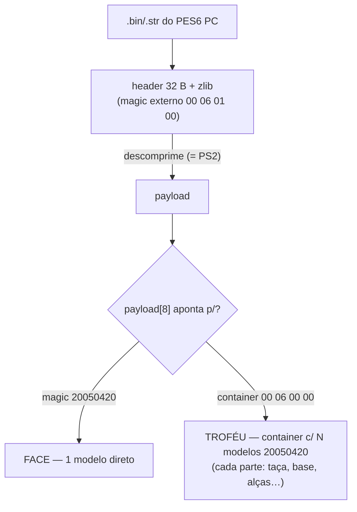
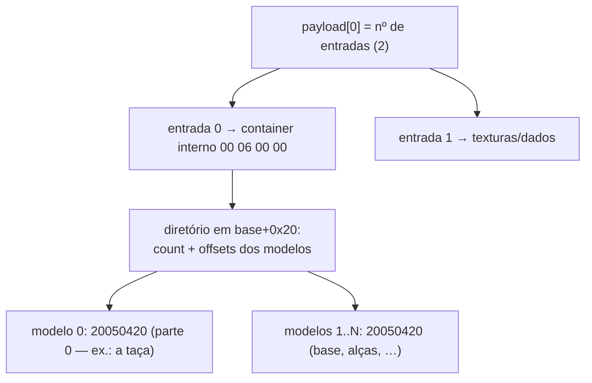
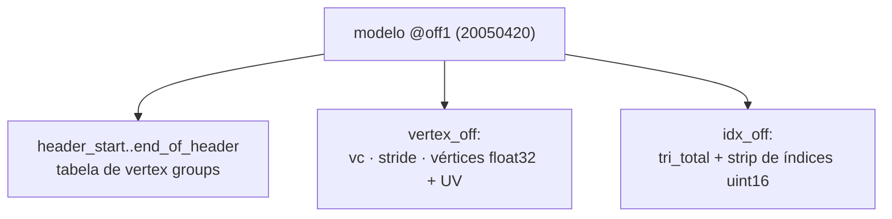
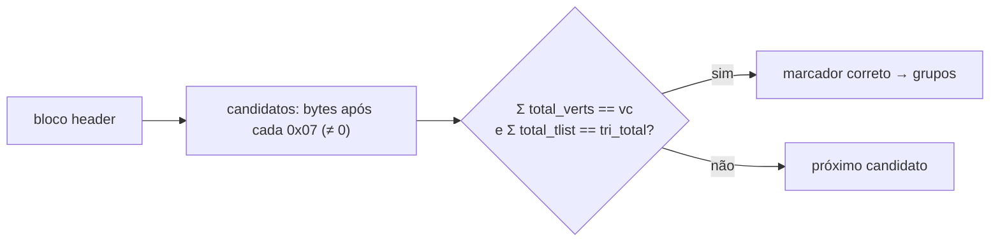

# 13 — PES6 / WE PC

O PES6 (e Winning Eleven) para **PC** usa um formato 3D **diferente** do PS2. Este
documento cobre o que descobrimos e o suporte atual (**só export** `.bin/.str → .obj`).
Implementação isolada em `adapters/pes6pc/` — **não** compartilha o motor PS2, só a
I/O comum (`shared/io`).

> ⚠ **PC ≠ PS2.** Não confunda os formatos. O PS2 usa `int16` + modelo `03 00 FF FF`
> + microcode VIF/VU. O PC usa `float32` + modelo `20050420` + strips por *vertex
> group*. A referência original do formato PC é o exportador de faces da comunidade.

---

## 1. Visão geral



- A **descompactação é igual à do PS2**: pula 32 bytes, zlib. (`shared/io.decompress_bin`
  funciona para os dois.)
- O que muda é o **modelo interno** (`magic 20050420`, `float32`) e, no troféu, o
  **container aninhado**.

| | Face PC | Troféu PC |
|---|---|---|
| `payload[8]` aponta p/ | o `20050420` (modelo direto) | container `00 06 00 00` |
| Nº de modelos | 1 | N (uma parte por modelo) |

---

## 2. Container de troféu (aninhado)

O troféu PC é um container aninhado com um **diretório de modelos**:



Na prática, o leitor faz um **scan robusto** do magic `20050420` no payload — acha
todas as partes sem depender de navegar o diretório (mesma filosofia do scan de
estádios). `find_parts()` devolve os offsets; face → 1, troféu → N.

---

## 3. Modelo PES6 PC (magic `20050420`)

Cada modelo tem um header de 6 `uint32` após o magic, todos **relativos ao início do
modelo** (`off1`):

```
off1+0  : magic 20 05 04 20
off1+4  : end_of_header, _, mat_info, vertex_off, idx_off, header_start  (6× uint32)
```



### 3.1 Vértices e UVs (float32)

Em `vertex_off`: `vc` (uint16) = nº de vértices, `vs` = stride em bytes. Cada vértice:

```
3× float32  (x, y, z)          # 12 bytes
(vs − 20) bytes               # padding / normais / pesos
2× float32  (u, v)             # 8 bytes  → total = vs
```

Conversão para OBJ (espaço do Blender): `x = z·0.025`, `y = −x·0.025`, `z = −y·0.025`,
`uv = (u, 1 − v)`. Ver [12 — Coordenadas](12-coordenadas.md).

### 3.2 Vertex groups + strip (a parte sutil)

Os triângulos são um *triangle strip* dividido em **vertex groups**. Cada grupo é um
marcador **`07 <m>`** no bloco header, seguido de 4× `uint16`:
`total_tlist, vert_start, total_verts, total_f`.

> **O segundo byte do marcador varia** entre modelos — face usa `07 05`, troféu usa
> `07 26`. Em vez de fixar, o leitor **descobre** qual `<m>` faz as contas fecharem:
> `Σ total_verts == vc` **e** `Σ total_tlist == tri_total`. Isso evita falsos
> positivos (ex.: o `07 00` do âncora `0d 00 07 00`).



Os índices do strip são **globais** (não se soma `vert_start`); o strip é quebrado
nos limites de grupo, e triângulos degenerados (restart) são pulados — exatamente
como o exportador de faces PC de referência.

---

## 4. Coordenadas

| | PES6 PC (face e troféu) |
|---|---|
| Escala | `0.025` (vértice já é `float32`) |
| raw `(x,y,z)` → obj | `( +z·0.025 , −x·0.025 , −y·0.025 )` |
| UV | `(u, 1 − v)` |

Face e troféu PC usam o **mesmo** espaço (validado renderizando: a taça fica em pé
com alças e base; o rosto fica em pé). Implementado em `adapters/pes6pc/coords.py`.

---

## 5. Uso (só export)

PC é tratado como "pasta de modelos" (como estádio/kit) — `--type pc`:

```bash
python -m wepes3d list   pl.str  --type pc              # estrutura (partes)
python -m wepes3d export pl.str  trofeu.obj --type pc --all      # todas as partes
python -m wepes3d export pl.str  taca.obj   --type pc --model 0  # só a parte 0
python -m wepes3d export pl.str  out/trofeu --type pc --parts    # 1 .obj por parte
python -m wepes3d export face.bin rosto.obj --type pc            # face PC (1 modelo)
```

```python
from wepes3d import list_pc, export_pc, export_pc_complete, export_pc_parts

list_pc("pl.str")                                  # imprime as partes (verts/faces)
export_pc_complete("pl.str", "trofeu.obj")         # todas combinadas (1 'o part_NN' por parte)
export_pc("pl.str", "taca.obj", model=0)           # só a parte 0
export_pc("face.bin", "rosto.obj")                 # face = 1 modelo
```

---

## 6. Status

- ✅ **Export** de face PC (1 modelo) e troféu PC (N partes) — por modelo, completo
  e por partes. Contagem de triângulos bate com o `total_f` declarado em cada parte.
- ⏳ **Import** (.obj → .bin PC) — não implementado.

> O PC é **export-only** por enquanto: o `--type pc` existe nos subcomandos `export`
> e `list`, mas é rejeitado no `import`.

---

## Próximo

Comparação de coordenadas entre todos os assets: [12 — Coordenadas](12-coordenadas.md).
Arquitetura (por que PC fica isolado): [11 — Arquitetura](11-arquitetura.md).
