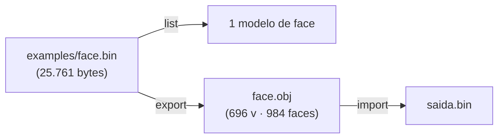
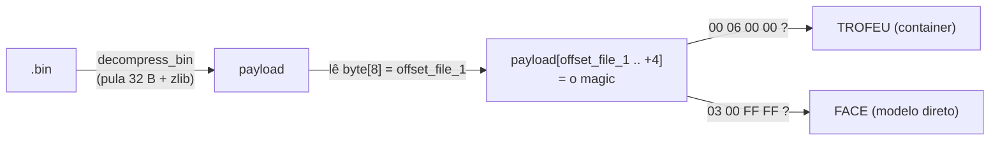
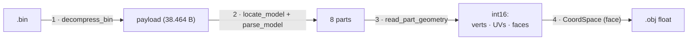
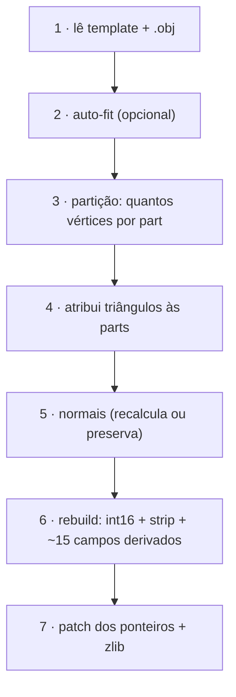
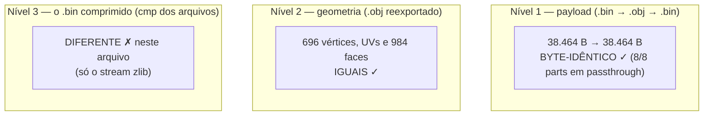
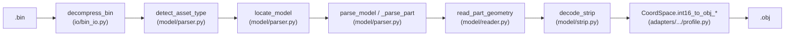

# 14 — Exemplo passo a passo: a face byte a byte

Este documento é um **passeio guiado**. Ele usa **um arquivo de exemplo real** que
vem dentro do pacote — [`examples/face.bin`](../examples/) — e mostra as três
operações (`list`, `export`, `import`) **byte a byte**, sempre dizendo **qual
função do código lê ou escreve cada byte**.

> **Todos os números desta página são reais.** Eles foram extraídos do
> `examples/face.bin` que acompanha o pacote. Você pode reproduzir cada um deles
> com os comandos mostrados aqui.

Pré-requisitos de leitura (opcionais, mas ajudam):

- [01 — Formato `.bin`](01-formato-bin.md): as 3 camadas do arquivo.
- [02 — Anatomia do payload](02-anatomia-payload.md): o mapa de campos completo.
- [03 — Pipeline](03-pipeline.md): as 7 fases do `import`.
- [12 — Coordenadas](12-coordenadas.md): a conversão `int16 ↔ float`.

> **Notação** (igual ao [02](02-anatomia-payload.md)): `byte[X]` = offset absoluto
> no payload; `header[X]` = offset relativo ao início de uma part; `prologue[X]` =
> offset relativo ao início do VIF prologue. Tudo é **little-endian** (o byte menos
> significativo vem primeiro).

---

## 0. O arquivo de exemplo



Fatos do arquivo (medidos):

| Propriedade | Valor |
|---|---|
| Tamanho do `.bin` (comprimido) | **25.761 bytes** |
| Tamanho do payload (descomprimido) | **38.464 bytes** |
| Tipo | face/cabelo PS2 (modelo direto) |
| Parts (sub-blocos de geometria) | **8** |
| Vértices por part | **87** em todas |
| Vértices no total | **696** (= 8 × 87) |
| Triângulos no total | **984** |

Rode os comandos a partir da raiz do repositório:

```bash
python -m wepes3d list   examples/face.bin --type face
python -m wepes3d export examples/face.bin face.obj --type face
python -m wepes3d import examples/face.bin face.obj saida.bin --type face
```

---

## 1. `list` — o mínimo de bytes para identificar o arquivo

`list` lê **bem poucos bytes** e diz que tipo de arquivo é. Saída real:

```text
$ python -m wepes3d list examples/face.bin --type face
examples/face.bin: PS2 face/cabelo — 1 modelo (use export para ver vertices/faces).
```

### Quais bytes ele lê



O passo de decisão está em `detect_asset_type` (em
[`shared/model/parser.py`](../wepes3d/shared/model/parser.py)):

1. Lê `byte[8]` do payload. É um `uint32` chamado **`offset_file_1`**. No nosso
   arquivo vale `0x10` (16).
2. Lê 4 bytes em `payload[0x10]`. Eles valem `03 00 FF FF` → é o **`MAGIC_MODEL`**,
   logo o arquivo é uma **face** (o modelo 3D começa ali mesmo).
3. Se valessem `00 06 00 00` (`CONTAINER_MAGIC`), seria um **troféu** (o modelo
   está mais fundo, dentro de um container — ver [08](08-trofeus.md)).

### Comparação: face × troféu

A mesma operação `list` em um troféu lê o **diretório de seções** e mostra vários
sub-modelos:

```text
$ python -m wepes3d list trofeu.bin --type trophy
trofeu.bin: PS2 trofeu — 9 secao(oes) (sub-modelos).
  secao  0: offset 0x60  (principal)
  secao  1: offset 0x8600
  ...
  secao  8: offset 0x23AC0
```

| | Face (`examples/face.bin`) | Troféu |
|---|---|---|
| `payload[8]` aponta para | o modelo (`03 00 FF FF`) | um container (`00 06 00 00`) |
| Quantos modelos | **1** | **N** (aqui, 9 seções) |
| Função que lê | `detect_asset_type` | `trophy_section_offsets` |

---

## 2. `export` (leitura): do `.bin` ao `.obj`, byte a byte

`export` faz o caminho **`.bin → .obj`**. Ele percorre as **3 camadas** do arquivo.



### 2.1 — Camada 1: descomprimir (`decompress_bin`)

Os **primeiros 32 bytes** do `.bin` são o *outer header* (não são comprimidos).
Depois deles vem o blob `zlib`. Hex real dos 32 bytes:

```text
offset │ 00 01 02 03  04 05 06 07  08 09 0A 0B  0C .. 1F
───────┼──────────────────────────────────────────────────
 0x00  │ 00 06 01 00  81 64 00 00  40 96 00 00  00 .. 00
        └─ magic ───┘ └ comp_size ┘ └ deco_size ┘ └ zeros ┘
          00 06 01 00   0x6481      0x9640
          (PES)         = 25.729    = 38.464
```

| Campo | Bytes | Valor | Significado |
|---|---|---|---|
| magic | `0x00..0x04` | `00 06 01 00` | "asset comprimido do PES" |
| `comp_size` | `0x04..0x08` | `25.729` | tamanho do blob zlib |
| `deco_size` | `0x08..0x0C` | `38.464` | tamanho do payload (confere com a tabela acima) |

`decompress_bin` (em [`shared/io/bin_io.py`](../wepes3d/shared/io/bin_io.py)) devolve três
coisas: o **payload** (os 38.464 bytes descomprimidos), o **outer header** (esses 32
bytes, guardados intactos para a volta) e o **trailing** (aqui, vazio).

### 2.2 — Camada 2: achar o modelo e ler as parts (`parse_model`)

O payload começa por **272 bytes** de cabeçalho — o `pre_parts`. Hex real do
começo dele:

```text
        00 01 02 03  04 05 06 07  08 09 0A 0B  0C 0D 0E 0F
 0x00 │ 02 00 00 00  08 00 00 00  10 00 00 00  c0 41 00 00
 0x10 │ 03 00 ff ff  08 00 00 00  80 00 00 00  01 00 00 00
 0x30 │ 08 00 00 00  00 01 00 00  00 00 00 00  b0 41 00 00
```

Os campos que o código usa (valores reais deste arquivo):

| Offset | Valor | Nome | Quem lê / por quê |
|---|---|---|---|
| `byte[0x00]` | `2` | flag/versão | preservado |
| `byte[0x04]` | `8` | **`MAX_PARTS_HARD`** | capacidade fixa do buffer. **Nunca** mexer. |
| `byte[0x08]` | `0x10` | **`offset_file_1`** | onde começa o modelo |
| `byte[0x0C]` | `0x41C0` | **`parts_end`** | ponteiro para o fim das parts |
| `byte[0x10]` | `03 00 FF FF` | **`MAGIC_MODEL`** | início do modelo |
| `byte[0x30]` | `8` | **`total_parts`** | em `offset_file_1 + 0x20` = `0x10+0x20` |
| `byte[0x34]` | `0x100` | `parts_start_rel` | onde a 1ª part começa (relativo) |
| `byte[0x3C]` | `0x41B0` | **fim das parts (relativo)** | em `offset_file_1 + 0x2C`: `0x41C0 − 0x10` (ver [02 §2](02-anatomia-payload.md#por-que-parts_end-aparece-duas-vezes)) |

`parse_model` lê `total_parts` (= 8) e o offset da 1ª part, e então fatia o payload:

```text
payload (38.464 B)
┌──────────────┬───────────────────────────────────────┬──────────────────────┐
│  pre_parts   │            8 parts (geometria)         │      post_parts      │
│   272 B      │   16.560 B  (~2 KB cada)               │     21.632 B         │
│ 0x0000       │ 0x0110                          0x41C0 │ 0x41C0       0x9640  │
└──────────────┴───────────────────────────────────────┴──────────────────────┘
                       ▲                                    ▲
                       parts_start (byte[0x34]+offset)      parts_end (byte[0x0C])
```

As 8 parts, medidas (todas com 87 vértices):

| Part | Offset | Tamanho | vértices | strip (elementos V4-16) |
|---|---|---|---|---|
| 0 | `0x00110` | 2.048 | 87 | 43 |
| 1 | `0x00910` | 2.048 | 87 | 43 |
| 2 | `0x01110` | 2.080 | 87 | 48 |
| 3 | `0x01930` | 2.080 | 87 | 48 |
| 4 | `0x02150` | 2.080 | 87 | 47 |
| 5 | `0x02970` | 2.080 | 87 | 47 |
| 6 | `0x03190` | 2.064 | 87 | 46 |
| 7 | `0x039A0` | 2.080 | 87 | 48 |

### 2.3 — Camada 3: dentro de uma part

Vamos abrir a **Part 0** (offset `0x110`, tamanho 2.048). Uma part tem 4 zonas:

```text
Part 0  (2.048 bytes)
┌──────────────────────────────────────────────────────────────────────┐
│ +0x000  HEADER (176 B)                                                 │
│         part_size · QWC · strip_total · cópias de vbe/ss · 12 floats   │
├──────────────────────────────────────────────────────────────────────┤
│ +0x0B0  VIF PROLOGUE (96 B)                                            │
│         "receita" para a VU1 do PS2: vbe · ss · se · vc · STCYCL       │
├──────────────────────────────────────────────────────────────────────┤
│ +0x110  GEOMETRIA                                                      │
│         tag+vértices (87×6 B) · tag+normais (87×6 B) · tag+UVs (87×4 B)│
├──────────────────────────────────────────────────────────────────────┤
│ +...    STRIP                                                          │
│         marker (8 B) · tag (4 B) · índices (43 × 8 B)                  │
└──────────────────────────────────────────────────────────────────────┘
```

**Header da part** — hex real dos primeiros 0x14 bytes (relativos à part):

```text
        +0x00       +0x04       +0x08       +0x0C       +0x10
 +0x00 │ 00 08 00 00 00 00 00 00 b0 00 00 00 75 00 00 00 ac 00 00 00
         └ part_size┘             └ 0xB0 ───┘ └ 0x75 ───┘ └ 0xAC ───┘
           0x800=2048               prologue   QWC=117     strip_total=172
```

| `header[X]` | Valor | Fórmula | Função que escreve |
|---|---|---|---|
| `0x00` part_size | `2048` | tamanho total, alinhado a 16 | `rebuild_part` |
| `0x08` part_info_start | `0xB0` | onde começa o prologue | (constante do template) |
| `0x0C` QWC | `117` | `(part_size − 0xB0) / 16` | `rebuild_part` |
| `0x10` strip_total | `172` | `strip_num × 4` = `43 × 4` | `rebuild_part` |
| `0x2C` vbe (cópia) | `352` | `4 × vc + 4` = `4×87+4` | `rebuild_part` |
| `0x30` ss (cópia) | `356` | `4 × vc + 8` = `4×87+8` | `rebuild_part` |

**VIF prologue** — os números que a VU1 do PS2 usa para decodificar a geometria
(ver [04 — VIF/VU](04-vu-microcode.md)). Valores reais (Part 0, `vc = 87`):

| `prologue[X]` | Valor | Hex | Fórmula |
|---|---|---|---|
| `0xC2` vbe | `352` | `0x160` | `4 × vc + 4` |
| `0xC8` ss | `356` | `0x164` | `4 × vc + 8` |
| `0xCA` se | `399` | `0x18F` | `ss + strip_num` = `356 + 43` |
| `0xF6` vbe (cópia) | `352` | `0x160` | `4 × vc + 4` |
| `0xF8` vbe (cópia) | `352` | `0x160` | `4 × vc + 4` |
| `0x108` vc (1 byte) | `87` | `0x57` | `vc` |
| `0x10C` STCYCL | — | `04 01 00 01` | CL=4 WL=1 (layout interleaved) |

> **Por que `vbe` aparece 3 vezes** (`0xC2`, `0xF6`, `0xF8`) **e ainda no header
> (`0x2C`)?** Porque etapas diferentes do hardware leem o valor de lugares
> diferentes. Esquecer **uma** cópia → face invisível no jogo. Essa redundância é o
> [coração do problema](02-anatomia-payload.md#5-o-mapa-dos-bytes-que-você-precisa-gravar)
> que o pacote resolve por você.

**As 3 tags de geometria.** Logo após o prologue, 3 "etiquetas" VIF de 4 bytes
marcam cada bloco. O formato é `IMMED(2) · NUM(1) · CMD(1)`:

```text
vértices │ 04 80 57 69 │ IMMED=0x8004 · NUM=0x57=87 · CMD=0x69 (V3-16, 3×int16)
normais  │ 05 80 57 69 │ IMMED=0x8005 · NUM=0x57=87 · CMD=0x69 (V3-16)
UVs      │ 07 80 57 65 │ IMMED=0x8007 · NUM=0x57=87 · CMD=0x65 (V2-16, 2×int16)
```

`NUM = 0x57 = 87` é o número de vértices. `CMD` diz o formato de cada elemento
(`0x69` = 3 inteiros de 16 bits; `0x65` = 2 inteiros de 16 bits).

**Os bytes da geometria.** Hex real logo após a tag de vértices (offset `+0x110`):

```text
 +0x110 │ 04 80 57 69 │ 25 01 aa fb 00 00 │ 09 02 f3 fb 00 00 │ ...
           └ tag ────┘   └ vértice 0 ────┘   └ vértice 1 ────┘
                          (0x0125, 0xFBAA, 0x0000)
                          = (293, −1110, 0)   ← ordem armazenada: (y, z, x)
```

`read_part_geometry` (em [`shared/model/reader.py`](../wepes3d/shared/model/reader.py)) lê
esses inteiros. O **vértice 0** é `(y, z, x) = (293, −1110, 0)`.

**O strip.** No fim da part vêm os índices que ligam os vértices em triângulos.
Primeiros bytes do strip (Part 0):

```text
marker (8 B) + tag (4 B) + índices...
01 00 00 05 01 01 00 01 │ 64 c1 2b 6d │ 04 80 │ 0c 80 │ 08 00 │ ...
└─ VIF_STRIP_MARKER ───┘   └ tag ────┘  índice0 índice1 índice2
                            IMMED=0xC164
                            NUM=0x2B=43
                            CMD=0x6D (V4-16)
```

Cada índice é um `int16`. O bit 15 (mais alto) é uma **flag de controle**, e o resto
é `(vértice_local + 1) × 4`. Decodificando os 3 primeiros:

```text
0x8004 → bit15=1 (não dispara) · (4 & 0x7FFF)/4 − 1 = vértice 0
0x800C → bit15=1 (não dispara) · (0x0C)/4 − 1      = vértice 2
0x0008 → bit15=0 (DISPARA!)    · (0x08)/4 − 1      = vértice 1
                                  → triângulo (0, 2, 1)
```

O detalhe completo do strip (os 3 casos do decoder, o *winding*) está em
[05 — Strip encoding](05-strip-encoding.md).

### 2.4 — `int16 → float`: o `CoordSpace` (camada 3 → `.obj`)

Os inteiros viram coordenadas de Blender pelo **CoordSpace da face**
([`adapters/pesweps2/faces/profile.py`](../wepes3d/adapters/pesweps2/faces/profile.py)).
Para a face, com `f = −0.001553`:

```text
armazenado (y, z, x) → obj (x, y, z) = ( x · f · −1 ,  y · f ,  z · f )
```

Aplicando no **vértice 0** = `(y, z, x) = (293, −1110, 0)`:

```text
obj.x =    0 · (−0.001553) · (−1) =  0.000000
obj.y =  293 · (−0.001553)        = −0.455029
obj.z = −1110 · (−0.001553)       =  1.723830
```

E é exatamente a **primeira linha** do `.obj` exportado:

```text
v 0.000000 -0.455029 1.723830     ← confere!
```

O **UV 0** armazenado é `(u, v) = (2047, 69)`. Com `UV_FACTOR = 0.000244` e o V
invertido (ver [12](12-coordenadas.md)):

```text
obj.u =     2047 · 0.000244  = 0.499468
obj.v = 1 − (69 · 0.000244)  = 0.983164
→  vt 0.499468 0.983164           ← confere com o .obj!
```

> **Por que isso nunca perde informação?** A conta é linear (`obj = s · f`), então
> `round(obj / f) == s` para todo `s` no range do `int16`. Voltar de `.obj` para
> `.bin` recupera os **mesmos inteiros**. É a base do roundtrip (seção 4).

### 2.5 — O `.obj` que sai

Cabeçalho e primeiras linhas reais de `examples/face.obj`:

```text
# face section 0 de face.bin
# wepes3d export — v=696 vt=696 f=984

mtllib face.mtl
usemtl material1
v 0.000000 -0.455029 1.723830
v 0.000000 -0.809113 1.610461
...
vt 0.499468 0.983164
...
f 1/1 3/3 2/2
```

> A face `f 1/1 3/3 2/2` usa índices **1-based** (padrão do `.obj`). Em base 0 isso
> é o triângulo `(0, 2, 1)` — o **mesmo** que decodificamos do strip na seção 2.3.

E o `.mtl` (aponta para a textura, que você extrai à parte):

```text
newmtl material1
	map_Kd face.png
```

---

## 3. `import` (conversão): do `.obj` ao `.bin`

`import` faz o caminho de volta **`.obj → .bin`** em **7 fases** (detalhe em
[03 — Pipeline](03-pipeline.md)). Saída real (resumida) ao reimportar o `face.obj`
sem editar:

```text
[1/7] Loading face .bin template: examples/face.bin
      Parts: 8, vertices total: 696
[2/7] Loading .obj file: face.obj
      Vertices: 696, UVs: 696, Faces (triangles): 984
[3/7] Calculating vertex distribution across parts...
      Contagem bate com template — usando distribuicao original.
[4/7] Assigning triangles to parts...
      Part 0: 130 faces (triangles) ...
[5/7] Preserving template normals...
[6/7] Converting and rebuilding parts...
      Part 0: 87 v IDENTICA ao template — strip original preservado (zero-diff)
      ...                                                   (idem nas 8 parts)
[7/7] Writing .bin...
      Payload: 38464 bytes (the template had 38464)
      Parts with identical size — no pointers to fix
=== COMPLETED SUCCESSFULLY ===
```

Sem edição, **as 8 parts passam direto** (*passthrough*): nenhum byte do payload é
recodificado. Para ver o rebuild em ação, mova o 1º vértice do `face.obj`
(`v 0.000000 …` → `v 0.100000 …`) e reimporte — só a part dele muda:

```text
[6/7] Converting and rebuilding parts...
      Part 0: 87 -> 87 v, size 2048 -> 2144 +96, 130 tris
      Part 1: 87 v IDENTICA ao template — strip original preservado (zero-diff)
      ...
[7/7] Writing .bin...
      Payload: 38560 bytes (the template had 38464)
      Part sizes have changed: 0x41C0 -> 0x4220
      Container pointers fixed: 2
      Model header parts_end (rel.): 0x4210
```

### O que cada fase faz



### Os "bytes derivados" que o `import` reescreve

Quando uma part muda de tamanho (ex.: a Part 0 editada foi de 2.048 → 2.144 bytes),
o código recalcula e regrava **vários campos de uma vez** — esquecer um quebra o
modelo no jogo. `rebuild_part` cuida dos campos da part:

```text
                          vc=87 (não mudou)            strip_num mudou
                          ────────────────             ───────────────
header[0x2C] = 4·vc+4     prologue[0xC2] = 4·vc+4      header[0x10]   = strip_num·4
header[0x30] = 4·vc+8     prologue[0xC8] = 4·vc+8      prologue[0xCA] = ss + strip_num
                          prologue[0xF6] = 4·vc+4      tag do strip NUM = strip_num
header[0x00] = part_size  prologue[0xF8] = 4·vc+4
header[0x0C] = QWC        prologue[0x108] = vc
```

Em seguida, o `importer` corrige os **ponteiros globais** no `pre_parts` (os
`parts_end` que vimos na seção 2.2): como o fim das parts foi de `0x41C0` para
`0x4220`, ele soma o mesmo `Δ` em `byte[0x0C]` (absoluto) e grava o fim **relativo
ao modelo** em `byte[0x3C]` (`offset_file_1 + 0x2C` = `0x4220 − 0x10` = `0x4210`) —
são as três últimas linhas da saída acima.

> O **mapa completo** desses ~15 bytes, com fórmulas, está em
> [02 §5](02-anatomia-payload.md#5-o-mapa-dos-bytes-que-você-precisa-gravar).

---

## 4. Roundtrip: o que "idêntico" significa em **cada camada**

Exportar e reimportar **sem editar** é o melhor teste de fidelidade. Mas "idêntico"
tem **três níveis diferentes**, e é importante não confundi-los. Medições reais
deste `examples/face.bin`:



| Nível | O que se compara | Resultado | Por quê |
|---|---|---|---|
| **1. Payload** | payload do template × payload da saída | **idêntico** | sem edição, todas as parts passam direto (o strip original é mantido) |
| **2. Geometria** | linhas `v`/`vt`/`f` dos dois `.obj` | **idêntica** | o `CoordSpace` é uma bijeção (seção 2.4) |
| **3. `.bin`** | `cmp arquivo_original arquivo_novo` | **difere** | só a compressão — ver abaixo |

**Por que o Nível 3 (o `.bin` final) difere**, mesmo com o payload idêntico: o
`import` recomprime com o zlib do Python (nível 9), que gera um stream válido mas
**diferente** do que o PES gerou para este arquivo — aqui, 25.748 bytes contra
25.761 do original. Os dois descomprimem para o mesmo payload; só os **bytes
comprimidos** não batem. Em outros arquivos o zlib do Python reproduz o original e
o `.bin` sai idêntico (é o caso do troféu de teste, `tests/seed/trophy.bin`).

```text
                     payload          .bin comprimido
template (jogo)      38.464 B         25.761 B  (zlib do PES)
saída (reimport)     38.464 B         25.748 B  (zlib do Python)
                     └ idêntico        └ stream zlib diferente
```

> Até a correção do [Bug 13](06-bugs-historicos.md#bug-13--triângulo-degenerado-no-decode_strip),
> as parts 2 e 3 deste arquivo eram recodificadas sem necessidade (um triângulo
> degenerado fazia o passthrough achar que tinham mudado) e o payload crescia 96 B.

### Como verificar o roundtrip de verdade

Compare o **payload** (Nível 1), não os bytes comprimidos:

```bash
# 1. exporta o original
python -m wepes3d export examples/face.bin a.obj --type face
# 2. reimporta sem editar
python -m wepes3d import examples/face.bin a.obj saida.bin --type face
# 3. compara os payloads descomprimidos
python -c "from wepes3d import decompress_bin as d; print(d('examples/face.bin')[0] == d('saida.bin')[0])"
# True
```

Para a **geometria** (útil quando você editou o `.obj`), reexporte a saída e
compare só as linhas `v`/`vt`/`f`: o comentário do topo e o `mtllib` levam o nome
dos arquivos e sempre diferem.

---

## 5. Mapa final: cada byte ↔ a função que o trata



| Região de bytes | Quem lê (export) | Quem escreve (import) |
|---|---|---|
| outer header (32 B) | `decompress_bin` | `compress_bin` |
| `payload[8]` magic | `detect_asset_type` | (preservado) |
| `pre_parts` (ponteiros) | `parse_model` | `importer` (patch `parts_end`) |
| part header + prologue | `_parse_part` | `rebuild_part` |
| vértices / normais / UVs | `read_part_geometry` | `rebuild_part` |
| strip (índices) | `read_part_geometry` / `decode_strip` | `strip` / `strip_connected` |
| `int16 ↔ float` | `CoordSpace.int16_to_obj_*` | `CoordSpace.obj_to_int16_*` |

---

## Resumo

- `list` lê **um campo** (`payload[8]` + 4 bytes de magic) para dizer face × troféu.
- `export` desce as 3 camadas (descomprime → acha o modelo → lê cada part) e usa o
  `CoordSpace` para virar `.obj`. **Cada número desta página foi conferido** contra
  o `.obj` gerado.
- `import` reescreve **~15 campos derivados** por part + os ponteiros globais.
- "Idêntico" tem 3 níveis: **payload** (byte-idêntico no roundtrip), **geometria**
  (lossless) e o **`.bin` comprimido** (idêntico só quando o zlib do Python reproduz
  o do jogo — não é o caso deste arquivo).

Próximos passos: [02 — Anatomia](02-anatomia-payload.md) (o mapa de campos) ·
[03 — Pipeline](03-pipeline.md) (as 7 fases) · [05 — Strip](05-strip-encoding.md).
