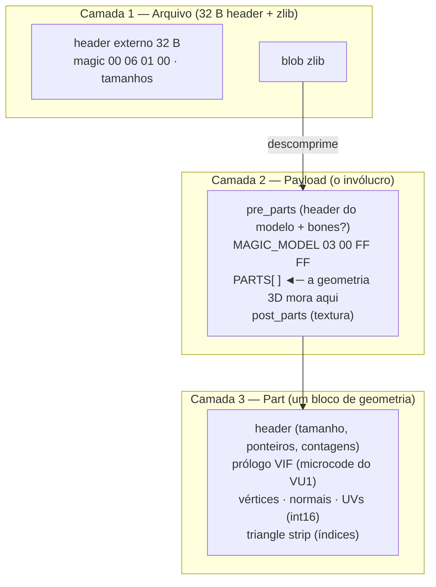
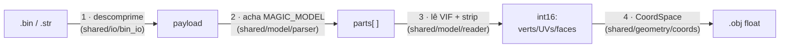

# Documentação — wepes3d

Ferramenta **open source** (Python puro, sem dependências) para **exportar e
importar** modelos 3D do **Pro Evolution Soccer** entre o formato `.bin`/`.str`
do jogo e `.obj` (Wavefront, editável no Blender).

Cobre duas plataformas e quatro tipos de asset:

| Plataforma | Asset | Exportar (`→ .obj`) | Importar (`.obj →`) |
|---|---|:---:|:---:|
| **PES/WE PlayStation 2** | Face / cabelo | ✅ | ✅ |
| | Troféu (e sub-modelos) | ✅ | ✅ |
| | Estádio / torcida / placas | ✅ | ⏳ planejado |
| | Kit (uniforme / mãos) | ✅ | ⏳ planejado |
| **PES6 / WE PC** | Face / cabelo | ✅ | ⏳ planejado |
| | Troféu | ✅ | ⏳ planejado |

> Esta pasta é também a **base de conhecimento** da engenharia reversa do formato.
> Tudo que descobrimos — em dias de testes e comparação byte-a-byte entre arquivos
> reais do jogo — está documentado aqui, para que a comunidade entenda, confie e
> contribua. A documentação é **autossuficiente**: não depende de nenhum arquivo
> ou ferramenta fora deste pacote.

---

## Comece por aqui

| Seu objetivo | Leia |
|---|---|
| **Só usar** (exportar / importar) | [00 — Guia de uso (cookbook)](00-guia-de-uso.md) |
| **Ver um exemplo byte a byte** | [14 — A face byte a byte](14-exemplo-face-byte-a-byte.md) |
| **Entender o formato `.bin`** | [01](01-formato-bin.md) → [02](02-anatomia-payload.md) → [04](04-vu-microcode.md) → [05](05-strip-encoding.md) |
| **Mexer no código** | [11 — Arquitetura](11-arquitetura.md) |
| **Resolver um problema** | [07 — Debugging](07-debugging-guide.md) · [06 — Bugs históricos](06-bugs-historicos.md) |
| **Trabalhar com PES6 PC** | [13 — PES6 PC](13-pes6-pc.md) |

---

## Anatomia do `.bin` em 1 página

Um `.bin`/`.str` do PES tem **3 camadas**. Entender essas camadas é entender tudo.

**Como isso vira um modelo 3D:**

1. Descomprime o `.bin` → payload *(camada 1)*.
2. Acha o `MAGIC_MODEL` e lê as parts *(camada 2)*.
3. Em cada part, o **prólogo VIF** diz como ler a geometria; vértices/UVs/normais
   são decodificados e o **strip** vira triângulos *(camada 3 — ver [04](04-vu-microcode.md) e [05](05-strip-encoding.md))*.
4. Os `int16` viram coordenadas `float` via **CoordSpace** *(ver [12](12-coordenadas.md))*.

### As variações de invólucro (camada 2)

O **modelo 3D interno (camada 3) é IDÊNTICO** em todos os assets — só mudam o
**invólucro** (como achar o modelo) e o **CoordSpace** (escala/eixos):

| Asset | Onde está o modelo |
|---|---|
| **Face / cabelo** (PS2) | `payload[8]` aponta **direto** para o `MAGIC_MODEL`. |
| **Troféu** (PS2) | `payload[8]` é um **container** (`00 06 00 00`) com um **diretório de seções** (sub-modelos: taça, base, palco…) + um container de texturas. Ver [08](08-trofeus.md). |
| **Estádio / kit** (PS2) | o payload é uma **"pasta de modelos"** (`[0]`=total, `[4]`=TOC, offsets dos modelos). Ver [09](09-estadios.md) / [10](10-kits.md). |
| **Face / troféu** (PES6 PC) | formato **diferente** (`magic 20050420`, vértices `float32`). Face = 1 modelo; troféu = container com N modelos. Ver [13](13-pes6-pc.md). |

---

## Índice completo

| # | Documento | Conteúdo |
|---|---|---|
| **00** | [Guia de uso](00-guia-de-uso.md) | Receitas práticas: exportar/importar face, troféu, estádio, kit, PC. **Comece aqui.** |
| 01 | [Formato `.bin`](01-formato-bin.md) | O arquivo: compressão zlib, header externo, layout geral. |
| 02 | [Anatomia do payload](02-anatomia-payload.md) | Dissecação byte-a-byte: pre_parts, part header, geometria, strip. |
| 03 | [Pipeline de import](03-pipeline.md) | As 7 fases do `.obj → .bin` (partição, normais, rebuild, patches). |
| 04 | [VIF e VU1](04-vu-microcode.md) | O microcode que decodifica a geometria (UNPACK, formatos de vértice). |
| 05 | [Encoding do strip](05-strip-encoding.md) | Triangle strip conectado (padrão) vs triangle list, winding, ADC. |
| 06 | [Bugs históricos](06-bugs-historicos.md) | Os bugs da engenharia reversa e como cada um foi diagnosticado. |
| 07 | [Guia de debugging](07-debugging-guide.md) | Sintomas (invisível, buracos, picos) → causas → solução. |
| 08 | [Troféus](08-trofeus.md) | Container aninhado, diretório de seções, leitor universal de geometria. |
| 09 | [Estádios](09-estadios.md) | "Pasta de modelos", containers, scan robusto. |
| 10 | [Kits](10-kits.md) | Uniforme/mãos, LODs, opções de export (groups/dedup). |
| 11 | [Arquitetura](11-arquitetura.md) | Layout do código: `shared/` (núcleo) + `adapters/` (por plataforma/asset). |
| 12 | [Coordenadas](12-coordenadas.md) | `CoordSpace`: int16 ↔ float de cada asset (lossless) + UV. |
| 13 | [PES6 PC](13-pes6-pc.md) | A plataforma PC: formato `20050420`, container de troféu, export. |
| **14** | [Exemplo: face byte a byte](14-exemplo-face-byte-a-byte.md) | Passeio guiado com `examples/face.bin`: `list`/`export`/`import`, cada byte explicado. |

---

## Glossário (linguagem do projeto)

- **payload** — o conteúdo descomprimido do `.bin`/`.str` (o que o parser interpreta).
- **MAGIC_MODEL** — assinatura `03 00 FF FF` que marca o início de um modelo 3D PS2.
- **part** — um bloco de geometria (≤ 255 vértices, ≤ ~340 triângulos). Um modelo
  de face tem até **8** parts (limite do engine); troféus têm mais.
- **strip** — os índices que ligam os vértices em triângulos (*triangle strip*).
- **VIF / UNPACK** — o microcode do PS2 que diz como descompactar a geometria; o
  `CMD` do UNPACK define o formato do vértice (`V3-16` = 3×int16, etc.).
- **container** (`00 06 00 00`) — invólucro que agrupa sub-arquivos (troféu, estádio).
- **pasta de modelos** — payload com `[0]`=total e uma TOC de offsets (estádio/kit).
- **CoordSpace** — a conversão int16 ↔ float (escala+eixos) de cada asset.
- **passthrough / zero-diff** — quando a geometria reproduz o template, o strip
  original é preservado e o `.bin` sai byte-idêntico.
- **template** — o `.bin` original do jogo usado como "casca" no import (header,
  bones, texturas) — só a geometria é trocada.

---

## Princípios do projeto

1. **Autossuficiente.** O pacote e esta documentação não dependem de ferramentas
   ou arquivos externos. Para extrair os `.bin` individuais de dentro dos arquivos
   maiores do jogo (option file, AFS), use as ferramentas da comunidade — mas o
   que está aqui basta para entender e manipular um `.bin` individual.
2. **Não tocar no que não entendemos.** Bones, texturas e campos desconhecidos do
   template são **preservados intactos** no roundtrip.
3. **Validação cruzada.** Toda constante do formato foi confirmada comparando
   **vários** arquivos reais do jogo — nunca por amostra única (ver [06](06-bugs-historicos.md)).

> Documentação e código em português (PT-BR), acompanhando a comunidade brasileira
> de edição de PES. Contribuições e correções são bem-vindas.
