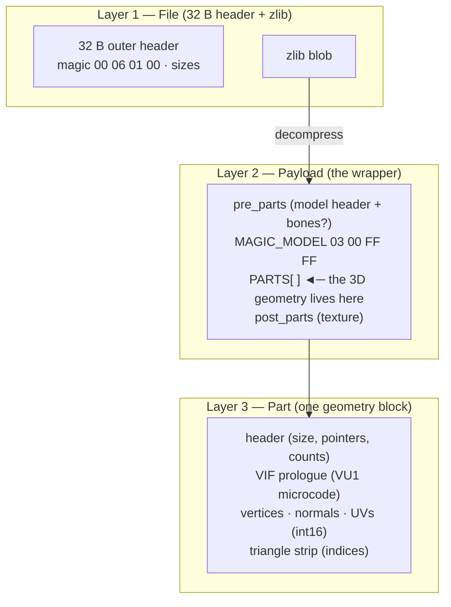
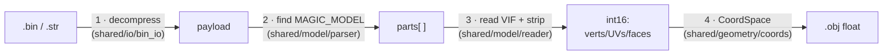

# Documentation — wepes3d

This folder is the **knowledge base** of the reverse engineering of the PES 3D
format. Everything we found — over days of tests and byte-by-byte comparisons
between real game files — is written here, so that the community can
understand it, trust it and contribute. The docs are **self-contained**: they
do not depend on any file or tool outside this package.

> What the tool does, what it supports, how to install it and the project
> principles are in the [project README](../README.md).

---

## Start here

| Your goal | Read |
|---|---|
| **Just use the tool** (export / import) | [00 — User guide (cookbook)](00-user-guide.md) |
| **See a real example, byte by byte** | [13 — A face, byte by byte](13-face-byte-by-byte.md) |
| **Understand the `.bin` format** | [01](01-bin-format.md) → [02](02-payload-anatomy.md) → [04](04-vif-and-vu1.md) → [05](05-strip-encoding.md) |
| **Change the code** | [10 — Architecture](10-architecture.md) |
| **Fix a problem** | [07 — Debugging guide](07-debugging-guide.md) · [06 — Bug history](06-bug-history.md) |
| **Work with PES6 PC** | [12 — PES6 PC](12-pes6-pc.md) |

---

## The `.bin` on one page

A PES `.bin`/`.str` has **3 layers**. Understanding these layers means
understanding everything.

**How this becomes a 3D model:**

1. Decompress the `.bin` → payload *(layer 1)*.
2. Find the `MAGIC_MODEL` and read the parts *(layer 2)*.
3. In each part, the **VIF prologue** says how to read the geometry;
   vertices/UVs/normals are decoded and the **strip** becomes triangles
   *(layer 3 — see [04](04-vif-and-vu1.md) and [05](05-strip-encoding.md))*.
4. The `int16` values become `float` coordinates through the **CoordSpace**
   *(see [11](11-coordinates.md))*.

### The wrapper variations (layer 2)

The **internal 3D model (layer 3) is THE SAME** in every asset — only the
**wrapper** (how to find the model) and the **CoordSpace** (scale/axes)
change:

| Asset | Where the model is |
|---|---|
| **Face / hair** (PS2) | `payload[8]` points **straight** to the `MAGIC_MODEL`. |
| **Trophy** (PS2) | `payload[8]` is a **container** (`00 06 00 00`) with a **section directory** (sub-models: cup, base, stage…) + a texture container. See [08](08-trophies.md). |
| **Stadium / kit** (PS2) | the payload is a **"model folder"** (`[0]`=total, `[4]`=TOC, model offsets). See [09](09-stadiums-and-kits.md). |
| **Face / trophy** (PES6 PC) | a **different** format (`magic 20050420`, `float32` vertices). Face = 1 model; trophy = container with N models. See [12](12-pes6-pc.md). |

---

## Full index

| # | Document | Content |
|---|---|---|
| **00** | [User guide](00-user-guide.md) | Practical recipes: export/import faces, trophies, stadiums, kits, PC. **Start here.** |
| 01 | [The `.bin` format](01-bin-format.md) | The file: zlib compression, outer header, overall layout. |
| 02 | [Payload anatomy](02-payload-anatomy.md) | Byte-by-byte breakdown: pre_parts, part header, geometry, strip. |
| 03 | [Import pipeline](03-import-pipeline.md) | The 7 phases of `.obj → .bin` (partition, normals, rebuild, patches). |
| 04 | [VIF and VU1](04-vif-and-vu1.md) | The microcode that decodes the geometry (UNPACK, vertex formats). |
| 05 | [Strip encoding](05-strip-encoding.md) | Connected triangle strip (default) vs triangle list, winding, ADC. |
| 06 | [Bug history](06-bug-history.md) | The 15 bugs of the reverse engineering and how each one was diagnosed. |
| 07 | [Debugging guide](07-debugging-guide.md) | Symptoms (invisible, holes, spikes) → causes → solution. |
| 08 | [Trophies](08-trophies.md) | Nested container, section directory, universal geometry reader. |
| 09 | [Stadiums and kits](09-stadiums-and-kits.md) | "Model folders", containers, robust scan, LODs, groups/dedup options. |
| 10 | [Architecture](10-architecture.md) | Code layout: `shared/` (core) + `adapters/` (by platform/asset). |
| 11 | [Coordinates](11-coordinates.md) | `CoordSpace`: the lossless int16 ↔ float conversion of each asset + UV. |
| 12 | [PES6 PC](12-pes6-pc.md) | The PC platform: `20050420` format, trophy container, export. |
| **13** | [Example: a face, byte by byte](13-face-byte-by-byte.md) | Guided tour with `examples/face.bin`: `list`/`export`/`import`, every byte explained. |

---

## Glossary (project vocabulary)

- **payload** — the decompressed content of the `.bin`/`.str` (what the
  parser reads).
- **MAGIC_MODEL** — the `03 00 FF FF` signature that marks the start of a PS2
  3D model.
- **part** — a block of geometry (≤ 255 vertices, ≤ ~340 triangles). A face
  model has up to **8** parts (engine limit); trophies have more.
- **strip** — the indices that join the vertices into triangles (*triangle
  strip*).
- **VIF / UNPACK** — the PS2 microcode commands that say how to unpack the
  geometry; the `CMD` of the UNPACK defines the vertex format (`V3-16` =
  3×int16, etc.).
- **container** (`00 06 00 00`) — a wrapper that groups sub-files (trophy,
  stadium).
- **model folder** — a payload with `[0]`=total and a TOC of offsets
  (stadium/kit).
- **CoordSpace** — the int16 ↔ float conversion (scale + axes) of each asset.
- **passthrough / zero-diff** — when the geometry matches the template, the
  original strip is kept and the payload of the `.bin` comes out
  byte-identical.
- **recount** — importing an `.obj` whose vertex count is different from the
  template (`--allow-recount`).
- **template** — the original game `.bin` used as the "shell" in an import
  (header, bones, textures) — only the geometry is replaced.
