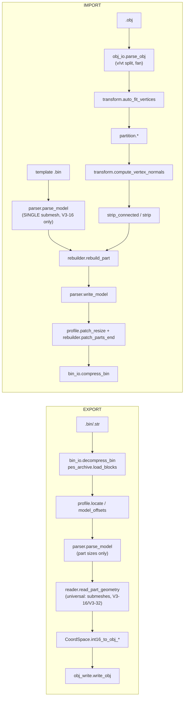

# Engineering audit — wepes3d (November 2026)

An independent review of the whole conversion engine: the math of the
geometry, the binary layout that the PS2 reads, and the claims in `docs/`.
No source file was changed. Every confirmed bug has a reproduction in
[`tests/test_audit_findings.py`](../../tests/test_audit_findings.py).

> **How to read the status of a finding**
> - **CONFIRMED** — reproduced with a test, or proven from the code and real files.
> - **PROBABLE** — strong evidence, but not fully reproduced (usually: the in-game effect).
> - **HYPOTHESIS** — needs more reverse engineering or a PCSX2 test.
>
> **Severity:** CRITICAL (corrupts the file or the VIF stream) · HIGH (wrong
> geometry, winding, normals or UVs) · MEDIUM (fails in some valid cases) ·
> LOW (minor, maintainability).

**Not verified:** nothing here was run in the game or in PCSX2. "The file is
valid" below always means *valid against the structure of real game files*,
never *it works in the game*.

---

## Executive summary — the five most dangerous issues

| # | ID | What | Status |
|---|---|---|---|
| 1 | [A-01](#a-01--trophy-sec0-the-colour-program-is-not-updated) | **Every rebuilt part of a trophy sub-model (sec0) has a broken VIF program.** Real trophy parts carry a small "colour" program after the UVs (one colour address per vertex + one RGBA qword, strip at `4·vc+9`). The importer copies it from the template without updating it. In a real import, 7 of 20 parts get a vertex position overwritten by the colour (a spike). | CONFIRMED (binary) · PROBABLE (in game) |
| 2 | [A-03](#a-03--faces-the-third-header-pointer-is-not-moved) | **Every real face/hair template has a second pointer after the parts (`payload[0x10]`) that is never moved.** After any change of size it points into texture pixels. Only `face.bin` (2 pointers) is safe. | CONFIRMED |
| 3 | [A-02](#a-02----section-n-accepts-sections-that-the-rebuilder-cannot-write) | **`--section N` destroys sections that are not in the simple layout.** V3-32 sections are rewritten with garbage vertices *even without edits*; multi-submesh sections end with "COMPLETED SUCCESSFULLY" and 0 valid parts. | CONFIRMED |
| 4 | [A-04](#a-04--parts-with-0-vertices-are-written-with-unpack-num0) | **Parts with 0 vertices are written with `UNPACK NUM=0`**, which the VIF reads as 256 elements (stream out of sync). Small meshes, `--match-template` and a normal Blender `--use-groups` export all reach it. | CONFIRMED (file) · PROBABLE (crash) |
| 5 | [A-06](#a-06--the-strip-encoders-use-the-wrong-winding-parity) | **Both strip encoders use a winding rule that the game data contradicts.** In every real file the strip parity is *absolute* (it never resets); the encoders reset it per strip. Re-encoded parts come back with ~50% of the triangles flipped. | CONFIRMED (inconsistency) · HYPOTHESIS (holes in game) |

Close behind: wrong normals on import (face basis, trophy sign and length —
[A-07](#a-07--face-normals-are-written-in-the-wrong-axes), [A-08](#a-08--trophy-normals-are-inverted-and-8-too-long)),
the strip address that wraps at `vc ≥ 254` ([A-05](#a-05--the-strip-address-wraps-for-vc--254-and-the-vu-memory-is-not-checked)),
and the PES6 PC reader that writes half of the triangles backwards
([A-11](#a-11--pes6-pc-strips-are-decoded-without-the-winding-alternation)).

**What is solid:** the universal export reader matches an independent
decoder on all 3,453 real parts; the derived fields are right for the face
layout and for simple trophy sections; the trophy container update keeps the
other sections byte-identical; the zero-diff roundtrip is real for unedited
meshes; the connected encoder never loses or duplicates a triangle.

---

## Method and evidence

1. Read all code (`shared/`, `adapters/`, `cli.py`), all docs (00–13) and all tests.
2. Wrote an **independent part decoder** that maps strip indices to vertices
   by exact VU address (it uses the IMMED of each UNPACK, not a heuristic),
   and compared it with the project at every step.
3. Used the **game's own normals** as ground truth: Konami's normals were
   made from Konami's triangles, so they tell us which winding and which
   axes are right.
4. Ran the real pipeline (export → import → export) and compared bytes and
   geometry.

**Files used** (original game files only, no outputs of any tool):

| Set | Files | Models | Parts |
|---|---|---|---|
| Faces / hair | `tests/seed/face.bin` + 9 from the maintainer's collection (`face_1..5`, `h1..h4`) | 10 | 57 |
| Trophies | `tests/seed/trophy.bin` + 5 more (all 9 sections each) | 54 | ~1,100 |
| Kits | `tests/seed/kit.bin` + shirt and hands files | 9 | ~280 |
| Stadium / boards | `tests/seed/stadium.str`, `adboard.bin` + 11 stadium files | 44 | ~2,000 |
| **Total** | | **117** | **3,453** |

Also checked: one trophy written by the current importer during a PES6 PC →
PS2 test (Libertadores template, sec0 recount, 20 parts).

The repository seeds can reproduce A-01, A-02, A-04 to A-06, A-08, A-10 to
A-14, A-16, A-20 and A-25. A-03 and A-07 need a real face template with 3
header entries (for example `h2.bin`); no seed has one — see the
[roadmap](#17-correction-roadmap).

---

## 1. Architecture and dependency map

The docs ([10](../10-architecture.md)) match the code: layers do not form
cycles, and PES6 PC only reuses `shared/io`. The real data flow:



| Job | Where |
|---|---|
| Decompression / compression | `shared/io/bin_io.py`, `pes_archive.py` |
| Model discovery | `parser.locate_model`, `trophies/profile.section_offsets`, `pes_archive.model_offsets`, `pes6pc/reader.find_parts` |
| Part parsing | `parser._parse_part` (import), `reader.read_part_geometry` (export) |
| Vertex / UV / normal decoding | `reader.read_part_geometry` (no normals), `parser._parse_part` |
| Strip decoding | `reader.read_part_geometry` (export), `strip.decode_strip` (zero-diff check) |
| Coordinates | `adapters/pesweps2/*/profile.py` (`COORD`) |
| Partition | `pipeline/partition.py` |
| Strip encoding | `strip.triangles_to_pes_strip` (list), `strip_connected.*` (connected) |
| Derived fields | `rebuilder.rebuild_part`, `rebuilder.patch_parts_end`, `profile.patch_resize` |

**Architectural risk (A-02, A-01):** export and import use **two different
part parsers**. The export reader understands every layout; the import
parser understands only the face layout, and nothing checks the layout
before a rebuild.

---

## 2. Import pipeline (`.obj` → `.bin`)

| Phase | Verdict | Findings |
|---|---|---|
| 1 · Template | Parser assumes one submesh, V3-16, prologue at `0xB0`. Real parts use prologues at `0xB0..0x110`, V3-32 and up to 43 submeshes. | A-02 |
| 2 · `.obj` | `v`/`vt` split is right. Negative indices, `vt u`, out-of-range indices and mixed faces are not handled. | A-12, A-20 |
| 2b · Auto-fit | Math is right (uniform scale, bbox centre). Unused vertices still count in the bbox. | A-21 |
| 3 · Partition | Vertex cap works (Bug 16 fix holds). Empty parts possible; `default` group counted; no strip/VU budget. | A-04, A-05, A-13, A-19 |
| 4 · Triangles → parts | Right. | — |
| 5 · Normals | Wrong axes (face), wrong sign and length (trophy), copied by index without the option, creases at seams, computed before orientation. | A-07, A-08, A-09, A-14, A-15 |
| 6 · Rebuild | Right for the face layout and simple trophy sections. Wrong for trophy sec0 and every other layout. Strip parity wrong. | A-01, A-02, A-05, A-06 |
| 7 · Pointers | Right for `face.bin` and trophies. Misses `payload[0x10]` in every other real face. | A-03 |

The interaction `--auto-fit` + coordinates is safe: all CoordSpaces are
proper rotations plus a scale, so the fit does not mirror or distort. The PC
and PS2 trophy exports use the same "up" axis (tallest span on Z in both), so
`--auto-fit` does not squash a PC cup.

---

## 3. Export pipeline (`.bin` → `.obj`)

- **PS2 face / trophy / stadium / kit:** the universal reader decodes the same
  triangle sets as the independent address-based decoder on **all 3,453
  real parts** (including V3-32 and multi-submesh). The winding it writes is
  right: it follows the absolute parity of the strip, and the exported
  triangles face outwards (they are 100% coherent on trophy sec0).
- **One weak point:** the reader does not use the UNPACK addresses. It
  guesses the base with `diff = max(index) − vc + 1`. This is only right when
  the last vertex of the part is used by the strip. Konami always does that;
  files written by this importer may not (A-10).
- **`--all/--model/--block/--parts/--groups`:** consistent, with one gap:
  `--groups` is silently ignored on the default `--all` path for
  stadium/kit (A-23).
- **PES6 PC:** see section 14.

---

## 4. Polygon triangulation audit

`obj_io.parse_obj` fan-triangulates every polygon from its first corner and
never checks the result.

- Fan triangulation is only correct when corner 0 can see every other
  corner (convex polygons, and some concave ones). There is no convexity,
  area or self-intersection test, so a bad concave n-gon silently becomes
  overlapping triangles. The docs say this; the code does not warn.
- A repeated corner (`f 1 2 2 4`) gives a degenerate triangle `(0, 1, 1)`
  that goes all the way into the strip. It is harmless on the GS (zero area)
  but it is noise in normals and counts.
- Non-planar n-gons are accepted without warning.
- Winding is kept (the fan keeps the corner order).

**Recommendation:** keep the fan (it is what Blender would also produce for
convex faces), but compute the polygon area with and without the fan; if
they differ, or if a corner repeats, stop with a clear message (or use ear
clipping only for those polygons). Finding A-20.

---

## 5. Triangle strip decoding audit

There are two decoders, and they model the hardware differently:

| Decoder | Used for | Firing rule | Winding |
|---|---|---|---|
| `reader.read_part_geometry` | export | fires on every non-ADC index after 2 entries | alternates on **every index** (absolute parity) |
| `strip.decode_strip` | zero-diff check | only `[neg,neg,pos]`, `[neg,pos,pos]`, `[pos,pos,pos]` | ignores winding |

- On all real single-submesh parts both decoders give the same triangle
  sets. The real files never contain a `[pos, neg, pos]` window (0 of 78,520
  windows), which is the only case where they disagree.
- The **absolute parity** of the reader is the right model. Tested against
  Konami's normals: 99.7% of trophy sec0 triangles, 100% of kit triangles and
  91.1% of real face triangles agree with it; the "reset at every restart"
  model gets 37–63% (chance level). Details in A-06.

---

## 6. Connected strip generation audit

`strip_connected.build_connected_strips` is a greedy, winding-aware strip
builder after a flood-fill orientation.

- **Triangle set:** always preserved (checked on 1,800 random meshes,
  including duplicates, non-manifold edges and degenerate triangles).
- **Winding:** correct only under the model "the GS flips odd triangles and
  restarts reset the parity" (`decode_connected_strips`). The real data says
  the parity is absolute (A-06). A strip that starts at an odd position in
  the index list is rendered with every triangle reversed.
- **Orientation:** `orient_for_front` votes with normals that were computed
  from the *unoriented* mesh (A-15).
- The motivation in the docs — "community `.obj` files have only 18–32% of
  coherent edges" — is an artifact of the project's own PC reader (A-11).
  PS2 exports are 100% coherent.

---

## 7. Vertex partitioning audit

- The BFS cap is a hard limit, as Bug 16 says. Seam copies have identical
  int16 positions, so there are no cracks.
- **Empty parts** are possible from four strategies (A-04).
- `--use-groups` counts the implicit `default` group, so a normal Blender
  export (one `o` line per object) has one group too many (A-13). The test
  fixture `islands_obj` hides this on purpose.
- The partition only counts vertices. It does not check the strip length or
  the VU memory per part (A-05, A-19).
- When the vertex count equals the template, `--use-groups`,
  `--match-template` and `--max-verts-per-part` are silently ignored, and
  unused vertices stay in the parts (A-21, feeds A-10).
- Normals are computed after the seam copies are made, so each copy gets a
  different normal (A-14).

---

## 8. UV conversion audit

- `int16 ↔ float` is lossless both ways for any int16, including values
  outside `[0, 1]` (real files use −4063..28762) and with 6-decimal `.obj`
  text. Export → import keeps UVs exactly.
- Seams: `(v, vt)` pairs are split correctly; the split does not touch
  indices or strips in a wrong way.
- `UV_FACTOR = 0.000244` is a rounded `1/4096`. The VU most likely converts
  with 12 fraction bits, so a UV of `1.0` made in Blender is stored as 4098
  instead of 4096 (0.06%, ≤ 0.13 texel on a 256-pixel texture). Finding A-24.

---

## 9. Normals audit

Konami's normals were used as ground truth. What the real files say:

| Asset | Stored axes | Sign | Length |
|---|---|---|---|
| Faces / hair (9 real files) | same order as the vertex (`s0,s1,s2`) | **inwards** (−geometric) | 32767 |
| Kits | same as vertex | inwards | 32767 |
| Trophy sec0 | same as vertex | inwards | **4096** |
| Stadium / boards | — | — | **4096** |

What the importer writes:

| | Axes | Sign | Length | Findings |
|---|---|---|---|---|
| Face, `--recalculate-normals` | `(-nx, ny, nz)` — **not** the vertex order `(-y, -z, x)` | outwards | 32767 | A-07 |
| Trophy, `--recalculate-normals` | vertex order (right) | **outwards** | **32767** | A-08 |
| Any, without the option | **template normal by index** | — | — | A-09 |

Plus: creases at part seams and UV seams (A-14), normals computed from an
unoriented mesh (A-15). End to end, on the **unedited** trophy, the
recalculated normals point the opposite way of the originals for 90.5% of
the vertices (median cos −0.988).

`face.bin` is an outlier: no axis mapping links its normals to its
geometry (best |cos| 0.10), while the 9 other faces fit with cos 0.96. The
face convention in the code (and the "normals are stored `(X, Y, Z)`" note
in [02 §3.4](../02-payload-anatomy.md#34-geometry-vif-unpack-tags)) was
probably derived from this file. See A-18.

---

## 10. VIF / VU1 data layout audit

Confirmed on real files (face layout, prologue at `0xB0`):

```
qw[0] = (flag, 0, 4, vbe)        UNPACK V4-16 @0  ← prologue 0xC0..0xC3
qw[1] = (0, 0, ss, se)           UNPACK V4-16 @1  ← prologue 0xC8, 0xCA
qw[2] = (vc, 0|8, 4, vbe)        UNPACK V4-16 @2 (ADD mode) + S-32/V2-16 masked
qw[3] = (vbe, 0, 0, 0)
qw[4 + 4n + 0/1/3] = vertex / normal / UV of vertex n   (STCYCL 4/1)
qw[ss ..] = strip (V4-16)
```

New facts:

- **Trophy sec0 parts** add a colour program after the UVs: `STMASK`, an
  `UNPACK S-16` (masked, `NUM = vc`) that writes the colour address
  `4·vc+8` into every vertex qword, `STCYCL 1/1`, and an `UNPACK V4-8` that
  writes the RGBA colour (128,128,128,128) at `4·vc+8`. The strip then starts
  at `4·vc+9` (or `+10` with two colours). `qw[2].y = 8` marks this mode.
  `header[0x30] = 4·vc+8` is the colour slot here, not a copy of `ss`.
- **Prologue position varies:** `0xB0` (faces, kits, trophy sec0/1),
  `0xC0..0x110` (other trophy sections, stadiums). The rebuilder writes at
  fixed offsets `0xC2..0xF8`, valid only for `0xB0`.
- **VU budget:** in 3,453 real parts the strip ends at VU address ≤ 480
  (median 128). No part goes above 512. The project allows `4·vc+9+sn` up to
  ~1,280 (A-05, A-19).
- Strip tails: Konami pads with ADC copies of real vertex addresses; the
  project pads with `0x8000` (address 0, the parameter qword). No triangle
  is fired either way.

---

## 11. Binary header and derived field audit

Checked on all 3,453 real parts (formula = what `rebuild_part` writes):

| Field | Formula | Face layout | Trophy sec0 | Other layouts |
|---|---|---|---|---|
| `header[0x0C]` QWC | `(size − pis)/16` | ✓ | ✓ | ✓ (3,453/3,453) |
| `header[0x10]` | `sn·4` | ✓ | ✓ | ✓ |
| `header[0x2C]` | `4vc+4` | ✓ | ✓ | ✓ (single submesh) |
| `header[0x30]` | `4vc+8` | ✓ | ✓ (but it is the colour slot) | ✗ multi |
| `prologue 0xC2/0xF6/0xF8` (vbe) | `4vc+4` | ✓ | ✓ | ✗ (offsets move) |
| `prologue 0xC8` (ss), strip IMMED | `4vc+8` | ✓ | **✗ real: `4vc+9`** | ✗ |
| `prologue 0xCA` (se) | `ss+sn` | ✓ | ✗ (follows ss) | ✗ |
| `prologue 0x108` (vc) | `vc` | ✓ | ✓ | ✗ |
| `payload[0x0C]` | parts end | ✓ | (container) | — |
| `payload[0x10]` (faces with 3 entries) | — | **never written** (A-03) | — | — |
| `model+0x2C` | `parts_end − model` | ✓ (10/10 faces) | ✓ | ✓ |

- The formulas in [02 §5](../02-payload-anatomy.md#5-the-map-of-the-bytes-you-need-to-write) are right **for the face layout only**.
- No integer overflow is possible in the 32-bit fields; the 16-bit/10-bit
  ones are A-05.
- Trophy container update (`trophies/profile.patch_resize`): correct on the
  6 trophies — the directory, `payload[0x0C]` and the container size move by
  Δ, and the other sections stay byte-identical (also checked after a
  recount of sec1). It works by a value-range heuristic (any uint32 in the
  outer header between the old parts end and the payload end is moved), so it
  depends on no other field having a value in that range.

---

## 12. Zero-diff passthrough audit

- **How it decides:** same `vc`, same int16 vertices/UVs/normals, and the
  same *set* of triangles as `decode_strip` gives for the original strip.
- **Exact or approximate?** Exact on int16 (good: float noise cannot break
  it, because the CoordSpace is lossless).
- **UVs and normals:** included (see the last point for what this means
  with `--recalculate-normals`).
- **Winding and duplicates:** *not* included — triangles are compared as
  frozensets. Flipping faces in Blender, or duplicating a face, is silently
  thrown away (A-16).
- **Vertex order** matters (good).
- **Byte identity:** confirmed for `face.bin` and the trophy (payload
  identical; the trophy `.bin` is even `cmp`-identical).
- **`--recalculate-normals`:** the README recommends it "almost always", but
  it turns the passthrough off for every part, so an unedited re-import is
  fully rebuilt (and gets A-06/A-07/A-08).

---

## 13. Round-trip consistency

| Workflow | Bytes | Geometry |
|---|---|---|
| 1 · PS2 BIN → OBJ → PS2 BIN (no edits, no options) | payload identical (face.bin, trophy sec0/sec1) · **not** for V3-32 sections (A-02) | identical |
| 2 · same, with `--recalculate-normals` | every part rebuilt | positions/UVs kept; ~50% triangles flipped (A-06); normals wrong (A-07/A-08) |
| 3 · after moving vertices | edited parts rebuilt | same as 2 for those parts |
| 4 · after UV changes | edited parts rebuilt | UVs exact; winding as 2 |
| 5 · after topology changes | rebuilt; may add or empty parts | A-04, A-10, A-14 |
| 6 · PES6 PC → OBJ → PS2 BIN | — | OBJ has 57–82% flipped edges (A-11); recalculated normals off by > 30° on 30% of vertices; then 2 applies |

Byte identity and geometric equivalence were checked separately: the
re-export compares triangles by vertex position and winding, not by index.

---

## 14. PES6 PC adapter

- Kept apart from the PS2 engine, as documented (only `shared/io` is shared).
- Vertex/UV decoding and the vertex-group search are consistent with the
  declared counts (the existing tests check the triangle totals).
- **Bug (A-11):** every strip triangle is written as `(c, b, a)`. A triangle
  strip alternates its winding, so every second triangle is reversed. With
  the usual alternation, edge coherence goes from 18–43% to 81–100%.
- No PC assumption leaks into the PS2 code, and no PS2 assumption into PC.

---

## 15. Test coverage assessment

The suite is good at what it checks (98% line coverage, all green), but the
coverage hides gaps:

- **Only one face template**, and it is the anomalous `face.bin` (A-18). No
  test uses a face with 3 header entries (A-03), a rich template, or a
  template with the model at `0x20`.
- **Only sec0/sec1 of the trophy** are imported in tests; no test imports a
  V3-32 or multi-submesh section (A-02).
- **No test checks winding** after a rebuild, or normals against the
  template (A-06, A-07, A-08).
- **No test checks the trophy colour program** (A-01).
- `islands_obj` works around the `default` group, which hides A-13.
- Missing adversarial inputs: empty meshes, tiny meshes (A-04), `vc ≥ 254`
  (A-05), negative indices (A-12), truncated files (A-25).

The new file `tests/test_audit_findings.py` adds 16 strict `xfail`
reproductions and 3 passing checks.

---

## 16. Findings

### Summary table

| ID | Sev. | Status | Area | One line |
|---|---|---|---|---|
| A-01 | CRITICAL | CONFIRMED | rebuild (trophy) | colour program after the UVs is not updated; `ss` must be `4vc+9` |
| A-02 | CRITICAL | CONFIRMED | import (trophy) | `--section N` rebuilds layouts the parser cannot read |
| A-03 | CRITICAL | CONFIRMED | pointers (face) | `payload[0x10]` is not moved in 3-entry face templates |
| A-04 | CRITICAL | CONFIRMED | partition/rebuild | parts with `vc = 0` are written with `UNPACK NUM=0` |
| A-05 | CRITICAL | CONFIRMED | rebuild | strip address wraps at `vc ≥ 254`; VU memory not checked |
| A-06 | HIGH | CONFIRMED / HYP. | strip | encoders reset the parity per strip; the data says absolute |
| A-07 | HIGH | CONFIRMED | normals (face) | normals written in the wrong axes |
| A-08 | HIGH | CONFIRMED | normals (trophy) | normals inverted and 8× too long |
| A-09 | HIGH | CONFIRMED | normals | without the option, normals are copied by index |
| A-10 | HIGH | CONFIRMED | export | `diff` heuristic breaks parts whose last vertex is unused |
| A-11 | HIGH | CONFIRMED | PES6 PC | strip winding not alternated |
| A-12 | HIGH | CONFIRMED | `.obj` | negative indices map to wrong vertices |
| A-13 | MEDIUM | CONFIRMED | partition | `--use-groups` counts the `default` group |
| A-14 | MEDIUM | CONFIRMED | normals | creases at part seams and UV seams |
| A-15 | MEDIUM | CONFIRMED | normals | normals computed before the mesh is oriented |
| A-16 | MEDIUM | CONFIRMED | zero-diff | winding and duplicate edits are discarded |
| A-17 | MEDIUM | CONFIRMED | docs | several documented facts are wrong |
| A-18 | MEDIUM | CONFIRMED / HYP. | data | `face.bin` is not a reliable reference |
| A-19 | MEDIUM | HYPOTHESIS | VU budget | parts above ~480 VU qwords may break in game |
| A-20 | LOW | CONFIRMED | `.obj` | `vt u`, bad indices, mixed faces, degenerate n-gons |
| A-21 | LOW | CONFIRMED | partition | equal vertex count ignores options and keeps unused vertices |
| A-22 | LOW | CONFIRMED | API/CLI | `sys.exit` inside the library; CLI hides `IndexError`/`KeyError` |
| A-23 | LOW | CONFIRMED | CLI | `--groups` ignored with `--all` (stadium/kit) |
| A-24 | LOW | PROBABLE | UV | `UV_FACTOR` is a rounded `1/4096` |
| A-25 | LOW | CONFIRMED | I/O | truncated or wrong files are not rejected |
| A-26 | LOW | CONFIRMED | performance | quadratic spots |

### A-01 — Trophy sec0: the colour program is not updated

- **Where:** `shared/model/rebuilder.py::rebuild_part` (keeps `part.pad_after_uvs`; writes `ss = 4vc+8` at `0xC8` and in the strip tag); `shared/model/parser.py::_parse_part` (treats the program as padding).
- **What:** every real sec0 part (6 trophies) has, between the UVs and the
  strip marker, a VIF program whose `NUM` is `vc` and whose addresses are
  `4·vc+8`; the strip is at `4·vc+9`. After a rebuild the program still has
  the template values, and `ss` is set to `4·vc+8` (on top of the colour).
- **Evidence:** a real sec0 import (20 parts): all 20 parts are
  inconsistent. In 7 parts the colour `UNPACK V4-8` now writes over a vertex
  *position* (part 0: `vc` 5 → 52, colour at qword 28 = vertex 6), and the
  vertices above the old count get no colour address.
- **Expected:** `S-16 NUM = vc`, all addresses `= 4vc+8`, colour at
  `4vc+8`, `ss = se − sn = 4vc+9`.
- **Fix:** parse this program as a structure; rewrite its `NUM`, its data
  (one address per vertex) and the `V4-8` IMMED; set `ss = 4vc+8+ncolours`.
  Same for parts cloned from a trophy donor.
- **Test:** `test_a01_*`. **Confidence:** high (binary); the in-game result
  (spikes, wrong colours) is PROBABLE.

### A-02 — `--section N` accepts sections that the rebuilder cannot write

- **Where:** `importer._import` (no layout check), `parser._parse_part`
  (one submesh, V3-16, `vc` at `pis+0x58`), `rebuilder.rebuild_part`
  (absolute offsets `0xC2..0xF8`).
- **Evidence (seed trophy):** sec4 and sec8 (V3-32, prologue at `0xD0`): a
  roundtrip **without edits** rebuilds 13/13 parts; the export of the result
  gives vertices like `(-82389237, -687144919, 2751254)`. Sec2/3/5/6/7
  (multi-submesh): the parser reports 17 vertices for 366 real ones; with
  `--allow-recount` the import ends with "COMPLETED SUCCESSFULLY" and 0 of 5
  parts can be parsed again.
- **Fix:** before any rebuild, check each target part: one submesh, vertex
  CMD `0x69`, prologue at `0xB0`, known gap program. Refuse anything else
  with a clear message. Later: one shared parser for import and export.
- **Test:** `test_a02_*`. **Confidence:** high.

### A-03 — Faces: the third header pointer is not moved

- **Where:** `adapters/pesweps2/faces/profile.py::patch_resize`.
- **What:** all 9 real face/hair templates have `payload[0] = 3` and two
  pointers after the parts: `[0x0C] = parts_end` and `[0x10]` (a block that
  starts with `94 72 85 29`). `patch_resize` only moves values equal to
  `parts_end` or `parts_end − 16`.
- **Evidence:** `h2.bin` with a size change of +272: `[0x10]` stays `0x62C0`
  and now points to texture pixels (`1a1a1a1a…`); the block is at `0x63D0`.
  Same for `face_1.bin` (+160).
- **Fix:** read the entry count at `payload[0]` and move every entry from
  `[0x0C]` on that is `≥ parts_end` (like the trophy profile does).
- **Test:** none possible with the current seeds — add a real 3-entry face
  (for example `h2.bin`) to `tests/seed/`. **Confidence:** high.

### A-04 — Parts with 0 vertices are written with `UNPACK NUM=0`

- **Where:** `partition.partition_mesh_by_faces` (appends empty parts when
  faces run out), `partition_by_obj_groups`, `partition_by_template`,
  `--part-sizes`; `importer` only checks the maximum; `rebuilder` writes
  `NUM = 0`.
- **What:** in VIF `UNPACK`, `NUM = 0` means 256 elements. The vertex,
  normal and UV tags then swallow the next bytes and the stream goes out of
  sync ("unknown vifcmd").
- **Evidence:** 2 triangles into `face.bin` → 6 empty parts;
  `--match-template` with the top of a head → 4 empty parts; `--use-groups`
  with 7 Blender objects → part 0 empty. All "COMPLETED SUCCESSFULLY".
- **Fix:** never write an empty part — drop it and lower `total_parts`
  (keeping `payload[0x04] = 8` for faces), or refuse.
- **Test:** `test_a04_*`. **Confidence:** high (file); in-game crash PROBABLE.

### A-05 — The strip address wraps for `vc ≥ 254`, and the VU memory is not checked

- **Where:** `rebuilder.rebuild_part`
  (`0xC000 | (new_strip_start & 0x03FF)`), `constants.MAX_VERTEX_COUNT_PER_PART = 255`,
  `importer._partition` (`--max-verts-per-part` up to 255).
- **Evidence:** `vc = 254` → `ss = 1024` → strip ADDR 0; `vc = 255` → ADDR 4
  (on top of vertex 0). Even `vc = 253` needs 1,083 qwords; VU1 has 1,024.
  [04 §5](../04-vif-and-vu1.md#5-hardware-limits-that-become-format-limits)
  itself says `vc ≤ 253`.
- **Fix:** check `4·vc + 8 + ncolours + sn ≤ budget` per part before
  writing, and use that budget in the partition (see A-19 for the value).
- **Test:** `test_a05_*`. **Confidence:** high.

### A-06 — The strip encoders use the wrong winding parity

- **Where:** `strip.triangles_to_pes_strip` (list), `strip_connected.build_connected_strips`
  / `connected_strips_to_indices` / `decode_connected_strips` (connected).
- **What:** the encoders assume the parity resets at every restart (and the
  list mode ignores parity). In all real files the parity is **absolute**:
  the winding of the triangle fired at index `i` flips with `i % 2`, across
  restarts. Tested models (Konami normals as ground truth):

  | Model | Trophy sec0 | Kits | Real faces |
  |---|---|---|---|
  | absolute index (reader) | **99.7%** | **100%** | **91.1%** |
  | reset at each ADC pair (encoders) | 63.2% | 41.9% | 39.0% |
  | reset at any ADC | 36.8% | 58.1% | 61.0% |
  | count kicks only | 67.1% | 48.4% | 37.7% |

- **Evidence in the pipeline:** import `face.obj` with
  `--no-preserve-strips`, export again: 487 of 984 triangles flipped
  (connected), 492 of 984 (list); trophy sec0: 735 of 1,382.
- **What it means:** the project is inconsistent with itself and with the
  data. If the PS2 culls back faces (as [04 §6](../04-vif-and-vu1.md#6-backface-culling-and-winding)
  says), about half of every rebuilt part is invisible. If it does not
  cull, the winding logic has no visible effect. Either way, the
  explanations of Bug 8 and of "the GS flips per strip" do not match the
  data: no parity model with culling can produce "completely invisible →
  fully visible" by one global flip of a list strip.
- **Fix:** encode with absolute parity: for a triangle fired at index `i`,
  write the window as `(a, b, c)` if `i` is even and `(a, c, b)` if odd
  (exported triangles face outwards, so no extra flip is needed). In the
  connected mode, insert one extra ADC index before a strip that would start
  at the wrong parity.
- **PCSX2 test to settle it:** import the same mesh twice, once with every
  triangle at an even index and once at an odd index (one ADC pad). If one
  of them disappears, culling uses absolute parity.
- **Test:** `test_a06_*`. **Confidence:** high for the inconsistency;
  HYPOTHESIS for the visible effect.

### A-07 — Face normals are written in the wrong axes

- **Where:** `adapters/pesweps2/faces/profile.py::obj_to_int16_normal`.
- **What:** vertices are stored as `(-y, -z, x)/f` but normals as
  `(-nx, ny, nz)·S`. In the 9 real faces the normal is stored in the
  **same** order as the vertex, pointing **inwards** (median cos 0.959
  against `−geometric`, 3,127 vertices). The right mapping is
  `(ny, nz, -nx)·S`.
- **Fix:** `obj_to_int16_normal(nx, ny, nz) = (ny, nz, -nx) · 32767`. Re-check
  in PCSX2 with a real face template (not `face.bin`).
- **Test:** none with seeds (`face.bin` normals are meaningless, A-18).
  **Confidence:** high from data; in-game lighting PROBABLE.

### A-08 — Trophy normals are inverted and 8× too long

- **Where:** `trophies/profile.py::obj_to_int16_normal`, `constants.NORMAL_SCALE`.
- **Evidence:** 10,986 sec0 normals have length 4095 ± 1 (stadiums: 4096);
  faces/kits 32767. Recalculating on the unedited trophy gives median cos
  −0.988 against the originals.
- **Fix:** a per-asset normal scale (4096 for trophies and stadiums) and the
  inward sign: `(-nx, -nz, ny) · 4096`.
- **Test:** `test_a08_*`. **Confidence:** high.

### A-09 — Without `--recalculate-normals`, normals are copied by index

- **Where:** `importer._import` (`template.parts[i].normals[v_local]`).
- **What:** [03 Phase 5](../03-import-pipeline.md#phase-5--normals-geometrytransformcompute_vertex_normals)
  says "kept for the vertices in the same position". The code takes the
  normal of the vertex *with the same index*, so any new mesh gets unrelated
  normals; extra vertices get `(0, 0, 32767)` in stored space.
- **Fix:** match by int16 position (dictionary); else compute.
  **Confidence:** high.

### A-10 — The export reader breaks parts whose last vertex is unused

- **Where:** `shared/model/reader.py::read_part_geometry` (`diff = max(gv) − vcounter + 1`).
- **Evidence:** delete the 6 triangles that use the last vertex of part 0
  of `face.obj` (keep the vertices), import, export: 74 wrong triangles.
- **Fix:** map indices with the vertex UNPACK addresses (`IMMED & 0x3FF`,
  stride 4) — the independent decoder does this and matches all real parts.
- **Test:** `test_a10_*`. **Confidence:** high.

### A-11 — PES6 PC strips are decoded without the winding alternation

- **Where:** `adapters/pes6pc/reader.py::parse_model` (`faces.append((c, b, a))`).
- **Evidence:** edge coherence 30.8% (cup), 18.3% (face) → 99–100% / 81%
  with the alternation. Recalculated normals of the PC cup: median 13.6°
  off, 30% of vertices more than 30° off.
- **Fix:** alternate per strip group (`(c, b, a)` on even, `(a, b, c)` on
  odd). **Test:** `test_a11_*`. **Confidence:** high.

### A-12 — Negative `.obj` indices map to wrong vertices

- **Where:** `obj_io._read_obj` (`int(fields[0]) - 1`).
- **Evidence:** `f -3 -2 -1` with 4 vertices gives vertices 0, 1, 2 instead
  of 1, 2, 3 (Python negative indexing), silently.
- **Fix:** `idx = n + i if i < 0 else i - 1`, with `n` = vertices read so
  far; check `0 ≤ idx < n`. **Test:** `test_a12_*`.

### A-13 — `--use-groups` counts the `default` group

- **Where:** `obj_io._read_obj` (`group_map = {"default": 0}`),
  `importer._partition` (`len(obj.group_names)`).
- **Evidence:** 8 Blender objects for an 8-part face → "The OBJ has 9 groups";
  7 objects → accepted with an empty part 0 (A-04).
- **Fix:** count only groups that have faces. **Test:** `test_a13_*`.

### A-14 — Creases at part seams and UV seams

- **Where:** `importer._import` → `compute_vertex_normals(work_vertices, work_faces)`
  after `_reindex_partition` and after the `(v, vt)` split.
- **Evidence:** on a smooth sphere, copies of the same point get normals up
  to 8.8° (fine sphere) / 15.3° (test sphere) apart.
- **Fix:** accumulate normals per int16 **position** before splitting.
  **Test:** `test_a14_*`.

### A-15 — Normals are computed before the mesh is oriented

`compute_vertex_normals` runs on the raw `.obj` winding; `orient_for_front`
then votes with those normals. With mixed winding, face normals cancel.
**Fix:** orient first, then compute normals, then encode.

### A-16 — Zero-diff discards winding and duplicate edits

- **Where:** `importer._part_is_faithful` (frozensets).
- **Evidence:** flip all triangles of part 0 in `face.obj` → "IDENTICAL to
  the template", payload identical.
- **Fix:** compare triangles with their winding (as decoded with the
  absolute parity) and as a multiset. **Test:** `test_a16_*`.

### A-17 — Documented facts that the data contradicts

| Doc | Claim | Reality |
|---|---|---|
| 02 §3.4 | normals stored `(X, Y, Z)`, "different" from vertices | same order as vertices (9 real faces) |
| 02 §3.1 / 06 Bug 10 | `header[0x30]` is a copy of `ss` | only in the face layout (trophy: colour slot) |
| 03 Phase 5 | template normals kept "for the vertices in the same position" | by index (A-09) |
| 04 §5 | `vc ≤ 253` | code allows 255 (A-05) |
| 04 §6, 05 §3, 06 Bug 8 | the X flip reverses the winding | every CoordSpace is a rotation (det > 0); no mirror |
| 05 §3 | community `.obj` files are 18–32% coherent | artifact of the PC reader (A-11) |
| 08 §7 | trophy recount "correct by construction" | A-01 |
| 01 §4 | rich templates "also load" | any resize breaks `payload[0x10]` (A-03) |

### A-18 — `face.bin` is not a reliable reference

`face.bin` differs from all 9 other real faces: model at `0x10`,
`payload[0] = 2`, 8 parts of exactly 87 vertices, and normals that match no
axis mapping of its own geometry (best |cos| 0.10 vs 0.96). It was probably
written by a community tool (HYPOTHESIS). Conventions taken from it (normal
axes, part statistics in the docs) should be re-checked on real files.

### A-19 — VU memory budget per part (HYPOTHESIS)

Konami parts never end the strip above VU address 480. The docs suggest
"≤ ~170 vertices per part" (≈ 700+ qwords) and allow 255. If the game
double-buffers VU1 memory (2 × 512 qwords), such parts overwrite the other
buffer. Files from the project's own tests reach 964. **Needs a PCSX2
test:** one part with ~120 vertices and one with ~190, same mesh.

### A-20 — `.obj` parser edge cases (LOW)

`vt u` (one value, valid OBJ) raises `IndexError`; out-of-range indices pass
the parser and crash later; faces without `vt` in a file that has `vt` take
the UV with the same number as the vertex; repeated corners make degenerate
triangles; no check of fan triangulation (section 4). **Test:** `test_a20_*`.

### A-21 — Equal vertex count ignores options (LOW)

`_partition` returns the template distribution before it looks at
`--use-groups`, `--match-template` or `--max-verts-per-part`, and keeps
unused vertices (which then trigger A-10). Warn, or apply the options.

### A-22 — Library exits the process (LOW)

`importer._import` calls `sys.exit(1)` on user errors, so API users (a
Blender add-on, a batch script) get `SystemExit`. The CLI catches
`IndexError`/`KeyError` as "expected" errors, which hides real bugs (A-20
shows up as "list index out of range"). Raise a custom error; let the CLI
format it.

### A-23 — `--groups` is ignored with `--all` (LOW)

`cli.cmd_export` calls `f_complete(...)` without `groups`. Pass it, or
reject the combination.

### A-24 — `UV_FACTOR` is a rounded `1/4096` (LOW, PROBABLE)

0.06% scale error. Use `1/4096` if the PCSX2 test of A-19 confirms the
12-bit conversion; keep the old value only for a byte-identical export of
old `.obj` files.

### A-25 — Truncated or wrong files are not rejected (LOW)

`bin_io.decompress_bin` does not check the magic, the zlib end of stream,
or that the payload size equals the header size: half a file gives a
partial payload and later errors. `parser._parse_part` does not check the
strip tag CMD (`0x6D`) or bounds. **Test:** `test_a25_*`.

### A-26 — Performance (LOW)

`partition_by_template` is O(V·T) in pure Python (≈ 4 M distance checks
for 2,000 × 2,000 vertices); the BFS face graph is O(Σ valence²);
`_scan_zlib_blocks` copies the rest of the file for each candidate. Fine for
PS2-size models; the first one matters for big PES6 PC meshes. A grid hash
would make `partition_by_template` near-linear.

---

## 17. Correction roadmap

Fix in this order (each step keeps the zero-diff passthrough):

1. **Stop writing broken files (binary integrity)**
   - A-02: refuse unsupported part layouts before any rebuild.
   - A-04: never write `vc = 0` parts.
   - A-05: per-part budget check (`vc ≤ 253` at once; the VU budget after A-19).
   - A-03: move every header entry `≥ parts_end` in face templates.
   - A-01: rebuild the trophy colour program.
2. **Correctness of what is drawn**
   - A-06: absolute parity in both encoders (then run the PCSX2 test).
   - A-07, A-08, A-09: per-asset normal axes, sign and scale; position match.
   - A-10: address-based index mapping in the reader.
   - A-11: PC strip alternation.
3. **Geometry quality**
   - A-14, A-15: orient first, weld normals by position.
   - A-16: winding-aware, multiset zero-diff check.
   - A-12, A-13, A-20, A-21: `.obj` and partition input handling.
4. **PES compatibility checks (PCSX2)**
   - Winding/culling (A-06), VU budget (A-19), normal sign (A-07/A-08),
     trophy colour program (A-01) — one small test file each.
   - Add real seeds: one 3-entry face (`h2.bin`), one rich face (`face_1.bin`).
5. **Performance:** A-26 (only `partition_by_template` matters).
6. **Architecture:** one shared part parser for import and export (the
   cause of A-01/A-02/A-10); `WepesError` instead of `sys.exit` (A-22);
   fix the docs listed in A-17 after the code changes.
